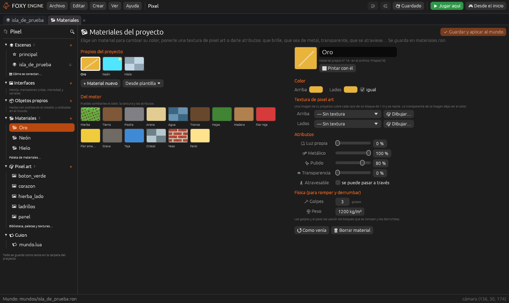

# Materiales

Los materiales son aquello de lo que están hechos los bloques: hierba,
piedra, cristal… Cada proyecto tiene su **paleta de materiales**: los 15 que
trae el motor, que puedes cambiar, y los **materiales propios** que crees tú,
con el color, la textura y los atributos que quieras.

## Abrir la paleta

Cualquiera de estas abre el panel **Materiales**:

- **Crear → Material…**
- El grupo **Materiales** del panel «Proyecto» (su <i class="fx fx-mas"></i>
  crea uno nuevo).
- **Editar materiales…**, debajo de la paleta del pincel, cuando pones o
  pintas bloques (también en el creador de objetos).

A la izquierda están los materiales: arriba los **propios del proyecto** y
debajo los **del motor**. Un clic elige uno y a la derecha salen sus opciones.
Los cambios no se ven en el mundo hasta pulsar **Guardar y aplicar al
mundo** (o <kbd>Cmd</kbd>/<kbd>Ctrl</kbd>+<kbd>S</kbd>).

## Crear un material propio

- **+ Material nuevo**: uno vacío, de un color nuevo.
- **Desde plantilla**: empieza de uno ya hecho. Hay **oro**, **hierro**,
  **lava**, **neón**, **hielo** y **mármol**.

Ponle un nombre y ajusta lo que quieras. Caben **240** materiales propios por
proyecto. **Pintar con él** vuelve a la escena con el pincel y ese material.

## Color y textura

- **Arriba** y **Lados**: el color de las caras de arriba y el de los lados.
  Con *igual*, los lados van a juego.
- **Textura de pixel art**: una imagen de tu proyecto para las caras de
  arriba y otra (si quieres) para los lados. Cubre cada cara de un bloque de
  1 m y se repite; donde la imagen es transparente se ve el color.
- **Dibujar…** crea una imagen nueva de 16 × 16 del color del material y la
  abre en el [editor de pixel art](pixel-art.md). Al guardarla **se pone
  sola** en el material.

> <i class="fx fx-consejo"></i> **¿Ya tienes la imagen dibujada?** Ábrela y,
> en su panel derecho, usa **Usar como textura**: eliges el material y
> pulsas *Arriba y lados* o *Solo los lados*.

## Atributos

| Atributo | Qué hace |
|---|---|
| **Luz propia** | Brilla en la oscuridad y **ilumina lo que tiene alrededor**, como un farol |
| **Metálico** | Refleja el cielo y el sol con su propio color, como el oro o el hierro |
| **Pulido** | De mate (0 %) a espejo (100 %): brillos más pequeños y reflejos más nítidos |
| **Transparencia** | Se ve lo que hay detrás, como el cristal o el hielo. No hace sombra |
| **Atravesable** | Se ve, pero se puede pasar a través (como las flores) |
| **Golpes** | Cuántos golpes aguanta antes de romperse (0 = no se rompe) |
| **Peso** | Cuánto pesa un metro cúbico, en kg (madera ~650, piedra ~2600) |

Jugando, los **golpes** dicen cuántos clics hacen falta para
[romper](jugar.md#romper-bloques) un bloque, y el **peso** cómo cae cuando
se derrumba.

En la paleta, un **punto amarillo** marca los materiales que brillan, una
**raya** los metálicos y unos **cuadros** los transparentes.

## Efecto

Un efecto hace que el material **se mueva, brille o cambie**: lava que
fluye, una luz que se enciende y se apaga, rayas que suben, puntitos que
brillan. Se hace con nodos y se explica en
[Efectos de material](efectos-de-material.md).

## Cubitos finos

Con **Musgo** o **Raíces**, el material deja de ser un cubito entero y se
dibuja con cubitos cuatro veces más pequeños pegados a lo que tiene
alrededor:

- **Musgo**: pinta el material junto al suelo, una pared o el techo y crece
  una alfombra irregular pegada a ellos.
- **Raíces**: pinta el material bajo un techo y cuelgan hilos finos. Si
  pintas varios uno debajo de otro, los hilos siguen hacia abajo.

Se atraviesan, no hacen sombra y de lejos no se dibujan, así que apenas
cuestan. Ver [Efectos de material](efectos-de-material.md#cubitos-finos).

## Volver atrás y borrar

- **Como venía**: un material del motor vuelve a como viene; uno propio
  pierde la textura y los atributos (conserva el nombre y el color).
- **Borrar material** (solo los propios): lo que ya esté hecho con él se ve
  **rosa** hasta que lo pintes con otro material.

Todo se guarda en [`materiales.ron`](../referencia/archivos.md#materiales),
que se puede leer y cambiar a mano (ver
[Materiales](../referencia/materiales.md) en la referencia).
