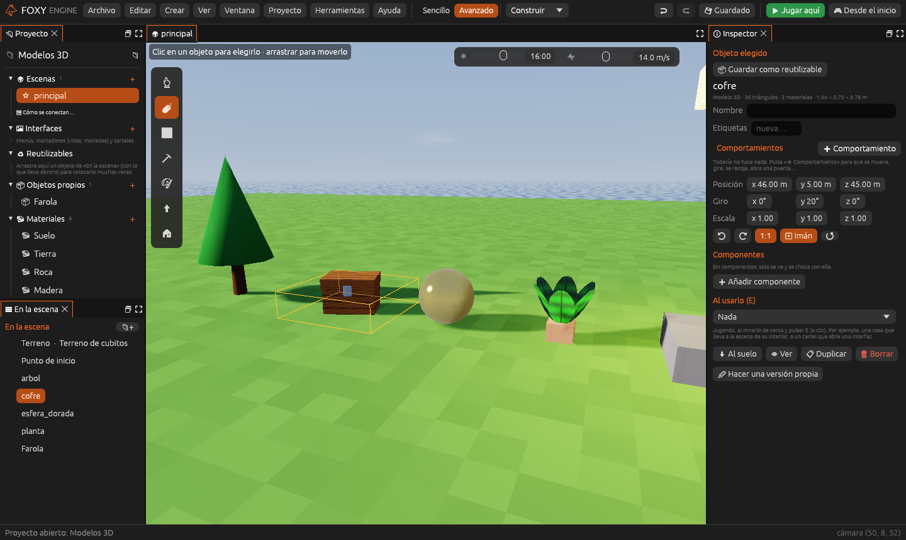
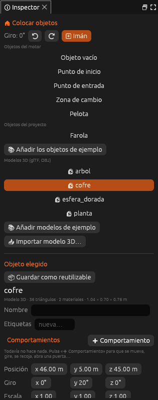
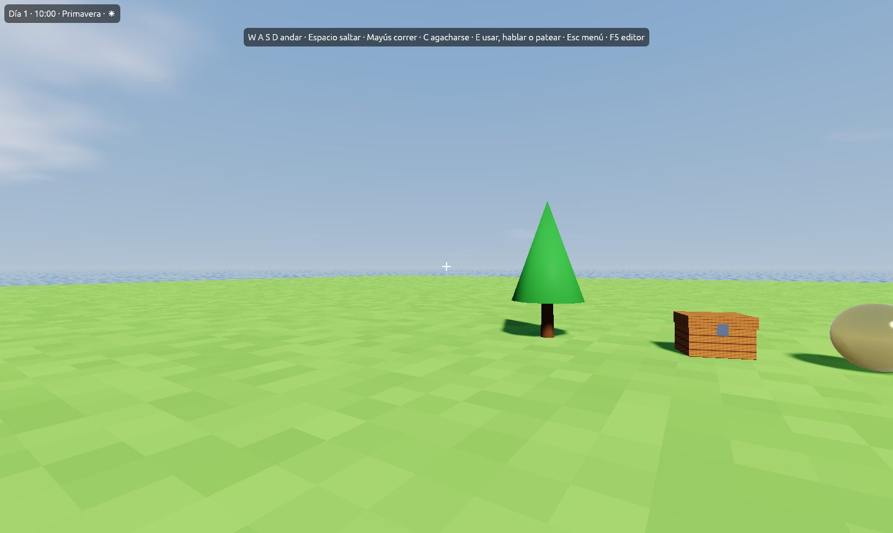

# Modelos 3D (glTF y OBJ)

Además de los cubitos, Foxy Engine usa **modelos 3D normales**, hechos con
triángulos en otros programas: Blender, Blockbench, MagicaVoxel (exportando
a OBJ), o descargados de bibliotecas de modelos. Se ven **con la misma luz y
las mismas sombras** que los cubitos y se mezclan con ellos en la misma
escena: un cofre de Blender junto a una casa de cubitos.

| Formato | Archivos | Qué se lee |
|---|---|---|
| **glTF binario** | `.glb` | Todo en un solo archivo: la forma, los materiales y las texturas. **El más cómodo** |
| **glTF** | `.gltf` + `.bin` + imágenes | Lo mismo, en varios archivos |
| **OBJ** | `.obj` + `.mtl` + imágenes | La forma, el color de cada material y su textura |

> <i class="fx fx-consejo"></i> **Consejo.** Si puedes elegir, exporta en
> **glTF binario (`.glb`)**: un solo archivo con todo dentro, que no se
> pierde por el camino.

## Importar un modelo

Hay cuatro formas, y todas lo copian a la carpeta `modelos/` del proyecto:

- **Soltar el archivo sobre la ventana del editor** (desde el Finder o el
  Explorador de Windows).
- Soltarlo en el panel [Archivos](archivos.md), en la carpeta `modelos`.
- **Crear → Importar modelo…** y elegirlo.
- En la herramienta **Colocar objetos**, el botón **📥 Importar modelo 3D…**

Un `.glb` se copia tal cual a `modelos/`. Un `.gltf` o un `.obj` necesitan
otros archivos a su lado (el `.bin`, el `.mtl`, las texturas): el motor los
busca y los copia **todos juntos en su propia carpeta**, por ejemplo
`modelos/silla/`, para que no se pierda ninguno.

Al terminar, el modelo ya está elegido en **Colocar objetos**: haz clic en la
escena para ponerlo.

> <i class="fx fx-consejo"></i> **Prueba sin buscar nada.** En **Colocar
> objetos**, **📚 Añadir modelos de ejemplo** copia a `modelos/` un cofre de
> madera, una esfera de oro, una planta y un árbol.

## Colocarlo

En la herramienta **Colocar objetos** (<kbd>O</kbd>), los modelos del
proyecto salen en su propia lista, **Modelos 3D (glTF, OBJ)**, con el
nombre de su archivo:

Elige uno y haz clic en la escena, como con cualquier objeto. También puedes
abrirlo desde [Archivos](archivos.md) con doble clic.

Desde ese momento es **un objeto más**: se mueve, se gira y se escala en el
[Inspector](../interfaz/inspector.md) (ver
[Objetos libres y jerarquía](objetos-libres.md)), puede ir dentro de otro,
llevar [comportamientos](comportamientos.md), etiquetas y componentes, y
convertirse en un [objeto reutilizable](reutilizables.md). Debajo de su nombre, el
Inspector dice cuántos triángulos y materiales tiene y cuánto mide.

## Tamaño y orientación

- El motor mide en **metros**, igual que glTF. Un modelo de 2 m de alto
  ocupa 4 cubitos.
- Si un modelo mide **más de 100 m**, el motor supone que está en
  **centímetros** (pasa a menudo con los OBJ) y lo divide entre 100.
- **Arriba es arriba**: +Y, como en glTF y en Blender al exportar con
  las opciones de serie.
- El **centro de la base** del modelo queda en la posición del objeto: se
  apoya en el suelo donde haces clic.

Si aun así sale muy grande o muy pequeño, cambia su **Escala** en el
Inspector.

## Materiales y texturas

Cada trozo del modelo usa su material, y el motor lee de él:

| Del material | Qué hace |
|---|---|
| **Color base** y **textura de color** | El color de la superficie. La textura se multiplica por el color |
| **Metálico** | Refleja el cielo y lo que le rodea con su propio color, como el oro o el hierro |
| **Rugosidad** | Mate (1) o pulido como un espejo (0): el brillo del sol se hace más pequeño y fuerte |
| **Luz propia** (*emissive*) | Brilla aunque sea de noche |
| **Transparencia recortada** (*alpha mask*) | Lo transparente de la textura no se dibuja: hojas, rejas, pelo |
| **Dos caras** (*double sided*) | Se ve por delante y por detrás (hojas sueltas, telas) |

Los colores de los vértices, si el modelo los trae, también se usan. Las
texturas de más de 2048 píxeles de lado se reducen al importarlas.

> <i class="fx fx-aviso"></i> **Importante.** Lo **semitransparente** (un
> cristal) se dibuja recortado: lo que tiene menos de la mitad de opacidad
> desaparece y el resto es opaco. Para un cristal de verdad, usa un material
> de cubitos con [transparencia](materiales.md).

## Chocar con un modelo

De serie, un modelo 3D es **sólido como una caja** que lo envuelve: el
jugador no lo atraviesa y se puede subir encima. Para cambiarlo, añádele el
componente [Colisión](../referencia/componentes/colision.md):

- **Sólida** apagado: se atraviesa (una planta, una alfombra).
- **Forma**: *Caja*, *Esfera* o *Cápsula*, del tamaño del modelo.

## Cambiar un modelo

Si cambias el modelo en Blender y lo vuelves a exportar encima del que hay
en `modelos/`, el motor lo vuelve a leer **en cuanto vuelves a su ventana**.
Todas las copias del modelo en todas las escenas se actualizan a la vez.

Si renombras o mueves el archivo, los objetos que lo usaban se quedan sin
modelo: el Inspector lo dice en rojo. Vuelve a ponerlo donde estaba, o
coloca otra vez el modelo.

## Al publicar

La carpeta `modelos/` va entera dentro del juego publicado, con sus
texturas. Los modelos se ven igual en Mac, Windows y Linux.

## Lo que todavía no hace

- **Animaciones con esqueleto** dentro del glTF (un personaje que anda): se
  lee la forma en reposo. Llegarán enlazadas con el
  [Animador](../referencia/componentes/animador.md). Mientras, puedes animar
  el objeto entero (moverlo, girarlo, escalarlo) con la
  [línea de tiempo](animacion.md).
- Texturas de **relieve** (*normal map*) y de oclusión: se ignoran.
- Las **sombras** de lo recortado (las hojas) son las de su forma entera.
