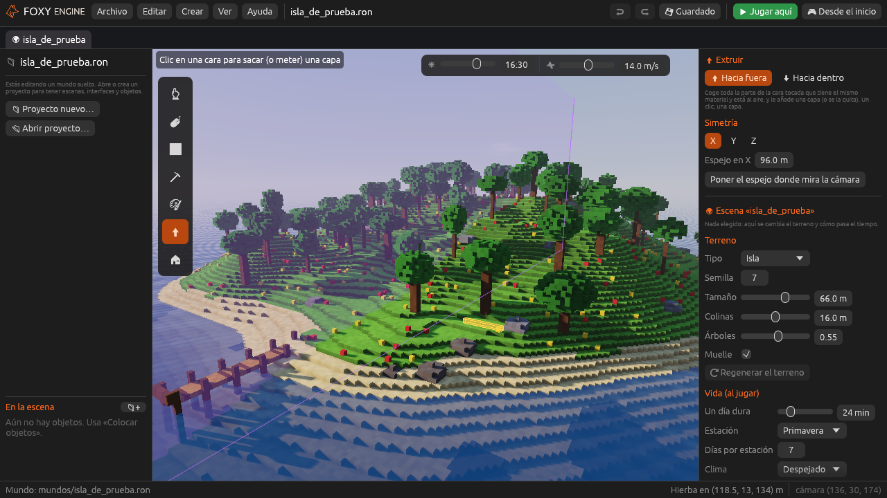
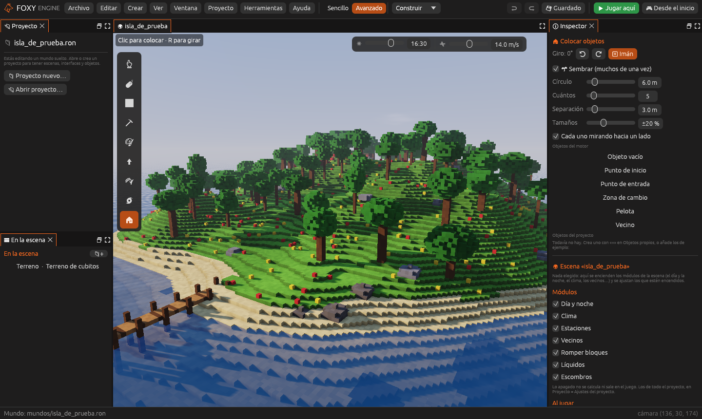

# Construir el mundo

La **Vista**, con la escena, es donde das forma al mundo: añades y quitas
terreno, lo pintas y colocas objetos.

## Las herramientas

Están en la **tira** del borde izquierdo de la vista. Cada una tiene su
tecla:

| | Herramienta | Tecla | Qué hace |
|---|---|---|---|
| <i class="fx fx-cursor"></i> | **Cursor** | <kbd>C</kbd> | Solo elegir. Un clic elige un objeto y nada se mueve ni cambia. La más segura para mirar |
| <i class="fx fx-mover"></i> | **Elegir y mover** | <kbd>V</kbd> | Clic para elegir un objeto; arrástralo para moverlo |
| <i class="fx fx-poner"></i> | **Poner bloques** | <kbd>B</kbd> | Clic o arrastra para poner bloques encima de lo que tocas |
| <i class="fx fx-quitar"></i> | **Quitar bloques** | <kbd>E</kbd> | Clic o arrastra para cavar. Bajo el nivel del mar el hueco se llena de agua |
| <i class="fx fx-pintar"></i> | **Pintar** | <kbd>P</kbd> | Cambia el material de lo que ya hay, sin añadir ni quitar |
| <i class="fx fx-extruir"></i> | **Extruir** | <kbd>X</kbd> | Clic en una cara para sacar una capa más de toda esa cara (o meterla) |
| <i class="fx fx-pintar-suelo"></i> | **Pintar el suelo** | <kbd>N</kbd> | Pinta la superficie del terreno en grande, con el borde mezclado |
| <i class="fx fx-suavizar"></i> | **Suavizar** | <kbd>M</kbd> | Lima lo que sobresale y rellena los huecos: formas redondeadas |
| <i class="fx fx-colocar"></i> | **Colocar objetos** | <kbd>O</kbd> | Pone casas, árboles, vecinos, pelotas… |

Las opciones de cada herramienta salen en el **inspector**, a la derecha.

## El pincel

Poner, quitar y pintar usan el **pincel**, que se ajusta arriba del
inspector:

- **Forma**: cubo o esfera.
- **Tamaño**: de 1 a 24 cubitos. <kbd>[</kbd> lo hace más pequeño y
  <kbd>]</kbd> más grande.
- **Material**: hierba, piedra, madera, teja… Un clic en su color. Todos
  están en [Materiales](../referencia/materiales.md).

Con un tamaño **par**, el pincel se ajusta a la rejilla de bloques de 1 m:
así es fácil construir paredes y suelos rectos. Con un tamaño impar puedes
trabajar al detalle, cubito a cubito.

> <i class="fx fx-consejo"></i> **Consejo.** Al arrastrar poniendo bloques,
> el pincel se queda en la capa donde empezó la pincelada. Así puedes pintar
> un suelo plano entero sin que vaya subiendo encima de lo que acabas de
> poner.

## Extruir

Con <i class="fx fx-extruir"></i> **Extruir** (<kbd>X</kbd>) un clic en una
cara coge **toda la parte de esa cara que tiene el mismo material y está al
aire**, y le añade una capa de un cubito. Antes de hacer clic se ve en
amarillo la capa que saldría. Es la forma rápida de levantar una pared
entera, engordar un tejado o sacar un suelo.

En el inspector se elige **Hacia fuera** (añade una capa) o **Hacia dentro**
(quita la capa de la cara). Cada clic es una capa: al arrastrar no se sigue
extruyendo.

## Pintar el suelo

<i class="fx fx-pintar-suelo"></i> **Pintar el suelo** (<kbd>N</kbd>) cambia
el material de la **superficie** del terreno en un círculo grande: arena en
una playa, roca en un cortado, hierba en un prado o tierra en un camino. No
añade ni quita nada: solo pinta lo de arriba (y el cubito de debajo, para
que en los escalones no asome el material de antes). El **borde se
deshilacha**: unos cubitos sí y otros no, así dos suelos se mezclan sin una
raya recta.

El tamaño va de 1 a 24, como el del pincel, pero el círculo es cuatro veces
más ancho: con cubitos de medio metro, de 2 a 48 m. Antes de hacer clic se
ve una losa verde del ancho del círculo.

> <i class="fx fx-consejo"></i> **Consejo.** Para un terreno natural, empieza
> con el [suelo de varios materiales](generadores.md#suelo-de-varios-materiales)
> del generador y retoca después con este pincel.

## Suavizar

<i class="fx fx-suavizar"></i> **Suavizar** (<kbd>M</kbd>) redondea lo que
tocas: el cubito que está casi solo (asomando de una pared, en una esquina)
se quita, y el hueco rodeado de cubitos se rellena con el material que más
hay alrededor. Pasa el pincel varias veces para redondear más. Con la forma
**esfera** queda más suave. Sirve en el mundo (rocas, colinas, cuevas) y en
el [creador de objetos](creador.md), para esculpir.

## Simetría

En las opciones del pincel (también al extruir) está la
<i class="fx fx-simetria"></i> **Simetría**, con un botón para cada eje:
**X**, **Y** y **Z**. Con un eje encendido, todo lo que pones, quitas,
pintas o extruyes a un lado del **espejo** se repite al otro lado, como en
un espejo. Con dos o tres ejes se repite en cada cuarto (u octavo).

El espejo se ve como una lámina morada fina. Empieza en el centro del
mundo, y se mueve de dos formas:

- Cambiando su número (**Espejo en X**…), en metros, de cuarto en cuarto de
  metro.
- Con **Poner el espejo donde mira la cámara**: el espejo pasa por el
  cubito que hay en el centro de la pantalla. Así, para hacer una casa
  simétrica, mira al centro de su fachada y pulsa el botón.

## Colocar objetos

Con <i class="fx fx-colocar"></i> **Colocar objetos** (<kbd>O</kbd>) eliges
un objeto en el inspector y haces clic donde lo quieras. Antes de soltarlo,
<kbd>R</kbd> (o los botones de giro) lo gira un cuarto de vuelta. La lista
tiene tres partes:

- **Construcción y naturaleza**: casa, puesto del mercado, árbol, farola,
  banco, valla, pozo y roca.
- **Juego**: pelota, vecino, punto de inicio, punto de entrada y zona de
  cambio. Todos están en [Objetos del motor](../referencia/objetos.md).
- **Mis objetos**: los que has hecho con el
  [creador de objetos](creador.md).

### Sembrar

En las opciones de **Colocar objetos** está
<i class="fx fx-sembrar"></i> **Sembrar (muchos de una vez)**. Encendido, un
clic pone **varios** del objeto elegido en un círculo del suelo, cada uno
girado hacia un lado y de un tamaño un poco distinto, y arrastrando se
siembra por donde pasas. Es la forma de hacer un bosque, un pedregal o un
campo de flores en un momento. Se ajusta:

- **Círculo**: el radio, en metros. Se ve como una losa verde.
- **Cuántos**: los que pone en cada clic, como mucho.
- **Separación**: la distancia mínima entre dos. Tampoco se ponen encima de
  los objetos que ya hay, así que pasar dos veces no los amontona.
- **Tamaños**: cuánto puede cambiar el tamaño de cada uno.
- **Cada uno mirando hacia un lado**: si no, todos miran como el giro
  elegido.

No se siembra en el agua ni encima de hojas o troncos. Cada tanda se
deshace de una vez con <kbd>Cmd</kbd>/<kbd>Ctrl</kbd>+<kbd>Z</kbd>.

El menú **Crear** también pone al momento una
<i class="fx fx-zona"></i> *Zona de cambio*, un
<i class="fx fx-entrada"></i> *Punto de entrada* o un
<i class="fx fx-vecino"></i> *Vecino* en la escena abierta.

## Editar un objeto colocado

Elige un objeto (con el cursor, con *Elegir y mover*, o en la lista
[En la escena](carpetas.md)) y el inspector muestra:

- **Nombre**: por ejemplo «Casa de Plumas». Los vecinos usan su nombre al
  hablar y en los guiones, y sale en el juego al usar el objeto.
- **Posición** (X, altura y Z, en metros) y **giro**.
- <i class="fx fx-suelo"></i> **Al suelo**: lo baja hasta que toca el terreno.
- <i class="fx fx-ver"></i> **Ver** (<kbd>F</kbd>): lleva la cámara hasta él.
- <i class="fx fx-duplicar"></i> **Duplicar**
  (<kbd>Cmd</kbd>/<kbd>Ctrl</kbd>+<kbd>D</kbd>) y
  <i class="fx fx-borrar"></i> **Borrar** (<kbd>Supr</kbd>).

<kbd>Esc</kbd> deja de elegirlo.

### <i class="fx fx-usar"></i> Al usarlo (E)

Las casas, los puestos, los árboles, las farolas y demás objetos de
construcción, y también **tus objetos propios**, pueden hacer una
[acción](../referencia/acciones.md) cuando el jugador los **mira de cerca y
pulsa <kbd>E</kbd>** (o hace clic). Por ejemplo:

- Una **casa** que lleva a la escena de su interior.
- Un **cartel** o un **puesto** que abre una interfaz (una tienda, un mapa).
- Un **pozo** que llama a una función del guion.

Jugando, al acercarse aparece una pista como
<kbd>E</kbd> *Casa: ir a «interior»*. Si eliges una escena, puedes elegir
también por qué **entrada** se llega.

### Opciones de algunos objetos

- <i class="fx fx-vecino"></i> **Vecino**: *Lo que dice*, una frase por
  línea. <kbd>Intro</kbd> empieza una línea nueva.
- <i class="fx fx-zona"></i> **Zona de cambio**: *Al entrar en la zona*, la
  acción que pasa al entrar en ella jugando.
- <i class="fx fx-entrada"></i> **Punto de entrada** y
  <i class="fx fx-inicio"></i> **punto de inicio**: su nombre, que es el que
  eligen las zonas, los objetos y los botones de otras escenas para llegar a
  él.

Con un objeto del motor elegido, <i class="fx fx-editar"></i> **Hacer una
versión propia** lo copia al creador de objetos para que lo cambies a tu
gusto. Con uno de los tuyos, **Editar este objeto** lo abre en el creador.

## Las opciones de la escena

Sin nada elegido, el inspector muestra la **escena** entera: sus
[módulos](../referencia/modulos/index.md) (día y noche, clima, estaciones,
vecinos...) como casillas y, debajo, en **Al jugar**, solo los ajustes de
los que están encendidos. Lo explica
[Empezar una escena desde cero](escena-desde-cero.md#solo-lo-que-activas).

### El terreno

El suelo es el objeto **Terreno de cubitos**: elígelo en *En la escena* para
cambiar su **generador** (**Vacío**, **Plano**, **Colinas**, **Cuevas**,
**Islas** o **Imagen de alturas**). Se describen en
[El terreno de cubitos](generadores.md).

<i class="fx fx-girar"></i> **Regenerar el terreno** vuelve a crear el suelo
con las opciones nuevas, **conserva** los objetos y los bloques que pusiste
a mano y se deshace con <kbd>Cmd/Ctrl</kbd>+<kbd>Z</kbd>. Si la escena no
tiene terreno, el Inspector ofrece **➕ Terreno de cubitos**.

## La cámara

| Para | Haz |
|---|---|
| Volar | <kbd>W</kbd> <kbd>A</kbd> <kbd>S</kbd> <kbd>D</kbd> |
| Subir / bajar | <kbd>Espacio</kbd> / <kbd>Mayús</kbd> |
| Mirar | Botón derecho y arrastrar, <kbd>Alt</kbd> + clic y arrastrar, o mantener <kbd>Cmd</kbd>/<kbd>Ctrl</kbd> y mover el ratón |
| Girar sin ratón | Flechas |
| Acercarse o alejarse | Rueda |
| Ir al objeto elegido | <kbd>F</kbd> |

La **velocidad** de la cámara (de 2 a 80 m/s) y la **hora** a la que ves el
mundo se cambian arriba a la derecha de la vista, o en el menú **Ver**.
