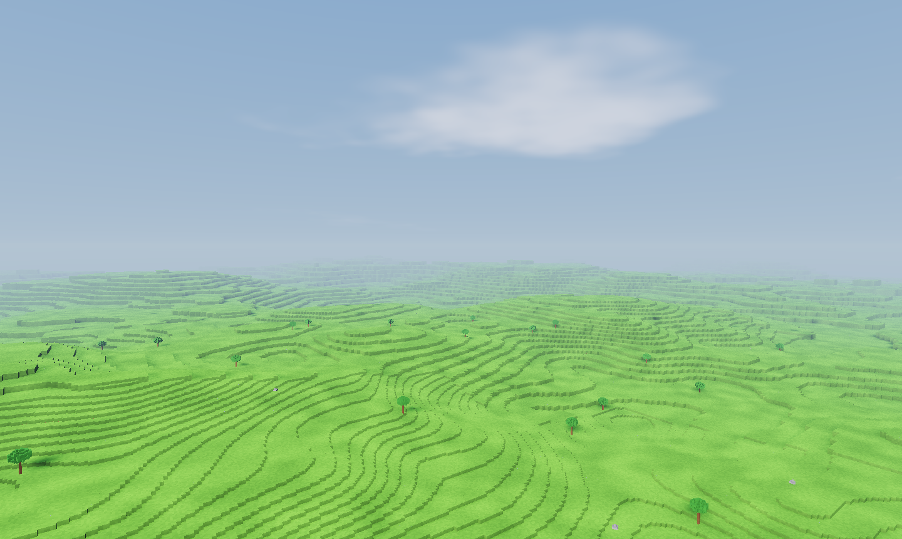
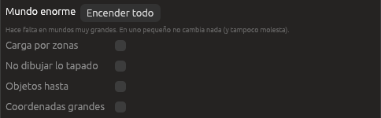

# Mundos enormes

Un mundo de varios kilómetros, con miles de árboles y rocas, no cabe entero
en la tarjeta gráfica con todo su detalle. Foxy Engine tiene un grupo de
ajustes, **Mundo enorme**, para que un mundo así vaya fluido: carga solo lo
que hace falta, dibuja lo de lejos con menos detalle, se salta lo que queda
tapado y no tiembla aunque te alejes mucho del centro.

Vienen **apagados**: un mundo pequeño no los necesita y se ve igual que
siempre. Se encienden en **Proyecto → Ajustes del proyecto → Gráficos →
Mundo enorme**.



## Encender todo

El botón **Encender todo** pone todas las piezas a la vez, con valores que
van bien para un mundo de kilómetros. **Apagar todo** las quita. También
puedes encenderlas una a una:

| Opción | Qué hace |
|---|---|
| **Carga por zonas** | El mundo se reparte en zonas que se preparan poco a poco, sin parar el juego. Cuanto más lejos, más grande es la zona y menos detalle lleva |
| **Se ve hasta** | Hasta dónde se dibuja el terreno con la carga por zonas, en metros (de serie, 1.500 m). La niebla de lejos llega justo hasta ahí |
| **No dibujar lo tapado** | Lo que queda detrás de la roca (las cuevas cuando estás en la superficie, o la superficie cuando estás en una cueva) no se dibuja |
| **Objetos hasta** | Los objetos más lejos de esa distancia, fuera de la pantalla o tan pequeños que no se verían, no se dibujan. Con 0 se dibujan todos |
| **Coordenadas grandes** | Todo se dibuja desde la cámara, para que a varios kilómetros del centro nada tiemble |



## Carga por zonas

Sin la carga por zonas, al abrir una escena el motor prepara todo el
terreno de una vez y lo guarda en la tarjeta gráfica. En un mundo pequeño
es lo más rápido. En uno de kilómetros tardaría mucho y no cabría.

Con la carga por zonas:

- **Cerca** de la cámara cada trozo (de 16 m) se dibuja con todo su detalle.
- **Más lejos**, los trozos se juntan en zonas cada vez más grandes (de 2,
  4, 8, 16 y 32 trozos de lado), cada una con casillas más grandes. Desde
  lejos no se nota y cuesta mucho menos.
- Las zonas se preparan **en todos los núcleos del ordenador** mientras
  juegas, y se suben unas pocas en cada imagen, lo más cercano primero.
  Así **no hay tirones**: mientras llega una zona nueva, se sigue viendo
  la de antes.
- Lo que queda muy lejos se **tira** de la memoria, así que puedes viajar
  sin que la memoria crezca.
- Al editar, solo se rehacen las zonas que tocan lo que has cambiado.

La distancia a la que se cambia de detalle es la del
[detalle de lejos](rendimiento.md#detalle-de-lejos) (96 m si no la
cambias): a esa distancia se pasa a zonas de 2 trozos, al doble a zonas de
4, y así.

> <i class="fx fx-nota"></i> **Nota.** El agua de lejos queda a su altura de
> verdad, y las zonas de distinto detalle encajan sin rendijas.

## No dibujar lo tapado

Desde el trozo donde está la cámara, el motor mira por qué huecos se puede
pasar a los trozos de al lado, y de ahí a los siguientes, sin volver nunca
hacia atrás. Lo que no se alcanza así está tapado por roca y no se dibuja.
Es muy barato y sirve sobre todo en mundos con cuevas: desde una cueva,
la mitad del mundo puede quedar sin dibujar sin que cambie un solo píxel.

Las sombras se siguen calculando con todo, porque una montaña que no ves
puede hacer sombra en lo que sí ves.

## Objetos de lejos

Los objetos iguales ya se dibujan juntos: mil árboles iguales son un solo
encargo para la tarjeta. Con **Objetos hasta**, además, solo van a la
tarjeta los que se ven: los que están dentro de la pantalla, más cerca que
esa distancia y no más pequeños que un par de píxeles.

## Coordenadas grandes

Los ordenadores guardan las posiciones con unos siete dígitos. A 4 km del
centro, eso deja poco para los centímetros y las cosas pueden temblar un
poco al moverse. Con **Coordenadas grandes**, el motor dibuja todo
contando desde la cámara, donde los números son pequeños y precisos.

## Probarlo

Las [escenas de prueba](../referencia/linea-de-comandos.md#escenas-de-prueba-enormes)
traen una de **4 × 4 km** con 4.096 árboles y rocas,
`mundo-de-kilometros`. En la línea de comandos, `--mundo-enorme` enciende
todo para una captura:

```sh
foxy-engine --captura km.png --enorme mundo-de-kilometros --mundo-enorme
```

En la ventana [Rendimiento](rendimiento.md), **Trozos dibujados** cuenta
las zonas que se dibujan y **Mallas en la tarjeta** lo que ocupan.

## Véase también

- [Rendimiento](rendimiento.md)
- [Gráficos: luz, sombras y atmósfera](graficos.md)
- [El terreno de cubitos](generadores.md)
- [Ajustes del proyecto](../editor/ajustes-proyecto.md)
