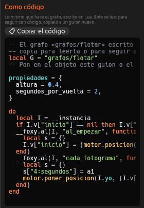

# Depurar y ver como código

Cuando un grafo no hace lo que esperas, el editor te deja verlo funcionar
por dentro mientras juegas: qué cables se encienden, qué valor lleva cada
uno y dónde se detiene la ejecución. Esta página explica esas herramientas
y cómo leer o copiar el Lua que sale de los nodos.

## Ver el grafo mientras juegas

1. Abre en el panel Nodos el grafo que quieres observar.
2. Pulsa <i class="fx fx-jugar"></i> **Jugar aquí** o **Desde el inicio**.
3. Pulsa <kbd>F8</kbd>. Aparece una ventana con el grafo encima del juego.
   Pulsa <kbd>F8</kbd> otra vez para ocultarla.

En esa ventana:

- Los **cables de ejecución** y los **nodos** por los que acaba de pasar la
  ejecución se iluminan en naranja y se apagan poco a poco. En un evento
  como *Cada fotograma*, el camino que se toma en cada momento queda siempre
  encendido.
- Cada **salida de datos** enseña, en una etiqueta de su color, el último
  valor que ha salido por ella.

Si un grafo de objeto lo llevan varias objetos, la ventana junta lo que
hacen todas.

## Puntos de parada

Un **punto de parada** detiene el juego justo antes de ejecutar un nodo,
para que puedas mirar los valores con calma.

1. Elige el nodo y pulsa <kbd>F9</kbd>. También puedes marcar
   **Punto de parada** en sus ajustes o en su menú de clic derecho. El nodo
   queda marcado con un punto rojo.
2. Juega. Cuando la ejecución llega a ese nodo, el juego se congela, el
   ratón queda libre y la ventana del grafo se abre sola con el nodo
   resaltado.
3. Pulsa <kbd>F6</kbd> para seguir.

Los puntos de parada solo funcionan en el grafo abierto en el panel y solo
al jugar desde el editor. No se guardan con el proyecto.

> <i class="fx fx-consejo"></i> **Consejo.** Para saber si una rama se
> ejecuta, pon un *Escribir en la consola* con un texto en ella: lo verás en
> el [Registro](../interfaz/registro.md) cada vez que pase.

## Errores

Un error en un grafo no cierra el juego. Aparece abajo en la pantalla y en
el [Registro](../interfaz/registro.md), con el nombre del grafo. Los más
habituales:

| Mensaje | Qué significa |
|---|---|
| «el guion tarda demasiado» | Un *Mientras* o un *Repetir* que nunca termina. Revisa su condición |
| «grafos/….nodos.ron: no se pudo leer» | Un comportamiento apunta a un grafo que ya no existe (el inspector lo marca con ⚠) |

En el lienzo, un nodo que llama a una función borrada o renombrada se
titula *Función «…» (no existe)* y aparece apagado. Vuelve a elegir la
función o borra el nodo.

## Ver como código

Pulsa **{ } Ver como código** en la barra del panel. A la derecha aparece,
con colores, el Lua que hace lo mismo que el grafo, y se actualiza al
momento con cada cambio. **📋 Copiar el código** lo copia entero. Es una
buena forma de aprender Lua: cada nodo se convierte en una o dos líneas
reconocibles, como `motor.decir("Hola")`.

Ese código **solo se lee**: el grafo no cambia ni se borra.

## Copiar a un guion nuevo

Si un grafo de objeto ha crecido tanto que prefieres seguir escribiéndolo a
mano, pulsa **📜 Copiar a un guion nuevo**:

1. El motor escribe un guion nuevo en `guiones/` que se comporta igual que
   el grafo, con sus variables *del objeto* como
   [propiedades](guiones-entidad.md#propiedades).
2. Si el objeto elegido usaba el grafo, el grafo se **apaga** en él y el
   guion se añade como [comportamiento](comportamientos.md) con los mismos
   valores.
3. El guion se abre en el panel [Código](../interfaz/codigo.md).

El grafo **no se borra**: sigue en `grafos/` y puedes volver a encenderlo
cuando quieras. En el grafo del juego o de una escena, usa **Ver como
código** y copia lo que necesites a `guiones/mundo.lua`.

## Véase también

- [Nodos](nodos.md)
- [Programar en Lua](programar-lua.md)
- [Probar el juego](jugar.md)
