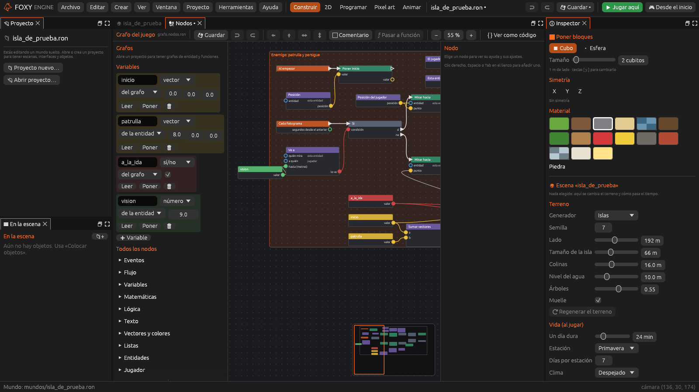
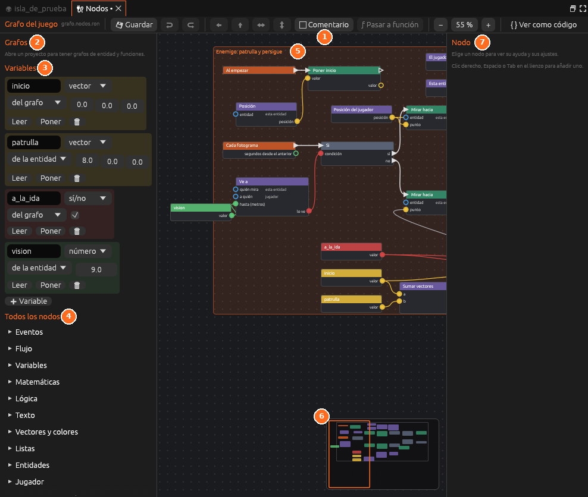

# Nodos

Los **nodos** permiten programar el juego sin escribir código. Cada nodo es
una caja que hace una sola cosa (esperar un evento, calcular un valor,
mover una entidad) y los **cables** que los unen deciden el orden y llevan
los datos de un nodo a otro. Al jugar, el motor convierte cada grafo en Lua,
así que los nodos pueden hacer lo mismo que un [guion](guiones.md).

Esta guía explica los conceptos y el editor. Las demás páginas de la
sección profundizan en cada parte:

- [Eventos y flujo](nodos-flujo.md): cuándo empieza una cadena y cómo se
  decide por dónde sigue.
- [Funciones, bibliotecas y nodos en Lua](nodos-funciones.md): reutilizar
  grupos de nodos y ampliar la paleta.
- [Depurar y ver como código](nodos-depurar.md): ver los cables encendidos
  mientras juegas, detener el juego en un nodo y leer o copiar el Lua que
  sale.
- [Comportamientos](comportamientos.md): dar a un objeto uno o varios
  grafos, y los diez que ya trae el motor.
- [Tutorial: un enemigo que persigue](tutorial-enemigo.md): un juego
  completo con vida, barra de vida y pantalla de derrota, sin código.
- [Referencia de nodos](../referencia/nodos.md): todos los nodos del motor.

## Tipos de grafo

Un proyecto puede tener tantos grafos como necesite. Hay tres tipos, según
lo que abarcan:

| Grafo | Archivo | Cuándo funciona |
|---|---|---|
| **Del juego** | `guiones/mundo.nodos.ron` | Durante toda la partida, en todas las escenas |
| **De escena** | `mundos/<escena>.nodos.ron` | Solo mientras se juega en esa escena |
| **De objeto** | `grafos/<nombre>.nodos.ron` | Una copia por cada objeto que lo lleva como [comportamiento](comportamientos.md) |

Los grafos de objeto son los más útiles para dar comportamiento: el mismo
grafo *enemigo* puede ir en diez entidades y cada una patrulla por su
cuenta, con sus propias variables. Dentro de ellos, **Esta entidad** es la
entidad que lleva el grafo.

## El panel Nodos

Ábrelo desde el panel **Proyecto** (*Guion → Nodos*), desde
*Herramientas → Nodos* o con el espacio de trabajo **Programar**.

- **Izquierda.** La lista de **Grafos** del proyecto (el del juego, los de
  escena, los de objeto, las funciones y los nodos en Lua), las
  **Variables** del grafo abierto y **Todos los nodos**, la paleta por
  categorías.
- **Centro.** El lienzo, con un minimapa abajo a la derecha.
- **Derecha.** Los ajustes del nodo elegido y su ayuda. Con **{ } Ver como código**
  activado, el código que sale del grafo.
- **Arriba.** Guardar, deshacer y rehacer, alinear y repartir lo elegido,
  **Comentario**, **Pasar a función**, el zoom, **{ } Ver como código** y,
  en los grafos de objeto, **📜 Copiar a un guion nuevo**.

Para crear un grafo de objeto, elige el objeto y, en el
[Inspector](../interfaz/inspector.md), pulsa **➕ Comportamiento → 🔌 Nodos
nuevos**. También puedes pulsar <i class="fx fx-mas"></i> **Grafo de
objeto** en la lista y añadirlo después con **📂 Del proyecto**.

## Cables y tipos

Cada nodo tiene **pines**: los de la izquierda son entradas y los de la
derecha, salidas. Hay dos clases de cable:

- **Ejecución** (blanco, con forma de flecha). Marca el orden: cuando un
  nodo termina, sigue el que está conectado a su salida de ejecución. Una
  cadena siempre empieza en un **evento**.
- **Datos** (de color). Lleva un valor de un nodo a otro. El color indica el
  tipo de dato.

| Tipo | Qué guarda | Ejemplo |
|---|---|---|
| **número** | Un número, con decimales | `3`, `0,5` |
| **texto** | Letras y palabras | `"Hola"` |
| **sí/no** | Verdadero o falso | la salida de *Comparar* |
| **vector** | Tres números: x, y, z, en metros | una posición |
| **color** | Un color | `#d65c26` |
| **entidad** | Una entidad de la escena o el jugador | *Esta entidad* |
| **recurso** | El nombre de un sonido, una interfaz o una escena | `has_perdido` |
| **lista** | Varios valores seguidos | las entidades que se llaman «Moneda» |
| **cualquiera** | Acepta cualquier tipo | la entrada de *Decir* |

Un cable solo se conecta si los tipos encajan. Algunas conversiones se hacen
solas porque tienen sentido: un número, un sí/no, un vector o una entidad se
pueden llevar a una entrada de **texto** (una entidad se convierte en su
nombre), y una **entidad** se puede llevar a una entrada de **vector** (se
usa su posición).

Una entrada de datos sin cable usa el valor escrito en el propio nodo. Por
eso *Decir* puede llevar su texto escrito o recibirlo por un cable.

> <i class="fx fx-consejo"></i> **Consejo.** Los nodos de valor, como
> *Sumar* o *Distancia*, no tienen pines de ejecución: se calculan cada vez
> que otro nodo usa su resultado. Si un valor cambia (la posición del
> jugador), siempre se lee el actual.

## Trabajar en el lienzo

| Para | Haz |
|---|---|
| Añadir un nodo | Clic derecho, <kbd>Espacio</kbd> o <kbd>Tab</kbd> en el lienzo, y escribe parte de su nombre. También puedes pulsarlo en la paleta |
| Añadir un nodo ya conectado | Tira un cable desde un pin y suéltalo en el vacío: el buscador solo enseña los nodos que encajan |
| Unir dos pines | Arrastra desde un pin hasta otro que encaje |
| Despegar un cable | Arrastra desde la entrada que lo recibe y suéltalo en el vacío |
| Mover nodos | Arrastra su cabecera. Se mueven todos los elegidos |
| Elegir varios | Arrastra un recuadro sobre el fondo, o <kbd>Mayús</kbd>+clic |
| Mover el lienzo | La rueda o dos dedos; también el botón central, o el derecho arrastrando, o <kbd>Espacio</kbd>+arrastrar |
| Acercar y alejar | <kbd>Cmd</kbd>/<kbd>Ctrl</kbd>+rueda, pellizcar, o los botones **−** y **+** |
| Ver todo el grafo | <kbd>F</kbd> o <kbd>Inicio</kbd> |
| Copiar, cortar, pegar | <kbd>Cmd</kbd>/<kbd>Ctrl</kbd>+<kbd>C</kbd>, <kbd>X</kbd>, <kbd>V</kbd>. Funciona también entre grafos distintos |
| Duplicar | <kbd>Cmd</kbd>/<kbd>Ctrl</kbd>+<kbd>D</kbd> |
| Borrar | <kbd>Supr</kbd> o <kbd>Retroceso</kbd>, o clic derecho en el nodo → **Borrar** |
| Deshacer y rehacer | <kbd>Cmd</kbd>/<kbd>Ctrl</kbd>+<kbd>Z</kbd> y <kbd>Mayús</kbd>+<kbd>Cmd</kbd>/<kbd>Ctrl</kbd>+<kbd>Z</kbd> |
| Guardar | **Guardar** o <kbd>Cmd</kbd>/<kbd>Ctrl</kbd>+<kbd>S</kbd> |

Para que un grafo grande se lea bien:

- **Comentario** dibuja un marco con título alrededor de lo elegido. Al
  mover el marco se mueve todo lo que tiene dentro. Cambia el título y el
  color en los ajustes, y el tamaño arrastrando su esquina.
- **Punto de paso** (en *Flujo*, o *Punto de paso (datos)* en *Otros*) es
  un nodo diminuto que solo deja pasar el cable. Sirve para llevar un cable
  largo por donde no estorbe.
- Los botones de **alinear** ponen lo elegido a la misma altura o en la
  misma columna, y los de **repartir** lo separan por igual.

## Variables

Una **variable** guarda un valor con nombre que se puede leer y cambiar.
Créala con <i class="fx fx-mas"></i> **Variable** en el grupo *Variables*:
elige su nombre, su tipo, su valor inicial y su ámbito.

| Ámbito | Dónde vive | Para qué sirve |
|---|---|---|
| **Del grafo** | En cada copia del grafo, solo para él | Datos internos: «voy de ida» |
| **De la entidad** | En la entidad; otros grafos pueden leerla con *Variable de una entidad* | Datos que se ajustan por entidad: la velocidad, el alcance de visión |
| **Del juego** | En la partida; se guarda con ella | La vida del jugador, las monedas, la puntuación |

Una variable del juego conserva su valor al cargar una partida y vuelve a
su valor inicial al empezar una partida nueva.

Los botones **Leer** y **Poner** de cada variable añaden al lienzo el nodo
que la lee o la cambia.

Las variables **de la entidad** de un grafo aparecen en el Inspector de cada
entidad que lo lleva, para darle a cada una su valor. Así, dos enemigos con
el mismo grafo pueden tener distinta visión.

Las variables **del juego** son también [valores del juego](interfaces.md#textos-que-cambian):
una interfaz enseña la variable `vida` escribiendo `{vida}`, y una
[barra](interfaces.md#barras) se llena con ella.

## Los nodos de antes

Los proyectos hechos con la primera versión de los nodos (con nodos
*Cuándo*, *Si* y *Hacer*) se convierten solos al abrirlos: cada nodo pasa a
su equivalente y las condiciones se vuelven un nodo **Si** con su
pregunta. El archivo se guarda en el formato nuevo la próxima vez que
pulses **Guardar**.

## Véase también

- [Panel Nodos](../interfaz/nodos.md)
- [Programar en Lua](programar-lua.md)
- [Referencia de nodos](../referencia/nodos.md)
