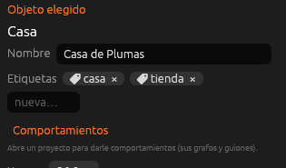

# Objetos que se hablan

Un juego de verdad necesita que sus objetos **se enteren unos de otros**:
la bala que toca a un enemigo, el enemigo que cae en la lava, el botón que
abre todas las puertas, la puerta que lee cuántas llaves tiene el jugador.
Para eso hay cuatro herramientas, que funcionan igual con
[nodos](nodos.md) y con [código](guiones-entidad.md):

| Herramienta | Para qué sirve |
|---|---|
| **Etiquetas** | Agrupar objetos: «enemigo», «moneda», «puerta»… |
| **Eventos entre objetos** | Enterarse de que dos objetos se tocan, de que uno entra en una zona o de que el jugador le hace clic |
| **Mensajes** | Avisar a un objeto, a todos los de una etiqueta o a todo el juego |
| **Variables de un objeto** | Leer o cambiar la vida, las monedas o cualquier valor de otro objeto |

## Etiquetas



Las etiquetas están en el [Inspector](../interfaz/inspector.md), justo
debajo del nombre del objeto:

- Escribe una en **nueva…** y pulsa **Intro**.
- **➕** pone una que ya lleva otro objeto del proyecto.
- Pulsa la **×** de una etiqueta para quitarla.

Un objeto puede llevar varias (`enemigo` y `volador`, por ejemplo). No
importan las mayúsculas ni los espacios de los lados: `Enemigo` y `enemigo`
son la misma.

- **En un [objeto reutilizable](reutilizables.md)**, todas sus copias
  llevan sus etiquetas. Cada copia puede añadir las suyas; las del original
  salen en gris y se cambian en el original.
- **El jugador** lleva siempre la etiqueta `jugador`, y además las del
  objeto que tiene su [controlador](../referencia/componentes/controlador.md).

### Usar las etiquetas

| Nodo | En Lua | Qué hace |
|---|---|---|
| **¿Tiene la etiqueta?** | `motor.tiene_etiqueta(objeto, "enemigo")` | Sí o no. Es lo que se usa para saber **con qué se ha chocado** |
| **Buscar objetos con la etiqueta** | `motor.con_etiqueta("moneda")` | La lista de todos los que la llevan y no están ocultos |
| **El más cercano con la etiqueta** | `motor.mas_cercano("enemigo", yo)` | El más cerca de un objeto o de un punto (sin contarse a sí mismo) |
| **Etiquetas de un objeto** | `motor.etiquetas(objeto)` | La lista de sus etiquetas |
| **Poner una etiqueta** / **Quitar una etiqueta** | `motor.poner_etiqueta(objeto, "activado")` / `motor.quitar_etiqueta(...)` | Las cambia mientras dura la partida. En el editor no cambian |

## Eventos entre objetos

| Evento (nodo) | En Lua (guion del objeto) | Cuándo salta |
|---|---|---|
| **Al chocar con otro objeto** | `al_chocar_objeto(otro)` | Cuando el objeto empieza a tocar a otro objeto (no al jugador) |
| **Al entrar un objeto en una zona** | `al_entrar_objeto_zona(quien)` | Cuando otro objeto entra en la [zona](../referencia/componentes/zona.md) de este |
| **Al salir un objeto de una zona** | `al_salir_objeto_zona(quien)` | Cuando sale |
| **Al hacer clic en el objeto** | `al_hacer_clic()` | Cuando el jugador hace clic (o pulsa *Golpear* en el mando) mirando al objeto |
| **Al recibir un mensaje** | `al_recibir(mensaje, valor, de)` | Cuando alguien le manda un mensaje (ver abajo) |
| **Al recibir daño** | `al_recibir_dano(cantidad, de)` | Cuando alguien usa *Hacer daño* con él |

Los de choque y zona tienen una casilla **con etiqueta**: si pones
`moneda`, solo saltan si el otro objeto la lleva. Vacía, saltan con
cualquiera.

Cosas que conviene saber:

- **Solo se enteran los objetos con comportamientos.** Si dos piedras sin
  nada se tocan, no pasa nada. Si una tiene un comportamiento, se entera
  ella.
- **Salta una vez**, cuando empiezan a tocarse. Para volver a saltar, tienen
  que separarse antes. Lo que ya se toca al empezar la escena no cuenta.
- **El jugador no es «otro objeto».** Para él siguen
  *Al chocar con el jugador* y *Al entrar en una zona*, como siempre, y la
  acción de las zonas (ir a otra escena…) solo la hace el jugador.
- **El clic** va a lo que hay en el centro de la pantalla, hasta 60 m, si
  no hay una pared delante. Hacer clic en un objeto con comportamientos no
  rompe bloques, aunque se mantenga el botón. De momento solo funciona en
  escenas 3D. En 2D, el choque entre objetos y las zonas funcionan igual.
- En el **guion del mundo**, las funciones reciben primero el objeto:
  `al_chocar_objeto(objeto, otro)`, y se llaman una vez por cada uno de los
  dos.

## Mensajes

Un mensaje es un aviso con un **nombre** (`alarma`, `abrir`…) y, si
quieres, un **valor**. Lo recibe el nodo **Al recibir un mensaje** con ese
nombre, que también dice **de quién** viene.

| Nodo | En Lua | Quién lo recibe |
|---|---|---|
| **Enviar mensaje a todos** | `motor.emitir("alarma", valor, yo)` | Todos los grafos y guiones |
| **Enviar mensaje a un objeto** | `motor.emitir_a("Puerta", "abrir", valor, yo)` | Solo los comportamientos de ese objeto |
| **Enviar mensaje a los de una etiqueta** | `motor.emitir_etiqueta("puerta", "abrir", valor, yo)` | Los comportamientos de todos los que llevan la etiqueta |

> <i class="fx fx-consejo"></i> **Consejo.** En los grafos de antes estos
> nodos se llamaban *Emitir un evento* y *Al recibir un evento*. Son los
> mismos: tus grafos siguen funcionando.

## Variables de un objeto

Las variables **de la entidad** de un grafo y las
[`propiedades`](guiones-entidad.md#propiedades) de un guion son visibles
desde los demás objetos. En el inspector, debajo de los comportamientos de
un objeto, se ve cuáles tiene.

- Con nodos: **Variable de un objeto** y **Poner variable de un objeto**.
  La casilla *variable* ofrece las que hay en el proyecto.
- En Lua: `motor.variable("Jugador", "vida")` y
  `motor.poner_variable(otro, "vida", 0)`. El objeto puede ir por su nombre
  o por su número.

## Ejemplo: monedas que recoge un carro

El carro lleva este guion. Las monedas solo llevan la etiqueta `moneda`:

```lua
function al_chocar_objeto(otro)
  if motor.tiene_etiqueta(otro, "moneda") then
    motor.ocultar(otro)
    motor.sumar_valor("monedas", 1)
  end
end
```

Con nodos es igual: **Al chocar con otro objeto** con *con etiqueta* =
`moneda`, seguido de **Ocultar** (con el pin *con qué choca*) y
**Sumar a un valor**.

## Véase también

- [Comportamientos](comportamientos.md)
- [Eventos y flujo](nodos-flujo.md)
- [Guiones de entidad](guiones-entidad.md)
- [Referencia de nodos](../referencia/nodos.md)
