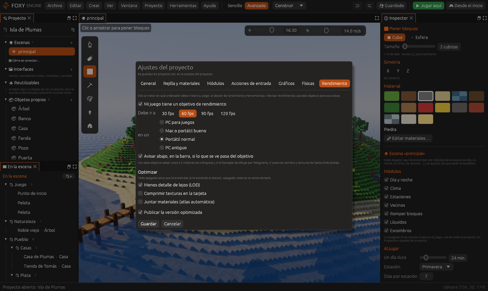
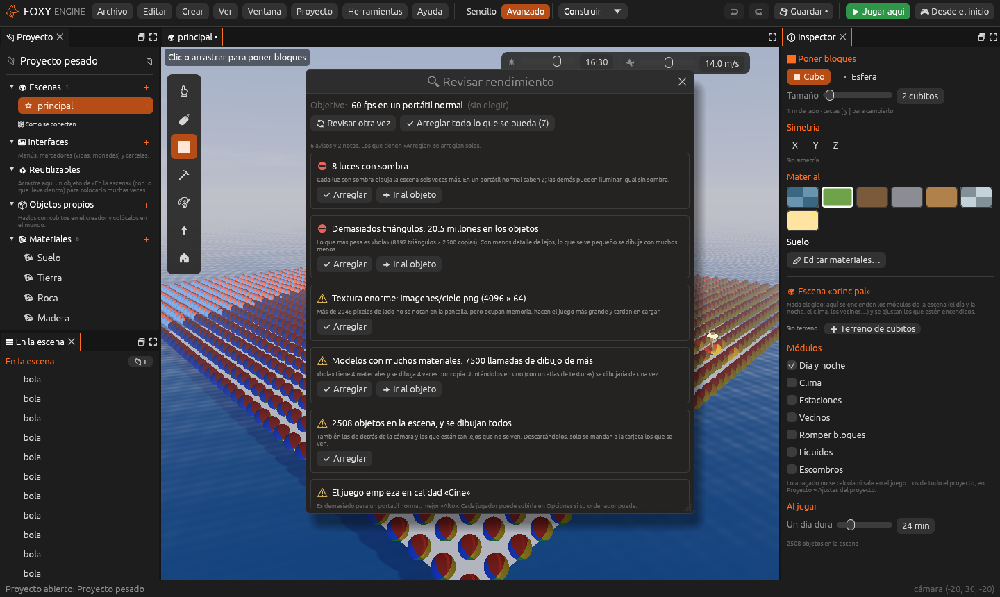
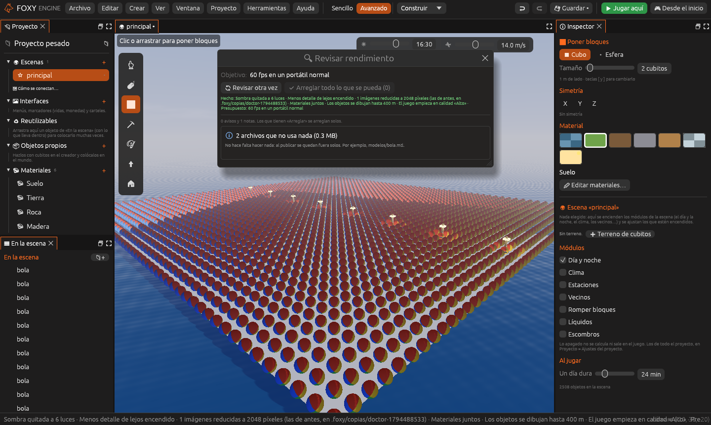

# Optimizar tu juego

No hace falta ser experto para que tu juego vaya fino. Foxy Engine trae
tres ayudas:

- El **objetivo de rendimiento**: le dices al motor en qué ordenador debe ir
  bien tu juego (por ejemplo, «60 fps en un portátil normal») y te avisa
  si lo que ves en la escena se pasa.
- El **doctor de rendimiento**: revisa el proyecto y la escena abierta y te
  dice, en lenguaje claro, qué la hará ir lenta. Casi todos sus avisos se
  arreglan con un botón.
- **Optimizar** modelos y objetos: menos detalle de lejos, texturas
  comprimidas y materiales juntos. Vienen apagados; los enciende el doctor
  cuando hacen falta, o tú en los ajustes del proyecto.

Y al [publicar](../publicar/publicar.md), el juego sale en su **versión
optimizada**.

## El objetivo de rendimiento

En **Proyecto → Ajustes del proyecto → Rendimiento** marca **Mi juego tiene
un objetivo de rendimiento** y elige:

- A cuántos **fotogramas por segundo** debe ir: 30, 60, 90 o 120. Lo normal
  es 60.
- En qué **ordenador**: un PC para juegos, un Mac o portátil bueno (como un
  MacBook Air M2), un portátil normal o un PC antiguo.

Debajo verás lo que cabe con ese objetivo: cuántos triángulos y cuántas
llamadas de dibujo por fotograma, cuántas luces con sombra y de qué tamaño
pueden ser las texturas.



Con **Avisar abajo, en la barra, si lo que se ve pasa del objetivo**, la
barra de abajo del editor enseña un aviso naranja, como **⚠ 42 fps en un
portátil normal**, cuando lo que estás viendo iría más lento que tu
objetivo en ese ordenador. Al pulsarlo se abre el doctor.

> <i class="fx fx-nota"></i> **Nota.** Es una cuenta aproximada con lo que
> se dibuja (cada tarjeta gráfica es un mundo), la misma que la pestaña
> **Otros ordenadores** de la ventana [Rendimiento](rendimiento.md). Sirve
> para saber si vas bien antes de probarlo en ese ordenador.

## El doctor de rendimiento

Abre **Herramientas → Revisar rendimiento** (también está en el modo
Sencillo y en la paleta de comandos). El doctor mira tu proyecto y la
escena abierta y te enseña una lista de avisos, de lo más grave a lo
menos:



Cada aviso dice qué pasa y por qué importa. Los botones:

- **Arreglar**: lo arregla solo. Al pasar el ratón por encima te dice qué
  va a hacer.
- **Ir al objeto**: elige en la escena el objeto del que habla y lleva la
  cámara a él.
- **Arreglar todo lo que se pueda**: hace todos los arreglos de una vez.
- **Revisar otra vez**: vuelve a mirar (por ejemplo, después de cambiar algo
  a mano).



Los arreglos **se pueden deshacer**: lo que cambia en la escena (como quitar
la sombra a unas luces) se deshace con **Ctrl+Z** (**Cmd+Z** en Mac), y las
imágenes que se reducen se guardan antes en `.foxy/copias/` dentro del
proyecto.

### Lo que revisa

| Aviso | Qué hace «Arreglar» |
|---|---|
| **No has dicho en qué ordenador debe ir tu juego** | Elige «60 fps en un portátil normal» (lo puedes cambiar después) |
| **Lo que se ve ahora iría a N fps** | Nada: los demás avisos dicen qué lo baja |
| **Textura enorme** (más grande de lo que se nota en la pantalla) | Reduce la imagen al tamaño que cabe en tu objetivo |
| **Demasiadas luces con sombra** | Deja la sombra en las más grandes y se la quita al resto |
| **Demasiados triángulos** | Enciende **Menos detalle de lejos** |
| **Un modelo con muchísimos triángulos** | Nada: conviene simplificarlo en Blender (modificador *Decimate*) |
| **Modelos con muchos materiales** | Enciende **Juntar materiales** |
| **Las texturas de los modelos ocupan mucho** | Enciende **Comprimir texturas** |
| **Muchos objetos, y se dibujan todos** | No dibuja los que no se ven (los de detrás de la cámara, los muy lejanos y los diminutos) |
| **Terreno grande, todo cargado a la vez** | Enciende la [carga por zonas](mundos-enormes.md) |
| **El juego empieza en una calidad demasiado alta** | Baja la calidad con la que empieza el juego (cada jugador la puede subir en Opciones) |
| **Cuerpos que se mueven con forma «Malla»** | Los pasa a la forma convexa, casi igual y mucho más rápida |
| **Demasiados cuerpos con físicas precisas** | Nada: los que no tienen que moverse pueden ser «Fijo» |
| **Sonidos WAV grandes** | Nada: guárdalos como OGG (en Audacity, Exportar → OGG) |
| **Archivos que no usa nada** | Nada que hacer: al publicar se quedan fuera solos |

Los avisos dependen de tu objetivo: un portátil normal admite menos luces
con sombra y texturas más pequeñas que un PC para juegos.

## Optimizar modelos y objetos

En **Ajustes del proyecto → Rendimiento → Optimizar** hay tres interruptores.
Vienen apagados; apagados, todo se ve igual que siempre.

| Opción | Qué hace |
|---|---|
| **Menos detalle de lejos (LOD)** | Cada objeto o modelo con muchos triángulos tiene, además, dos o tres versiones más sencillas que el motor hace solo. Cuando se ve pequeño en la pantalla (lejos), se dibuja con una de ellas. De cerca, siempre el original |
| **Comprimir texturas en la tarjeta** | Las texturas de color de los modelos 3D ocupan de 4 a 8 veces menos memoria en la tarjeta gráfica. Pierden un poco de detalle de color, casi nada |
| **Juntar materiales (atlas automático)** | Muchos modelos traen un material por color o por pieza, y cada uno es una llamada a la tarjeta. Los materiales sencillos de cada modelo se juntan en uno, con sus texturas puestas una al lado de otra en una sola imagen (un *atlas*). Se ve igual y cada copia se dibuja de una vez |

> <i class="fx fx-consejo"></i> **Consejo.** No hace falta encenderlo todo
> «por si acaso». Deja que el doctor te diga cuándo hace falta cada cosa.

Lo que **no** se junta: los materiales con mapa de normales, de rugosidad,
de oclusión o de luz propia, y las texturas que se repiten como un mosaico
(un suelo de baldosas, por ejemplo). Esos se dibujan como siempre.

## Al publicar

En la ventana **Publicar** y en la página **Rendimiento** de los ajustes,
**Publicar la versión optimizada** (encendido de serie) hace que el juego:

- Deje fuera los **modelos 3D que no usa nada**, con sus texturas (como ya
  pasaba con las imágenes y los sonidos).
- Lleve las **texturas de los modelos ya a su tamaño**: las de más de 2.048
  píxeles de lado, que el motor iba a reducir al abrirlas, van ya reducidas.
- **Cargue antes**: lo que ya viene comprimido (PNG, OGG, MP3, JPG) se guarda
  tal cual y no hay que descomprimirlo al abrir el juego.

## Desde la línea de comandos

```sh
foxy-engine --doctor "Documentos/Foxy Engine/proyectos/Mi juego"
foxy-engine --doctor "Documentos/Foxy Engine/proyectos/Mi juego" --arreglar
```

La primera escribe los avisos de la escena de inicio; la segunda, además,
hace los arreglos que se hacen solos y guarda el proyecto. Ver
[Línea de comandos](../referencia/linea-de-comandos.md).

## Véase también

- [Rendimiento](rendimiento.md)
- [Tabla de rendimiento](../demos/rendimiento.md): las demostraciones, medidas
