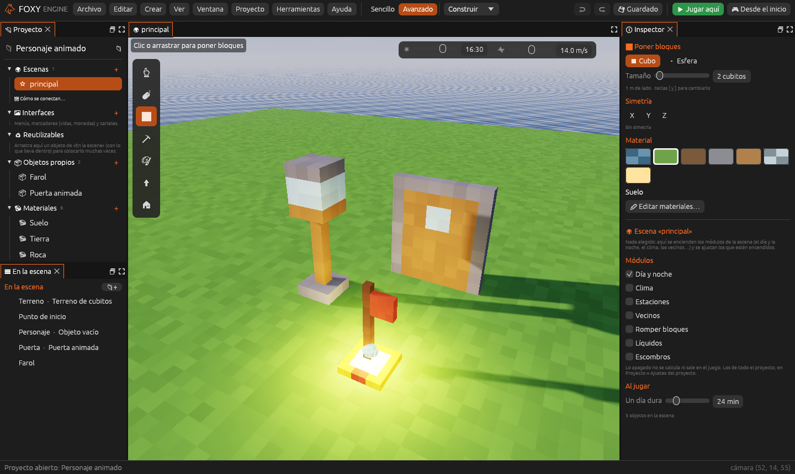
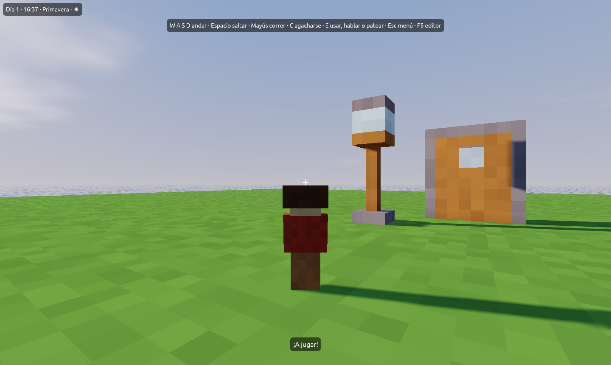

# Personajes por piezas

Un objeto de cubitos se puede partir en **piezas** que se mueven por
separado: la cabeza, los brazos y las piernas de un personaje, la hoja de
una puerta o las aspas de un molino. Cada pieza gira sobre su propio
**punto de giro** y puede colgar de otra, así que el brazo se mueve con el
cuerpo y la mano con el brazo.

## Las piezas de un objeto

Las piezas se hacen en el [creador de objetos](creador.md), en la sección
**Piezas (para animar)**. Cada pieza es una caja de cubitos del objeto:

| Campo | Qué es |
|---|---|
| **Nombre** | Cómo se llama la pieza. Es el nombre que sale en **Qué** al añadir una pista |
| **Cuelga de** | La pieza de la que depende, o **la raíz** si se mueve sola |
| **Desde** / **Hasta** | Las esquinas de la caja, en cubitos del objeto (**Hasta** no se incluye) |
| **Giro en** | El punto sobre el que gira: el hombro, el cuello, la bisagra… Puede caer entre dos cubitos |

Los cubitos que no son de ninguna pieza forman el **cuerpo**. El cuerpo
también se puede animar: en **Qué**, elige **cuerpo**. Gira desde la
cadera, que es lo alto de las piernas si las tiene.

### Partir un objeto

1. Abre el objeto en el creador.
2. Pulsa **Pieza** para añadir una caja nueva, o **Piezas de figura** para
   partirlo como una persona.
3. Haz clic en el nombre de la pieza para elegirla. En la vista se ve su
   caja en azul y su punto de giro en rojo.
4. Ajusta **Desde**, **Hasta** y **Giro en** hasta que la caja cubra la
   pieza y el punto rojo quede donde debe girar.
5. Pulsa **Guardar objeto**.

**Piezas de figura** crea **cabeza**, **brazo_izq**, **brazo_der**,
**pierna_izq** y **pierna_der** con medidas que se ajustan al tamaño del
objeto. La cabeza y los brazos cuelgan del **cuerpo**, y las piernas de la
raíz, para que no se inclinen cuando el cuerpo se inclina al correr.

> <i class="fx fx-consejo"></i> **Consejo.** Haz que el personaje mire
> hacia delante en el creador (hacia +Z, como los vecinos). Así las
> animaciones de figura se ven bien sin tocarlas.

## Animar las piezas

Con las piezas guardadas, cualquier animación puede moverlas:

1. Elige en la escena un objeto con ese objeto.
2. En el panel **Animación**, en **Pista nueva**, elige la pieza en
   **Qué** y su propiedad en **Cambia** (casi siempre **Giro**).
3. Pon las claves. El giro de una pieza es sobre su punto de giro y se suma
   al de la pieza de la que cuelga.

## La figura de bloques

El cuerpo del jugador en tercera persona ya viene partido en piezas. Con el
botón **Personaje** del panel [Estados](../interfaz/estados.md) se crean
cuatro animaciones para él:

| Animación | Qué hace |
|---|---|
| **quieto** | Respira: separa un poco los brazos y asiente con la cabeza |
| **andar** | Balancea brazos y piernas y sube y baja un poco, con un sonido de paso en cada pie |
| **correr** | Lo mismo, más deprisa y con el cuerpo inclinado |
| **saltar** | Levanta los brazos y una rodilla, y suelta polvo al despegar |

Sirven también para tus personajes si los partes con **Piezas de figura**.

## Véase también

- [Animación](animacion.md)
- [Crear objetos propios](creador.md)
- [Archivos del proyecto: objetos propios](../referencia/archivos.md#objetos-propios)
