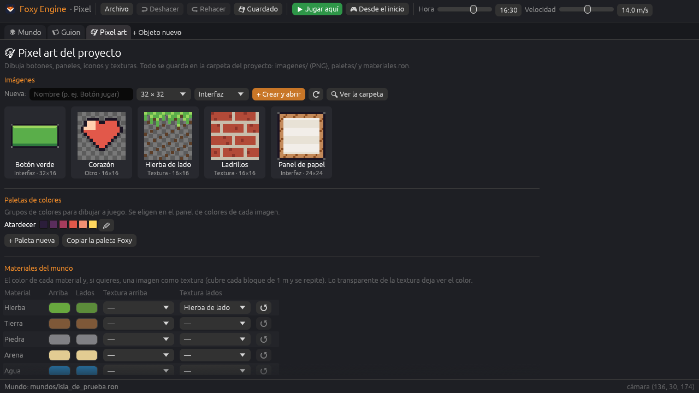
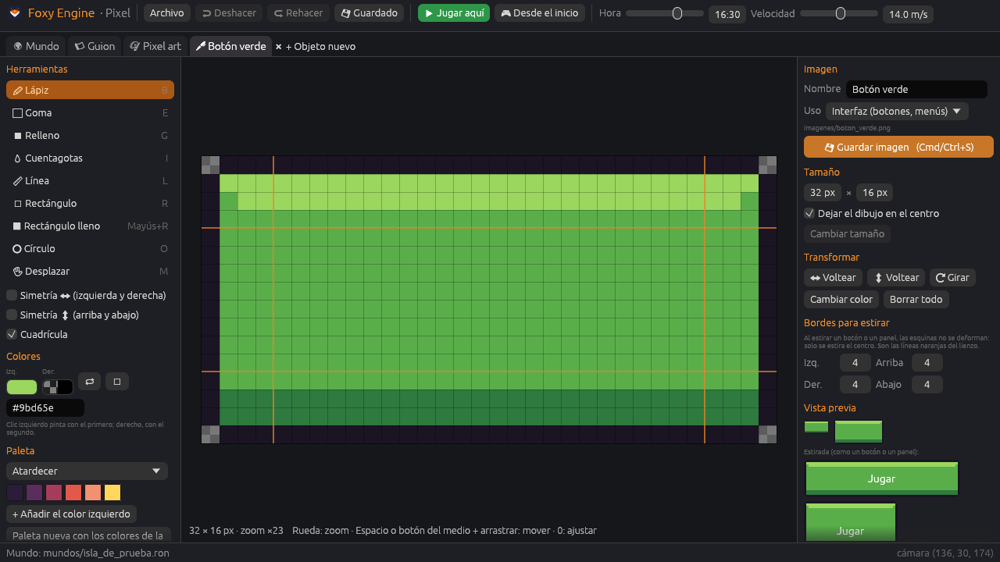
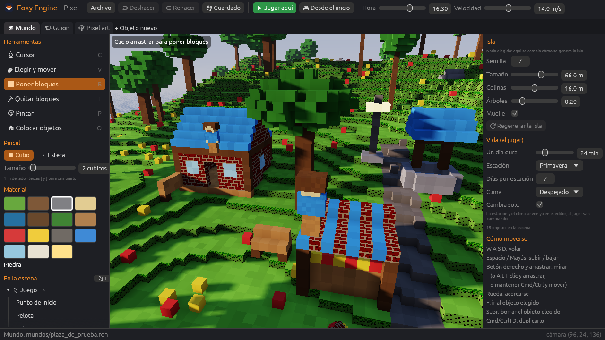

# Pixel art

La pestaña **🎨 Pixel art** es un pequeño programa de dibujo dentro del motor.
Sirve para hacer:

- **Imágenes de interfaz**: botones, paneles, iconos y marcos para tus
  [interfaces](interfaces.md).
- **Texturas** para los materiales del mundo: ladrillos en las paredes,
  hierba con flores, tejas de colores…
- **Paletas** de colores para que todo el proyecto combine.

| Biblioteca | Editando un botón | Texturas en el mundo |
|---|---|---|
|  |  |  |

## La biblioteca

La pestaña tiene tres apartados:

1. **Imágenes** del proyecto, ordenadas por uso (*Interfaz*, *Textura* u
   *Otro*). Un clic abre la imagen en su propia pestaña 🖊.
2. **Paletas** de colores.
3. **Materiales del mundo**: el color de cada material y, si quieres, una
   imagen como textura.

## El lienzo

Cada imagen se abre en una pestaña 🖊 con su lienzo. Las imágenes pueden
medir hasta **256 × 256** píxeles.

### Herramientas

| Herramienta | Tecla | Qué hace |
|---|---|---|
| Lápiz | <kbd>B</kbd> | Pinta píxel a píxel. Botón izquierdo: color principal; derecho: el secundario |
| Goma | <kbd>E</kbd> | Deja los píxeles transparentes |
| Relleno | <kbd>G</kbd> | Rellena la zona del mismo color |
| Cuentagotas | <kbd>I</kbd> | Coge el color de un píxel |
| Línea | <kbd>L</kbd> | Arrastra para dibujar una línea |
| Rectángulo | <kbd>R</kbd> (<kbd>Mayús</kbd>+<kbd>R</kbd> relleno) | Arrastra para dibujar un rectángulo |
| Círculo | <kbd>O</kbd> | Arrastra para dibujar un círculo |
| Desplazar | <kbd>M</kbd> | Mueve todo el dibujo; lo que sale por un lado entra por el otro (ideal para texturas que se repiten) |

### Moverse por el lienzo

| Para | Haz |
|---|---|
| Cambiar los dos colores | <kbd>X</kbd> |
| Acercar y alejar | Rueda |
| Mover el lienzo | <kbd>Espacio</kbd> o botón del medio + arrastrar |
| Ajustar a la vista | <kbd>0</kbd> |
| Deshacer | <kbd>Cmd</kbd>/<kbd>Ctrl</kbd>+<kbd>Z</kbd> |
| Guardar | <kbd>Cmd</kbd>/<kbd>Ctrl</kbd>+<kbd>S</kbd> |

### Más opciones

- **Simetría** izquierda/derecha y arriba/abajo: lo que pintas en un lado sale
  reflejado en el otro.
- **Cuadrícula** de píxeles.
- **Cambiar tamaño**, **↔ / ↕ Voltear** y **⟳ Girar**.
- **Cambiar un color por otro** en todo el dibujo.

## Imágenes que se estiran (bordes)

Un botón tiene que verse bien tanto si es estrecho como si es ancho. Para eso
las imágenes de interfaz tienen **bordes**: las esquinas se quedan siempre a
su tamaño, los bordes de arriba y abajo solo se estiran a lo ancho, los de los
lados solo a lo alto, y el centro rellena el resto. Es lo que se llama
*nine-slice* (estirar en nueve partes).

```text
 izq.        der.
 ┌──┬────────┬──┐
 │  │ arriba │  │  ← esquinas: no cambian
 ├──┼────────┼──┤
 │  │ centro │  │  ← se estira en los dos sentidos
 ├──┼────────┼──┤
 │  │ abajo  │  │
 └──┴────────┴──┘
```

Pon los bordes en las opciones de la imagen; la **vista previa** enseña cómo
queda el botón estirado.

## Paletas

Además de las del proyecto, siempre tienes tres:

- **Foxy**: los 32 colores del motor.
- **Materiales del mundo**: los colores de los materiales.
- **Colores de esta imagen**: los que ya usa el dibujo.

## Texturas para los materiales

En *Materiales del mundo* elige un material y pon una imagen como **textura**
(para las caras de arriba) y otra como **textura de lado** si quieres. También
puedes cambiar su **color**.

- Una textura cubre cada cara de un **bloque de 1 m** y se repite. Se puede
  dibujar de cualquier tamaño, pero **16 × 16** queda muy bien.
- Donde la textura es transparente se ve el color del material: una textura
  con huecos sirve de «adorno» sobre el color.
- Vale para el terreno y para los objetos (casas, objetos propios…).
- Caben hasta **120 texturas** distintas.

## Imágenes hechas fuera

Las imágenes son **PNG normales**. Puedes hacerlas en Aseprite, Photoshop o
cualquier otro programa y copiarlas a la carpeta `imagenes/` del proyecto.
El motor las dibuja **sin suavizar**, para que el pixel art se vea nítido.

Los formatos de imágenes, paletas y materiales están en
[Archivos del proyecto](../referencia/archivos.md).
