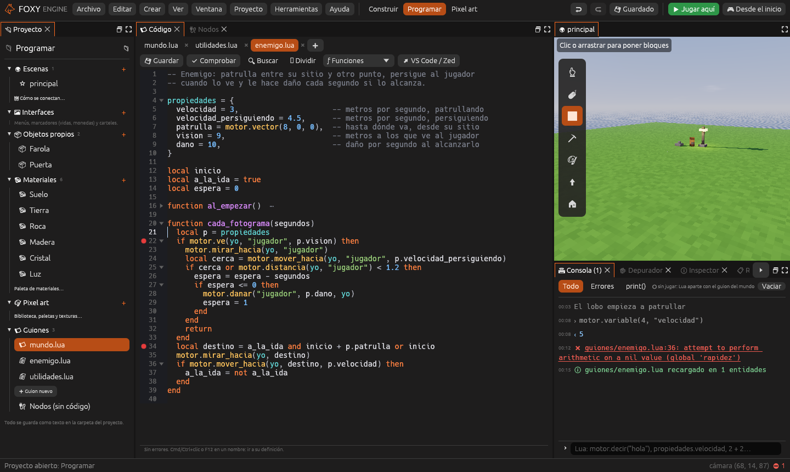

# Programar en Lua

Foxy Engine se programa en [Lua 5.4](https://www.lua.org/manual/5.4/es/), un
lenguaje pequeño que se usa en muchos juegos. Lua y los [nodos](nodos.md)
funcionan a la vez: cada cosa se puede hacer de las dos formas y se pueden
mezclar en el mismo proyecto.



## Dos clases de guion

| Guion | Dónde está | Para qué sirve |
|---|---|---|
| **Guion del mundo** | `guiones/mundo.lua` | Lo que afecta a todo el juego: la hora, el clima, los vecinos, las interfaces. Ver [Guion del mundo](guiones.md) |
| **Guion de entidad** | `guiones/<nombre>.lua`, elegido en el componente [Guion](../referencia/componentes/guion.md) | El comportamiento de una entidad: un enemigo, una puerta, una moneda. Cada entidad tiene su propia copia. Ver [Guiones de entidad](guiones-entidad.md) |
| **Módulo** | `guiones/<nombre>.lua`, cargado con `require` | Funciones que comparten varios guiones. Ver [Módulos](guiones-entidad.md#módulos) |

Todos son archivos de texto dentro de la carpeta `guiones/` del proyecto. Se
pueden editar en el panel [Código](../interfaz/codigo.md) o en cualquier
editor externo, como VS Code o Zed.

## Lo que ofrece el editor

- **Panel Código**: pestañas, vista dividida, colores de Lua, números de
  línea, plegado de funciones, buscar y reemplazar.
- **Autocompletado** de toda la API (`motor.`, las propiedades, tus
  funciones), con la ayuda de cada función y sus parámetros.
- **Errores mientras escribes**: los fallos de sintaxis se subrayan en rojo y
  las funciones de `motor` que no existen, en amarillo, con una sugerencia.
- **Ir a la definición** con <kbd>Cmd</kbd>/<kbd>Ctrl</kbd>+clic o
  <kbd>F12</kbd>, también en otros archivos.
- **Propiedades en el inspector**: los valores de la tabla `propiedades` de un
  guion de entidad se ajustan en el [Inspector](../interfaz/inspector.md) de
  cada entidad.
- **Recarga en caliente**: al guardar con el juego en marcha, el guion se
  recarga sin reiniciar y sin perder el estado.
- **[Consola](../interfaz/consola.md)**: ejecuta Lua contra el juego en marcha
  y enseña los `print()` y los errores. Un clic en un error abre su línea.
- **[Depurador](../interfaz/depurador.md)**: puntos de parada, paso a paso y
  todas las variables.
- **Plantillas** para empezar: entidad vacía, enemigo, puerta, recogible y
  módulo.

## Empezar en cinco pasos

1. Pulsa **Programar**, arriba en el centro, para cambiar de espacio.
2. En el panel **Proyecto**, grupo **Guiones**, pulsa **Guion nuevo** y elige
   la plantilla **Enemigo**.
3. Elige una entidad en la escena. En el
   [Inspector](../interfaz/inspector.md), añade el componente **Guion** y elige
   el archivo `enemigo.lua`.
4. Cambia **velocidad** en las propiedades del inspector.
5. Pulsa **Jugar aquí**. Con el juego en marcha, pulsa <kbd>F7</kbd>, cambia
   el guion y guárdalo con <kbd>Cmd</kbd>/<kbd>Ctrl</kbd>+<kbd>S</kbd>: el
   enemigo cambia al momento.

El [tutorial del enemigo en Lua](tutorial-enemigo-lua.md) lo explica paso a
paso.

## Cómo se ejecuta un guion

Un guion no se ejecuta de arriba abajo como un programa. Define **funciones
con nombres especiales** que el motor llama cuando pasa algo: `al_empezar`,
`cada_fotograma`, `al_chocar`… Desde ellas se usa la tabla **`motor`** para
preguntar o pedir cosas al juego. Las listas completas están en la
[referencia de la API de Lua](../referencia/api-lua.md).

```lua
function al_empezar()
  motor.decir("Empieza la partida")
end

function cada_fotograma(segundos)
  motor.mirar_hacia(yo, "jugador")
end
```

> <i class="fx fx-nota"></i> **Nota.** Un error en un guion no cierra el
> juego. Sale en la pantalla, en la consola y en el
> [Registro](../interfaz/registro.md), con el archivo y la línea. El motor
> también corta los bucles que no terminan («el guion tarda demasiado»).

## Véase también

- [Guion del mundo](guiones.md)
- [Guiones de entidad](guiones-entidad.md)
- [Recargar, consola y depurador](lua-depurar.md)
- [Editores externos](lua-editor-externo.md)
- [API de Lua](../referencia/lua.md) y [Referencia de la API de Lua](../referencia/api-lua.md)
