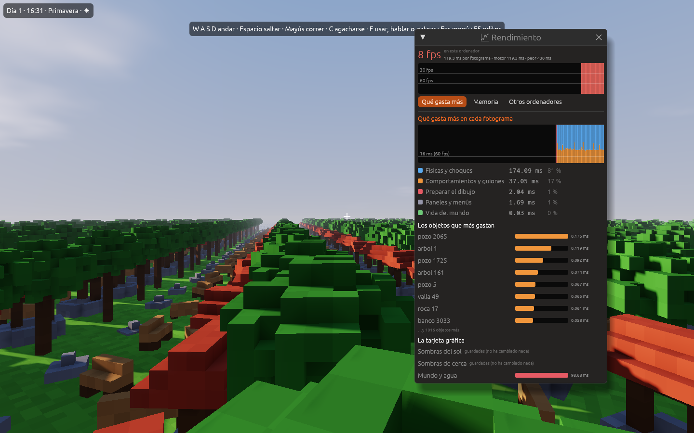
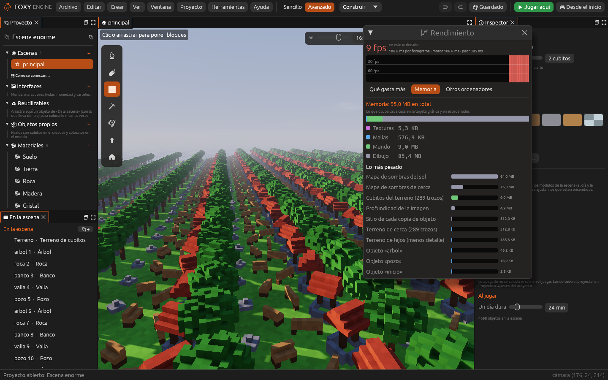
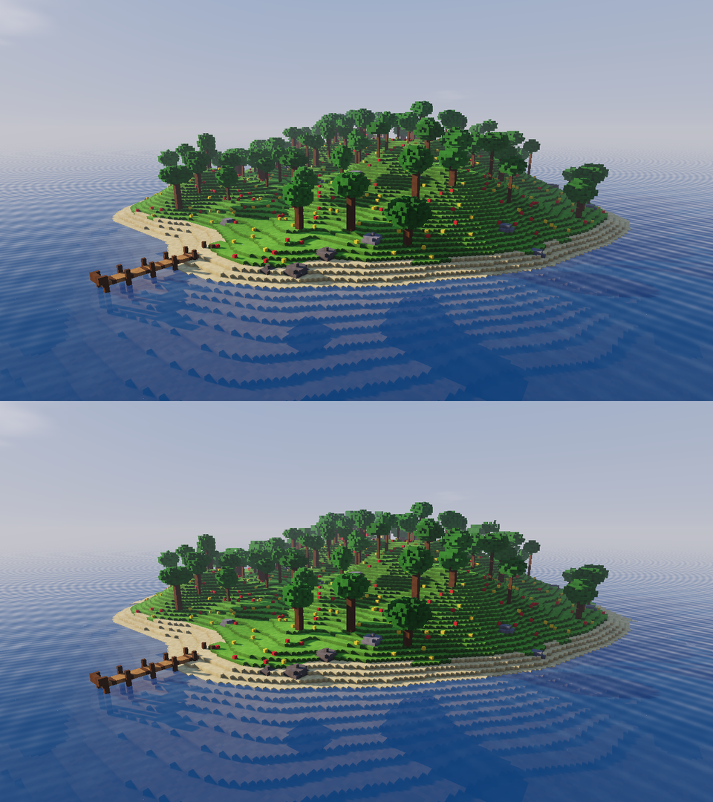

# Rendimiento

Un mundo que en tu ordenador va sobrado puede ir a tirones en el de otra
persona. Foxy Engine te ayuda de dos formas: **dibuja con menos detalle lo
que está lejos** y tiene una ventana, **Rendimiento**, que mide de verdad
qué parte de tu juego gasta más (y en qué objeto), cuánta memoria ocupa
cada cosa y cómo iría en otros ordenadores.

## La ventana «Rendimiento»

Ábrela en **Ver → 📈 Rendimiento**. Mientras está abierta, el editor dibuja
sin parar (aunque no toques nada) para medir de verdad.

Arriba tienes los **fotogramas por segundo** de este ordenador y tres
tiempos:

- **ms por fotograma**: lo que tarda cada imagen de media.
- **motor**: lo que tarda el motor en prepararla y dibujarla. El resto es
  esperar a la pantalla (con la sincronía vertical, a 60 Hz cada imagen
  tarda al menos 16,7 ms, aunque el motor acabe antes).
- **peor**: el fotograma más lento de los últimos dos segundos. Si es mucho
  más alto que la media, se notan **tirones**.

La **gráfica** enseña los últimos 240 fotogramas (unos 4 segundos). La parte
clara de cada barra es el tiempo total y la fuerte, el trabajo del motor. Las
rayas marcan 60 y 30 fps. Verde es que va bien, amarillo que va justo y rojo
que va a tirones.

Debajo hay tres pestañas: **Qué gasta más**, **Memoria** y **Otros
ordenadores**.

## Qué gasta más (el perfilador)

Esta pestaña mide, en cada fotograma, cuánto tiempo se va en cada parte del
motor. La **gráfica** tiene una barra por fotograma, con un color por parte;
pasa el ratón por encima para ver los números de ese fotograma. La raya
marca 16 ms, lo que cabe en un fotograma a 60 fps.

| Parte | Qué es |
|---|---|
| Comportamientos y guiones | Los comportamientos de los objetos, los grafos de nodos y el código Lua |
| Físicas y choques | El jugador, las pelotas, las zonas y los choques entre objetos |
| Animación | Las animaciones de los objetos |
| Partículas | Polvo, chispas, lluvia, humo... |
| Vida del mundo | El reloj, el clima, los vecinos, el agua y los derrumbes |
| Sonido | Los sonidos y la música |
| Preparar el dibujo | Lo que hace el ordenador para mandar la imagen a la tarjeta gráfica |
| Paneles y menús | Los paneles del editor y los menús del juego |
| Otros | Lo demás |

Debajo de la gráfica, la lista de partes de la que más gasta a la que menos,
con su media del último segundo y el porcentaje.

**Los objetos que más gastan.** Mientras juegas (con *Jugar*), la ventana
apunta lo que tardan los comportamientos de cada objeto y enseña los ocho
que más gastan. Si un enemigo con un guion pesado frena el juego, lo verás
el primero de la lista. El tiempo es solo de ese objeto: si su guion manda
un mensaje a otro, lo que tarda el otro en contestar se le apunta al otro.

**La tarjeta gráfica.** Lo que tarda la tarjeta en cada pasada del dibujo:
las sombras del sol, las sombras de cerca, las sombras de las luces, el
mundo con el agua y el tono. Encima sale la lista de pasadas de este
fotograma: las [piezas](graficos.md#piezas-del-dibujo) apagadas no salen. Las
sombras se guardan y solo se vuelven a dibujar si algo cambia; entonces
pone *guardadas*. Algunas tarjetas no saben decir lo que tardan; entonces
la ventana lo avisa.

> <i class="fx fx-consejo"></i> **Consejo.** Para ver tu juego al límite,
> abre la ventana mientras juegas en el sitio con más objetos.

## Memoria

Lo que ocupa cada cosa, en la tarjeta gráfica y en el ordenador, por tipos:

| Tipo | Qué es |
|---|---|
| Texturas | Las imágenes de los materiales y de los modelos 3D |
| Mallas | Los triángulos del terreno, de los objetos de cubitos y de los modelos 3D |
| Sonidos | Los sonidos del proyecto y los del motor, ya preparados para sonar |
| Mundo | Los cubitos del terreno |
| Dibujo | Lo que el dibujo necesita para funcionar: los mapas de sombras y la profundidad |

Debajo, **lo más pesado**: las diez cosas que más ocupan, de mayor a menor
(por ejemplo, *Texturas de «castillo.glb»* o *Terreno de cerca*). Si tu
juego ocupa mucho, empieza por arriba.

## Otros ordenadores

Arriba están los números de lo que se dibuja:

| Dato | Qué es |
|---|---|
| Trozos dibujados | Trozos del mundo (de 16 m de lado) que se ven, de cuántos hay, y cuántos van con el detalle de lejos |
| Triángulos | Lo que dibuja la tarjeta gráfica en cada imagen |
| Llamadas de dibujo | Cuántas veces el motor le pide a la tarjeta que dibuje algo. Cada una cuesta, sobre todo en los ordenadores flojos |
| Mallas en la tarjeta | Memoria que ocupan las formas del mundo en la tarjeta gráfica |
| Imagen | Tamaño de la imagen, en megapíxeles |

### Cómo iría en otros ordenadores

La ventana calcula los fotogramas por segundo que daría tu mundo, tal como
lo estás mirando, en cuatro ordenadores de referencia:

| Equipo | Por ejemplo |
|---|---|
| PC para juegos | Gráfica dedicada, como una GeForce RTX 3060 |
| Mac o portátil bueno | Un MacBook Air M2 |
| Portátil normal | Gráfica integrada, como una Intel Iris Xe |
| PC antiguo | De hace unos diez años, como una Intel HD 4000 |

Es una **cuenta aproximada**: tiene en cuenta los triángulos, las llamadas
de dibujo y los píxeles de la imagen, pero cada tarjeta gráfica es un mundo.
Sirve para comparar: si quitas detalle, ¿mejora mucho en el PC antiguo?

> <i class="fx fx-nota"></i> **Nota.** Mira el mundo desde los sitios donde más se ve
> (una montaña, la entrada de una ciudad). Desde ahí es donde más cuesta.

#### Notar cómo va

Elige un equipo y marca **Notar cómo va**: el editor, y también *Jugar
aquí*, se ponen a los fotogramas por segundo de ese ordenador, para que lo
veas con tus propios ojos. Se quita al cerrar la ventana.

#### Consejos

Si algo se puede mejorar, al final de la ventana sale un consejo con
<i class="fx fx-consejo"></i>: activar el detalle de lejos, acercarlo, o que el
mundo es muy grande para un PC antiguo.

## Detalle de lejos

A partir de cierta distancia (**96 m**, si no la cambias), cada trozo se
dibuja con una forma más sencilla, en la que cada casilla junta 2×2×2
cubitos. Desde lejos casi no se nota y la tarjeta gráfica tiene mucho menos
trabajo: en la isla de prueba, vista desde fuera, se pasa de 304 000 a unos
77 000 triángulos.

- Si dentro de la casilla hay algo sólido, la casilla es sólida: no salen
  agujeros y los troncos finos no desaparecen.
- Toma el material que más hay, contando más lo de arriba, que es lo que se
  ve (la hierba sobre la tierra).
- El **agua** se dibuja siempre con todo el detalle, porque es plana y casi
  no cuesta, y así queda a la misma altura que el mar.
- Las sombras se calculan con todo el detalle.

Se activa, se quita y se cambia la distancia en la ventana *Rendimiento* o
en [Preferencias](preferencias.md). **Más cerca** es más rápido y **más
lejos**, más bonito.

## Texturas de lejos

Las [texturas](pixel-art.md) de los bloques llevan copias cada vez más
pequeñas (se llaman *mipmaps*). De cerca se ven los píxeles del pixel art y
de lejos los colores se mezclan, así que las caras lejanas **no parpadean**
al moverse. No hay que hacer nada: el motor las prepara solo.

## Véase también

- [Tabla de rendimiento](../demos/rendimiento.md): cómo van las demostraciones en distintos ordenadores
- [Optimizar tu juego](optimizar.md)
- [Mundos enormes](mundos-enormes.md)
