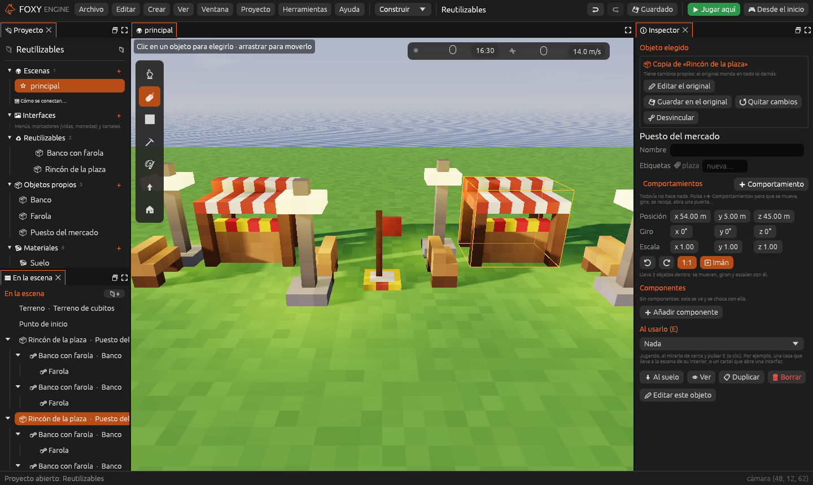
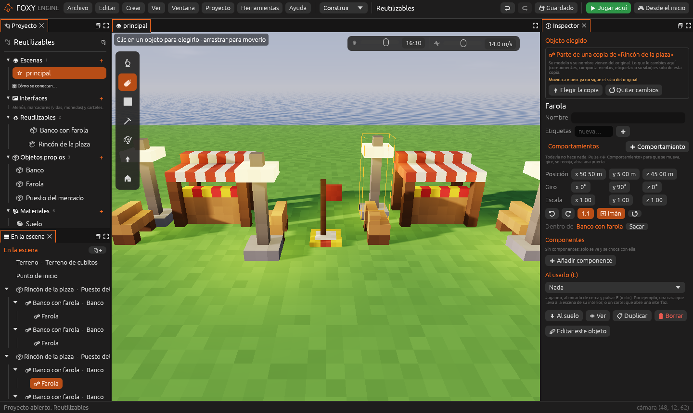
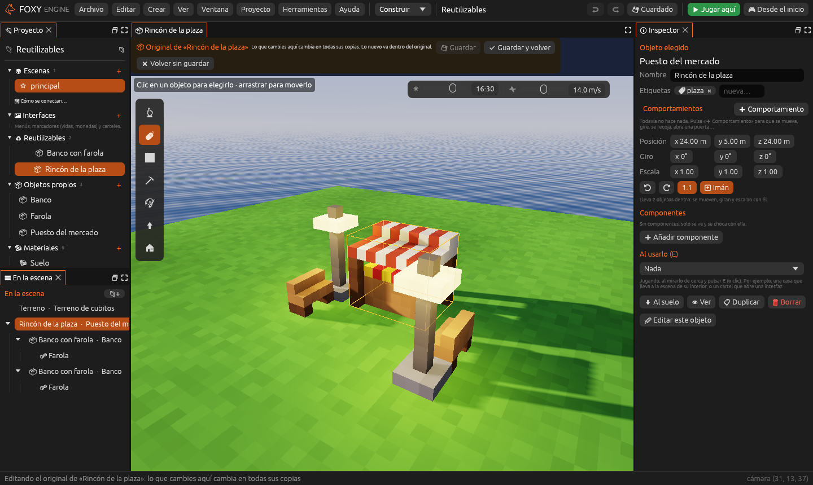

# Objetos reutilizables

Un **objeto reutilizable** es un objeto guardado para colocarlo muchas
veces: **con todo lo que lleva dentro** (sus hijos), sus
[comportamientos](comportamientos.md), sus etiquetas y sus componentes. Un
puesto de mercado con sus bancos y sus farolas, un enemigo con su arma, un
coche con sus ruedas.

Cada vez que lo colocas haces una **copia**. Las copias **siguen al
original**: si cambias el original, cambian todas, menos lo que hayas
cambiado a mano en una copia.

> <i class="fx fx-nota"></i> **Antes se llamaban prefabricados.** Los de
> proyectos anteriores siguen funcionando igual y se guardan en la misma
> carpeta, `prefabricados/`.

## Guardar un objeto como reutilizable

1. Prepara el objeto: mete dentro lo que quieras que lleve (arrastrando
   cada cosa encima de él en [En la escena](../interfaz/escena.md); ver
   [Objetos libres y jerarquía](objetos-libres.md)) y dale sus
   comportamientos.
2. **Arrástralo** desde *En la escena* hasta el grupo **♻ Reutilizables**
   del panel [Proyecto](../interfaz/proyecto.md) y suéltalo ahí.

También sirve el botón **📦 Guardar como reutilizable** del
[Inspector](../interfaz/inspector.md) o el clic derecho sobre el objeto en
*En la escena*.

El objeto que tenías pasa a ser **su primera copia**. El reutilizable sale
en **♻ Reutilizables** y en la herramienta **Colocar objetos**, en la lista
**Reutilizables**: elígelo y haz clic en la escena para poner otra copia.

## Copias y partes

En *En la escena*, una copia lleva <i class="fx fx-objeto"></i> 📦 delante, y
lo que lleva dentro (sus **partes**) lleva 🔩. Las partes son objetos de
verdad: se ven, chocan, tienen sus comportamientos y se mueven con la copia.

Al elegir una **copia**, el Inspector lo dice arriba y ofrece:

| Botón | Qué hace |
|---|---|
| **✏ Editar el original** | Abre el original en su propia pestaña (ver abajo) |
| **💾 Guardar en el original** | Pasa lo que has cambiado en esta copia al original, y por tanto a todas las copias |
| **↺ Quitar cambios** | La copia vuelve a ser igual que el original (también quita lo que le hayas metido dentro) |
| **⛓ Desvincular** | Deja de ser copia: ella y sus partes se quedan como están, como objetos normales |

Al elegir una **parte**:

| Botón | Qué hace |
|---|---|
| **⬆ Elegir la copia** | Elige la copia a la que pertenece |
| **↺ Quitar cambios** | La parte vuelve a ser como en el original, también su sitio |

### Qué puede cambiar cada copia

| Se cambia en cada copia | Viene siempre del original |
|---|---|
| Componentes, comportamientos y sus valores, etiquetas y la acción al usarlo (E) | El modelo de cada parte |
| El sitio, el giro y la escala de la copia | El nombre de las partes |
| El sitio de una parte (al moverla queda **movida a mano** y ya no sigue al original) | Qué partes lleva |

Lo cambiado aparece en el Inspector como *cambiado aquí*, con **↺ Como el
original** para deshacerlo. Lo heredado aparece como *del original*.

Una parte **no se borra ni se saca** de su copia: va donde dice el original.
Para quitarla, quítala del original o desvincula la copia. Lo que sí puedes
es **meter cosas nuevas** dentro de una copia; con *Guardar en el original*
pasan al original.

## Editar el original

Haz clic en el reutilizable en **♻ Reutilizables** (o **✏ Editar el
original** en una copia). Se abre en **su propia pestaña**, con su nombre
y 📦: el original encima de un suelo llano, con todo lo que lleva dentro.

Ahí se edita como una escena normal: mueve, gira y escala las partes, añade
comportamientos, componentes o etiquetas, o coloca objetos nuevos (**lo
nuevo va dentro del original** solo). El nombre del original es el nombre
del reutilizable.

La barra de arriba tiene:

| Botón | Qué hace |
|---|---|
| **💾 Guardar** (<kbd>Cmd/Ctrl</kbd>+<kbd>S</kbd>) | Guarda el original y sigue en la pestaña |
| **✔ Guardar y volver** | Guarda y vuelve a la escena. Las copias de la escena ya están al día |
| **✖ Volver sin guardar** | Vuelve a la escena y olvida lo no guardado |

Pulsar **Jugar**, abrir otra escena o volver a la pantalla de inicio guarda
el original y vuelve a la escena antes. Las demás escenas se ponen al día
solas al abrirlas.

> <i class="fx fx-consejo"></i> **Consejo.** Lo que hayas cambiado a mano
> en una copia se respeta aunque cambies el original. Así puedes tener diez
> farolas iguales y una que da más luz.

## Reutilizables dentro de reutilizables

Un reutilizable puede llevar **copias de otros**: un *Rincón de la plaza*
con dos *Bancos con farola*, o un coche con cuatro ruedas. Si cambias la
rueda, cambian las ruedas de todos los coches.

Un reutilizable no puede llevarse dentro a sí mismo, ni directa ni
indirectamente: el editor no lo deja colocar en su propio original.

## En el archivo

El reutilizable se guarda en `prefabricados/<id>.ron`, con lo que lleva
dentro en `hijos`. En la escena, la copia dice de cuál es
(`prefabricado`) y cada parte qué parte es (`pieza`). Ver
[Archivos del proyecto](../referencia/archivos.md#objetos-reutilizables).

## Véase también

- [Entidades y componentes](entidades.md)
- [Objetos libres y jerarquía](objetos-libres.md)
- [Comportamientos](comportamientos.md)
