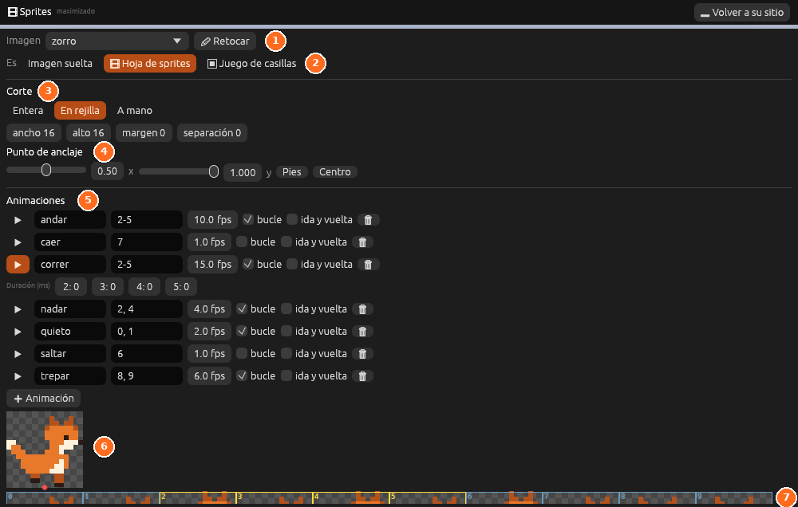

# Sprites

Un sprite es la imagen con la que se ve una entidad 2D. Puede ser una
imagen suelta o una **hoja de sprites**: una imagen con varios fotogramas
que se cortan y se juntan en animaciones. El panel **Sprites** sirve para
cortar la hoja, poner su punto de apoyo y montar las animaciones.

## El panel

| Parte | Qué hace |
|---|---|
| **Imagen** | La imagen de `imagenes/` que se edita |
| **Retocar** | Abre la imagen en [Pixel art](pixel-art.md), con la rejilla de los fotogramas |
| **Es** | **Imagen suelta**, **Hoja de sprites** o **Juego de casillas** (ver [Mapas de casillas](casillas.md)) |
| **Corte** | Cómo se corta la hoja en fotogramas |
| **Punto de anclaje** | El punto del fotograma que se pone en la posición de la entidad |
| **Animaciones** | La lista de animaciones de la hoja |
| Vista previa | La animación elegida, moviéndose, con su punto de anclaje en rojo |
| Fotogramas | Todos los fotogramas, numerados desde 0. Los de la animación elegida salen en amarillo |

## Cortar una hoja

1. En **Imagen**, elige la imagen.
2. En **Es**, pulsa **Hoja de sprites**.
3. En **Corte**, elige cómo:
   - **Entera**: toda la imagen es un solo fotograma.
   - **En rejilla**: fotogramas iguales, de izquierda a derecha y de
     arriba abajo. Escribe su **ancho** y **alto** en píxeles y, si la hoja
     los tiene, el **margen** de alrededor y la **separación** entre ellos.
   - **A mano**: rectángulos de cualquier tamaño, uno por fotograma.
4. Comprueba los fotogramas en la tira de abajo.

Los cambios se guardan solos en el archivo `imagenes/<nombre>.ron`, junto a
la imagen.

## El punto de anclaje

El punto de anclaje dice qué punto de cada fotograma va en la posición de
la entidad. Se mide de 0 a 1: `x` de izquierda a derecha e `y` de arriba
abajo.

- **Pies** (0,5 × 1) pone la entidad de pie sobre su posición. Es lo normal
  en los personajes.
- **Centro** (0,5 × 0,5) la centra. Va bien en monedas, gemas y partículas.

## Animaciones

Cada animación tiene un nombre, sus fotogramas y su velocidad.

| Columna | Qué es |
|---|---|
| ▶ | Muestra la animación en la vista previa |
| Nombre | Cómo se llama, en minúsculas (`correr`, `saltar`…) |
| Fotogramas | Los números de los fotogramas, como `0-3` o `0, 2, 4` |
| **fps** | Fotogramas por segundo |
| **bucle** | Vuelve a empezar al acabar |
| **ida y vuelta** | Va hacia delante y luego hacia atrás (0 1 2 1 0…) |

Con una animación elegida, la fila **Duración (ms)** deja que cada
fotograma dure lo suyo, en milésimas de segundo: por ejemplo, un parpadeo
corto entre dos fotogramas largos. Con 0, el fotograma dura lo que dicen
los **fps**; **Iguales** vuelve a ponerlos todos así.

Para animar un sprite con claves y curvas (moverlo, girarlo, teñirlo o
cambiar de fotograma en momentos exactos), usa la
[línea de tiempo](animacion.md#en-2d).

### Crear una animación

1. Pulsa **Animación**.
2. Escribe su nombre.
3. Escribe sus fotogramas, o haz clic en la tira de abajo para añadir o
   quitar cada uno.
4. Ajusta los **fps** y marca **bucle** si se repite.

Si la imagen es el sprite del jugador, el panel ofrece botones para crear
las [animaciones que usa solo](juegos-2d.md#animaciones-del-jugador) y que
todavía no tiene.

> <i class="fx fx-consejo"></i> **Consejo.** Dibuja todos los fotogramas en
> una sola imagen, uno al lado del otro y del mismo tamaño. Así basta con
> el corte **En rejilla**.

## Poner un sprite a una entidad

1. Elige la entidad en la vista o en **En la escena**.
2. En el Inspector, añade el componente **Sprite** si no lo tiene.
3. Elige la **Imagen** y, si es una hoja, la **Animación** con la que
   empieza o el **Fotograma** fijo.

Ver [Sprite](../referencia/componentes/sprite.md) para el resto de
opciones: espejo, orden de dibujo y tinte.

## Véase también

- [Juegos 2D](juegos-2d.md)
- [Mapas de casillas](casillas.md)
- [Pixel art](pixel-art.md)
- [Sprite](../referencia/componentes/sprite.md)
