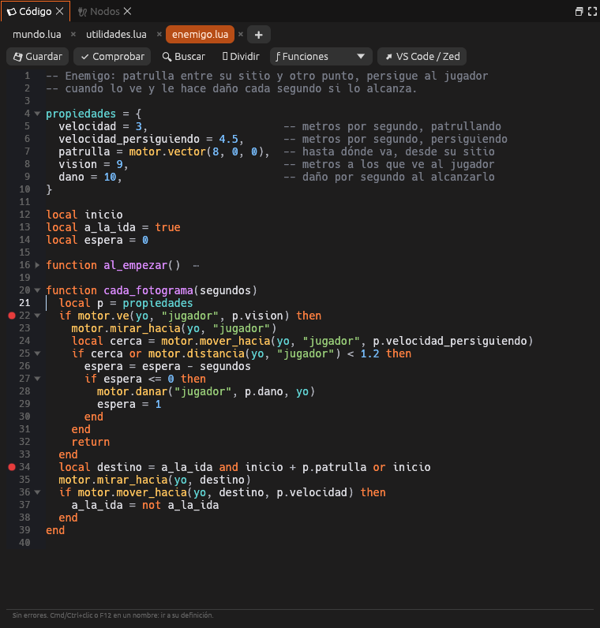
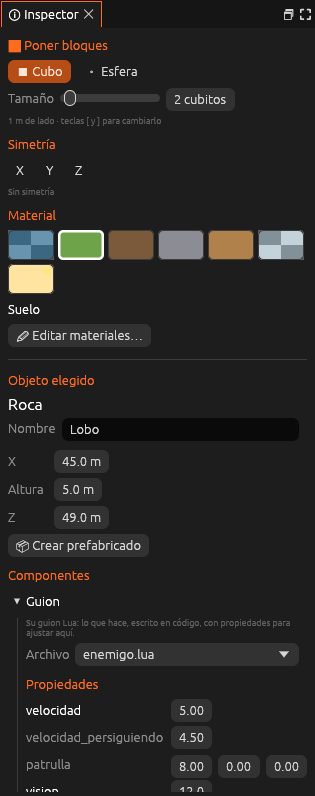
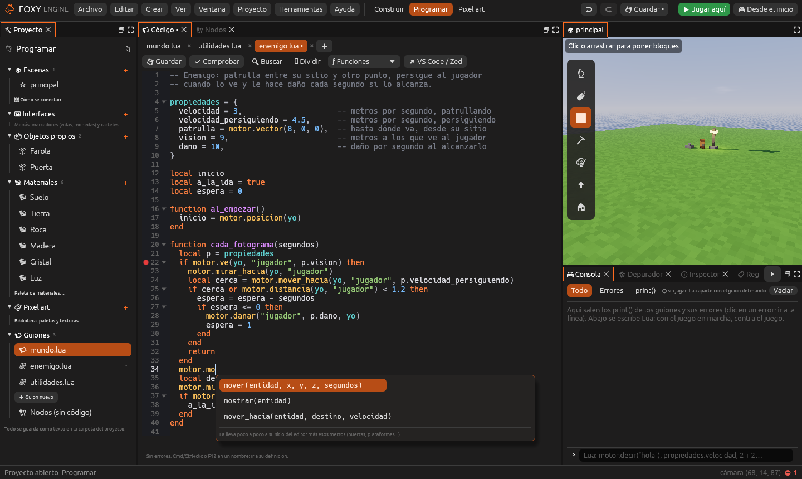
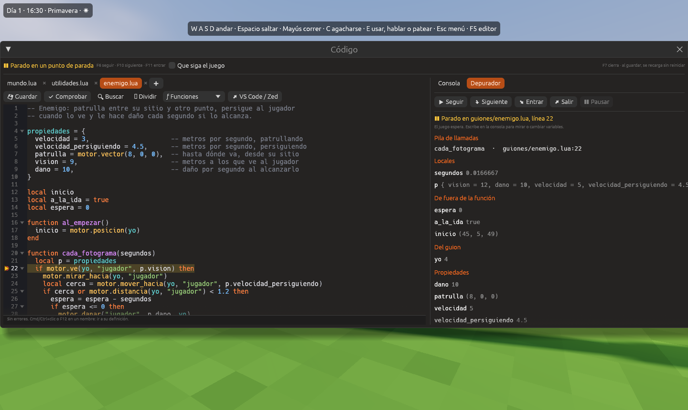

# Tutorial: el enemigo en Lua

En este tutorial haces en Lua el mismo enemigo del
[tutorial de nodos](tutorial-enemigo.md): patrulla, persigue al jugador
cuando lo ve y le quita vida al alcanzarlo. Después ajustas su velocidad
desde el inspector y corriges un error **con el juego en marcha**, sin
reiniciar.

Necesitas unos 15 minutos. Conviene haber leído antes
[Programar en Lua](programar-lua.md).



## 1. Crear el guion

1. Crea un proyecto con la plantilla **Vacío 3D** y coloca un objeto que
   haga de enemigo. Ponle de nombre **Lobo**.
2. Pulsa **Programar**, arriba en el centro.
3. En el panel **Proyecto**, grupo **Guiones**, pulsa **Guion nuevo →
   Enemigo** y escribe `enemigo`. Se crea `guiones/enemigo.lua` y se abre en
   el panel **Código**.

## 2. Leer el guion

La plantilla ya hace todo el trabajo. Tiene tres partes:

```lua
propiedades = {
  velocidad = 3,                     -- metros por segundo, patrullando
  velocidad_persiguiendo = 4.5,      -- metros por segundo, persiguiendo
  patrulla = motor.vector(8, 0, 0),  -- hasta dónde va, desde su sitio
  vision = 9,                        -- metros a los que ve al jugador
  dano = 10,                         -- daño por segundo al alcanzarlo
}

local inicio
local a_la_ida = true
local espera = 0

function al_empezar()
  inicio = motor.posicion(yo)
end
```

- **`propiedades`**: los valores que se ajustan en el inspector.
- **Variables locales**: dónde empezó, hacia dónde va y cuánto falta para
  el siguiente mordisco. Cada lobo tiene las suyas.
- **`al_empezar`**: recuerda el sitio donde está el lobo al empezar.

Y `cada_fotograma`, que decide qué hace en cada momento:

```lua
function cada_fotograma(segundos)
  local p = propiedades
  if motor.ve(yo, "jugador", p.vision) then
    motor.mirar_hacia(yo, "jugador")
    local cerca = motor.mover_hacia(yo, "jugador", p.velocidad_persiguiendo)
    if cerca or motor.distancia(yo, "jugador") < 1.2 then
      espera = espera - segundos
      if espera <= 0 then
        motor.danar("jugador", p.dano, yo)
        espera = 1
      end
    end
    return
  end
  local destino = a_la_ida and inicio + p.patrulla or inicio
  motor.mirar_hacia(yo, destino)
  if motor.mover_hacia(yo, destino, p.velocidad) then
    a_la_ida = not a_la_ida
  end
end
```

> <i class="fx fx-consejo"></i> **Consejo.** Pasa el ratón por encima de
> `motor.ve` para leer su ayuda, o pulsa <kbd>F12</kbd> sobre `inicio` para
> saltar a donde se declara.

## 3. Ponérselo al lobo

1. Elige el lobo en la escena.
2. En el [Inspector](../interfaz/inspector.md), pulsa
   <i class="fx fx-mas"></i> **Añadir componente → Guion** y elige
   `enemigo.lua` en **Archivo**.
3. En **Propiedades**, cambia **velocidad** a `5` y **vision** a `12`.



## 4. Probar y escribir con autocompletado

1. Pulsa **Jugar aquí**. El lobo patrulla y, al acercarte, te persigue.
2. Pulsa <kbd>F7</kbd> para abrir la ventana **Código** encima del juego.
3. Al final de `al_empezar`, escribe `motor.de`. El autocompletado propone
   `decir(texto)`; pulsa <kbd>Intro</kbd> y completa:

   ```lua
   motor.decir("¡Cuidado con el lobo!")
   ```

4. Guarda con <kbd>Cmd</kbd>/<kbd>Ctrl</kbd>+<kbd>S</kbd>. La consola dice
   «guiones/enemigo.lua recargado en 1 entidad».



## 5. Arreglar un error jugando

1. En `cada_fotograma`, cambia `p.velocidad` por `rapidez` en la última
   llamada a `motor.mover_hacia` y guarda.
2. La consola enseña en rojo un error como «guiones/enemigo.lua:37: attempt
   to perform arithmetic on a nil value (global 'rapidez')», con el archivo
   y la línea. El lobo se queda quieto, pero el juego sigue.
3. Haz clic en el error: el guion se abre en esa línea, marcada en rojo.
4. Vuelve a escribir `p.velocidad` y guarda. El lobo sigue patrullando
   desde donde estaba, sin reiniciar la partida.

## 6. Pararlo con el depurador

1. Haz clic a la izquierda de la línea `if motor.ve(...)`. Sale un punto
   rojo.
2. Cierra la ventana con <kbd>F7</kbd>. El juego se para en esa línea y la
   ventana se abre sola, con el **Depurador** a la derecha.
3. Mira **Locales** (`segundos`, `p`), **De fuera de la función**
   (`inicio`, `a_la_ida`, `espera`) y **Propiedades**.
4. Pulsa **Siguiente** (<kbd>F10</kbd>) para avanzar línea a línea, y
   **Seguir** (<kbd>F6</kbd>) para volver a jugar.



## Véase también

- [Guiones de entidad](guiones-entidad.md)
- [Recargar, consola y depurador](lua-depurar.md)
- [Tutorial: un enemigo que persigue](tutorial-enemigo.md), con nodos
