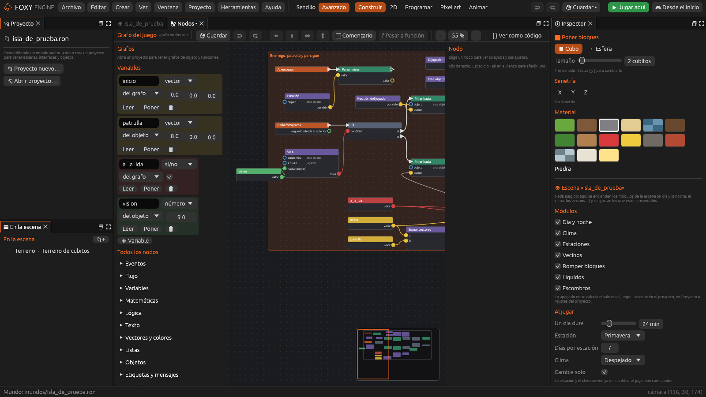

# Tutorial: un enemigo que persigue

En este tutorial construyes, sin escribir código, un pequeño juego
completo: un enemigo que patrulla, persigue al jugador cuando lo ve y le
quita vida al alcanzarlo; una barra de vida en pantalla, y una pantalla de
«Has perdido» cuando la vida llega a cero. Al final, depuras el enemigo
viendo cómo se encienden sus cables.

Necesitas unos 20 minutos. Conviene haber leído antes [Nodos](nodos.md).

## 1. Preparar la escena

1. Crea un proyecto con la plantilla **Vacío 3D**.
2. Coloca un objeto que haga de enemigo. Sirve cualquiera de la paleta de
   objetos; si quieres uno propio, hazlo en el [creador](creador.md).
   Ponle de nombre **Lobo**.
3. Con el lobo elegido, en el [Inspector](../interfaz/inspector.md), pulsa
   **➕ Comportamiento → 🔌 Nodos nuevos**. Se crea `grafos/lobo.nodos.ron`,
   se le pone al lobo como [comportamiento](comportamientos.md) y se abre
   en el panel Nodos.

## 2. Las variables del enemigo

En el grupo **Variables** del panel, crea cuatro con
<i class="fx fx-mas"></i> **Variable**:

| Nombre | Tipo | Ámbito | Valor inicial | Para qué |
|---|---|---|---|---|
| `inicio` | vector | del grafo | 0, 0, 0 | Dónde empieza la patrulla |
| `patrulla` | vector | del objeto | 8, 0, 0 | Hasta dónde va, contado desde el inicio |
| `a_la_ida` | sí/no | del grafo | sí | Si va hacia el final o vuelve |
| `vision` | número | del objeto | 9 | A cuántos metros ve al jugador |

Como `patrulla` y `vision` son **del objeto**, aparecen en el Inspector
del lobo. Así, si pones más lobos con el mismo grafo, cada uno puede
patrullar un recorrido distinto.

## 3. Recordar dónde empieza

1. El grafo nuevo ya trae **Al empezar**. Pulsa **Poner** en la variable
   `inicio` y une la salida de ejecución de *Al empezar* con el nodo nuevo.
2. Añade **Posición** (categoría *Objetos*). Deja su entrada *objeto*
   vacía, que significa *este objeto*, y une su salida *posición* con la
   entrada *valor* de *Poner inicio*.

## 4. ¿Ve al jugador?

1. Añade **Cada fotograma** y, a continuación, **Si**.
2. Añade **Ve a**. Su entrada *a quién* ya es el jugador. Pulsa **Leer** en
   `vision` y une su valor con *hasta (metros)*.
3. Une la salida *lo ve* con la *condición* del *Si*.

## 5. Perseguir y golpear

Desde la salida **sí** del *Si*:

1. **Mirar hacia**, con **Posición del jugador** en su entrada *punto*.
2. **Ir hacia**, con la misma *Posición del jugador* en *destino* y
   *metros por segundo* en `4`.
3. Otro **Si**. Para su condición, añade **Distancia** con **El jugador**
   en *a* y **Este objeto** en *b*, y llévala a un **Comparar** con el
   operador *es menor que* y `1,4` en *b*.
4. De la salida *sí* del segundo *Si*, añade una **Puerta** y, de la
   puerta, una **Secuencia** con tres salidas:
   - *1* → **Hacer daño**: *a quién* el jugador y *cantidad* `10`.
   - *2* → la entrada **cerrar** de la misma *Puerta*.
   - *3* → **Esperar** (1 segundo) → la entrada **abrir** de la *Puerta*.

La puerta hace que el lobo golpee como mucho una vez por segundo, aunque la
cadena pase 60 veces por segundo.

## 6. Patrullar

Desde la salida **no** del primer *Si*:

1. Calcula el destino: pulsa **Leer** en `a_la_ida`, `inicio` y
   `patrulla`. Suma `inicio` y `patrulla` con **Sumar vectores** y lleva
   las tres cosas a un **Uno u otro**: *si* ← `a_la_ida`, *entonces* ← la
   suma, *si no* ← `inicio`.
2. **Mirar hacia** con ese destino en *punto*.
3. **Ir hacia** con el mismo destino y *metros por segundo* en `2`.
4. Un **Si** con la salida *ha llegado* de *Ir hacia* como condición. De su
   salida *sí*, **Poner a_la_ida** con un **No** de `a_la_ida` como valor:
   al llegar a un extremo, da la vuelta.

Pulsa **Guardar**. Selecciona todo y pulsa **Comentario** para enmarcarlo
con el título «Enemigo: patrulla y persigue».

## 7. La vida del jugador

La vida es del jugador y debe valer en todas las escenas, así que va en el
**grafo del juego**. Ábrelo en la lista de grafos (*Juego*).

1. Crea la variable `vida`: tipo **número**, ámbito **del juego**, valor
   inicial `100`.
2. Añade **Al recibir daño** y escribe `jugador` en su entrada *objeto*.
3. Pulsa **Poner** en `vida`. Para su valor, encadena **Restar**
   (`vida` menos la salida *cantidad* del evento) y **Máximo** (con `0`),
   para que nunca baje de cero.
4. Después, **Sonar** con el sonido `patada`.
5. Por último, un **Si** con **Comparar** (`vida` *es como mucho*
   `0`) y, de su salida *sí*, **Abrir la interfaz** con `has_perdido`.

## 8. La barra de vida y «Has perdido»

1. Crea una [interfaz](interfaces.md) llamada `marcador` con el uso
   **Marcador**. Añade una **Barra** pegada *arriba a la izquierda*, con
   *Valor* `{vida}` y *Máximo* `100`. Si quieres, ponle el texto
   `{vida} / 100`.
2. Crea otra llamada `has_perdido`, con el uso **Pantalla o cartel**,
   *pausar el juego* y *oscurecer el fondo*. Añade un **Texto** grande con
   «Has perdido» y dos **Botones**: uno con la acción **Partida nueva** y
   otro con **Menú principal**.

## 9. Jugar y depurar

1. Vuelve a abrir el grafo del lobo en el panel Nodos.
2. Pulsa <i class="fx fx-jugar"></i> **Jugar aquí** cerca del lobo y pulsa
   <kbd>F8</kbd>. Verás el grafo con los nodos de la patrulla encendidos.
3. Acércate. Cuando el lobo te ve, se enciende la rama **sí** y las
   etiquetas enseñan la distancia, que va bajando.
4. Deja que te alcance. La barra baja 10 cada segundo y, al llegar a cero,
   aparece «Has perdido».

Para estudiar el golpe con calma, elige el nodo **Hacer daño**, pulsa
<kbd>F9</kbd> y vuelve a jugar: el juego se detiene justo antes de cada
golpe. Pulsa <kbd>F6</kbd> para seguir. Lo explica
[Depurar y ver como código](nodos-depurar.md).

## Para seguir

- Pon varios lobos con el mismo grafo y cambia su `patrulla` y su `vision`
  en el Inspector.
- Convierte la persecución en una función con **Pasar a función** y úsala
  en otros enemigos. Ver
  [Funciones, bibliotecas y nodos en Lua](nodos-funciones.md).
- Añade un evento propio `alarma` que el lobo emita al verte, para que
  otros enemigos acudan. Ver [Eventos propios](nodos-flujo.md#eventos-propios).
