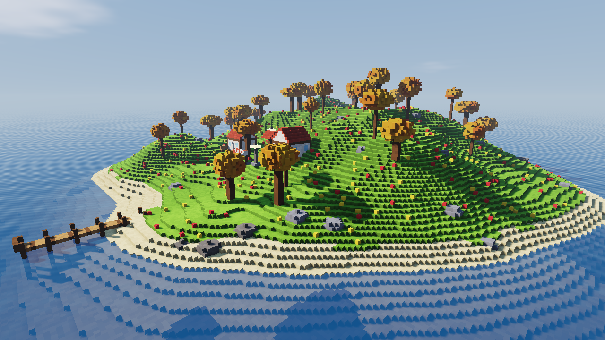
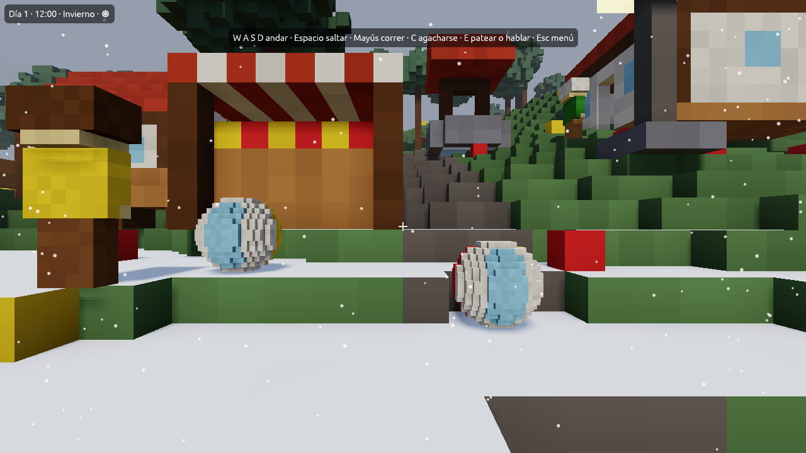
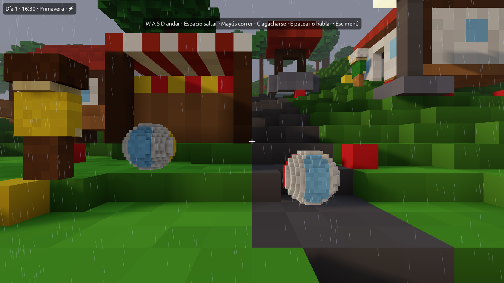
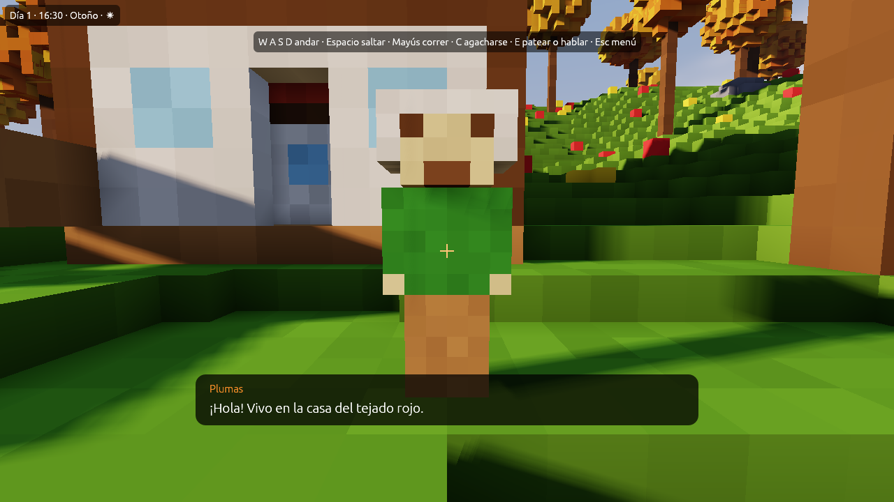

# La vida del mundo

Al jugar, un mundo de Foxy Engine no está quieto: pasan los días, cambian las
estaciones y el tiempo, los vecinos van a lo suyo y suena música.

| Otoño | Invierno | Tormenta |
|---|---|---|
|  |  |  |

## Día y noche

La hora avanza mientras juegas. Por defecto **un día dura 24 minutos de
verdad** (un minuto por hora). Arriba a la izquierda se ven el día, la hora,
la estación y el tiempo; un [marcador](interfaces.md) puede esconder ese reloj.

## Estaciones

Primavera, verano, otoño e invierno, cada una de **7 días** por defecto:

- En **verano** la hierba amarillea.
- En **otoño** las hojas se vuelven naranjas.
- En **invierno** todo se cubre de nieve.

## El tiempo

**Despejado**, **nublado**, **lluvia** (nieve en invierno) y **tormenta**,
con relámpagos y truenos. Si está activado, el tiempo **cambia solo** cada
pocas horas, según la estación.

## Ajustes de la vida

Sin nada elegido en el editor, el inspector de la derecha tiene el apartado
**Vida (al jugar)**:

| Ajuste | Qué hace | Por defecto |
|---|---|---|
| **Un día dura** | Cuánto dura un día, en minutos de verdad. 0 = la hora no avanza | 24 |
| **Días por estación** | Cuántos días dura cada estación | 7 |
| **Estación** | Con cuál empieza una partida nueva | Primavera |
| **Clima** | Con cuál empieza una partida nueva | Despejado |
| **Cambia solo** | Si el clima cambia por su cuenta | Sí |

Qué partes de la vida están activas (día y noche, clima, estaciones,
vecinos) lo deciden los [módulos](../referencia/modulos/index.md) del
proyecto y de la escena.

## Vecinos

Los <i class="fx fx-vecino"></i> **vecinos** son los habitantes de tu mundo.
Se colocan con **Crear → Vecino** o *Colocar objetos → Vecino*, y en el
inspector se les pone **nombre** y **lo que dice**, una frase por línea.

Al jugar, los vecinos:

- Pasean cerca de su sitio.
- Se paran a mirarte cuando te acercas.
- De noche vuelven a casa.
- Hablan contigo cuando pulsas <kbd>E</kbd> (o X / <i class="fx fx-ps-cuadrado" title="Cuadrado"></i> en el mando), con una de
  sus frases.

Con un guion puedes hacer que digan otra cosa según la hora o el tiempo, o
llevarlos a otro sitio. Mira [Guion del mundo](guiones.md).

## Sonido y música

Foxy Engine trae música de **día**, de **noche** y del **menú**, y efectos de
pasos, saltos, caídas, patadas, lluvia, truenos y pájaros. El volumen de la
música y de los efectos se cambia en *Opciones*.

> <i class="fx fx-nota"></i> **Nota.** Por ahora los sonidos se fabrican con código dentro del motor.
> Los sonidos grabados del proyecto se ponen con [Sonidos](sonidos.md).
