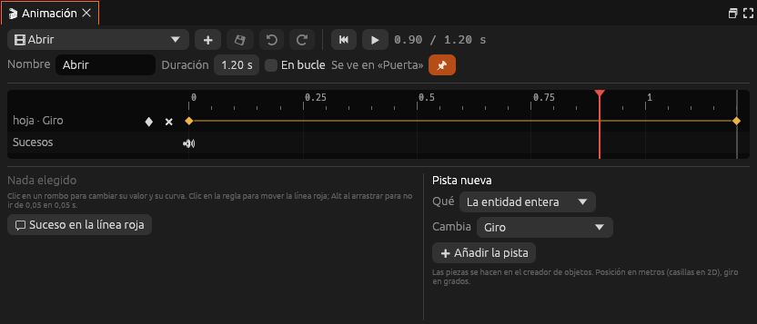

# Animación

**La línea de tiempo** de la animación o la cinemática abierta. Mientras se
edita, la entidad elegida (o la fijada) se mueve en la Vista.

| Parte | Qué hace |
|---|---|
| Lista de arriba | Abre otra animación o cinemática del proyecto |
| <i class="fx fx-mas"></i> | Crea una **Animación nueva** o una **Cinemática nueva** |
| <i class="fx fx-guardar"></i> | Guarda la animación |
| <i class="fx fx-deshacer"></i> <i class="fx fx-rehacer"></i> | Deshacen y rehacen los cambios de la animación |
| Principio y <i class="fx fx-jugar"></i> | Vuelven al segundo 0 y la reproducen en la Vista |
| **Nombre**, **Duración**, **En bucle** | Cómo se llama, cuánto dura y si se repite |
| **Se ve en «…»** y la chincheta | La entidad en la que se ve. La chincheta la fija aunque elijas otra |
| **Ver por su cámara** | En una cinemática, la Vista mira por su cámara |
| Regla | Los segundos. Un clic o arrastrar mueve la línea roja |
| Pistas | Una fila por pista, con sus claves (rombos). El rombo de la izquierda pone una clave; la cruz quita la pista |
| **Sucesos** | Los sonidos, partículas, avisos y frases de la animación |
| Abajo a la izquierda | Lo elegido: el segundo, el valor y la curva de una clave, o el tipo de un suceso |
| **Pista nueva** | **Qué** se mueve, **Cambia** qué propiedad y **Añadir la pista** |

Se abre desde *Ventana*, al hacer clic en una animación del panel
[Animaciones](animaciones.md) o en el espacio **Animar**.

Todo se explica en [Animación](../guia/animacion.md) y
[Cinemáticas](../guia/cinematicas.md).
