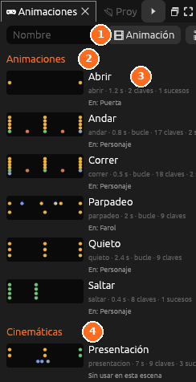

# Animaciones

**Todas las animaciones del proyecto**, en tres grupos: **Animaciones**
(`animaciones/`), **Cinemáticas** (`cinematicas/`) y **Animaciones de
sprites** (las de las hojas de sprites, en 2D).

| Nº | Elemento | Descripción |
|---|---|---|
| 1 | **Buscar** | Filtra por nombre. **Animación** crea una nueva |
| 2 | **Animaciones** | Los clips de `animaciones/` |
| 3 | **Clip** | Su nombre, duración, si va en bucle, sus claves y qué entidad lo usa |
| 4 | **Cinemáticas** | Las cinemáticas de `cinematicas/` |

Cada una enseña una miniatura con sus claves, cuánto dura, cuántas claves y
sucesos tiene y **en qué entidades de la escena se usa**: las que la tienen
en su Animador, en su máquina de estados o en una acción.

| Para… | Haz esto |
|---|---|
| Crear una | Escribe un nombre arriba y pulsa **Animación** o **Cinemática** |
| Abrirla en la línea de tiempo | Haz clic en su nombre |
| Duplicarla o borrarla | El menú **…** de su fila. Al borrar, va a la papelera del proyecto |
| Ver una animación de sprites | Se mueve en su miniatura; un clic la abre en el panel [Sprites](../guia/sprites.md) |

Todo se explica en [Animación](../guia/animacion.md).
