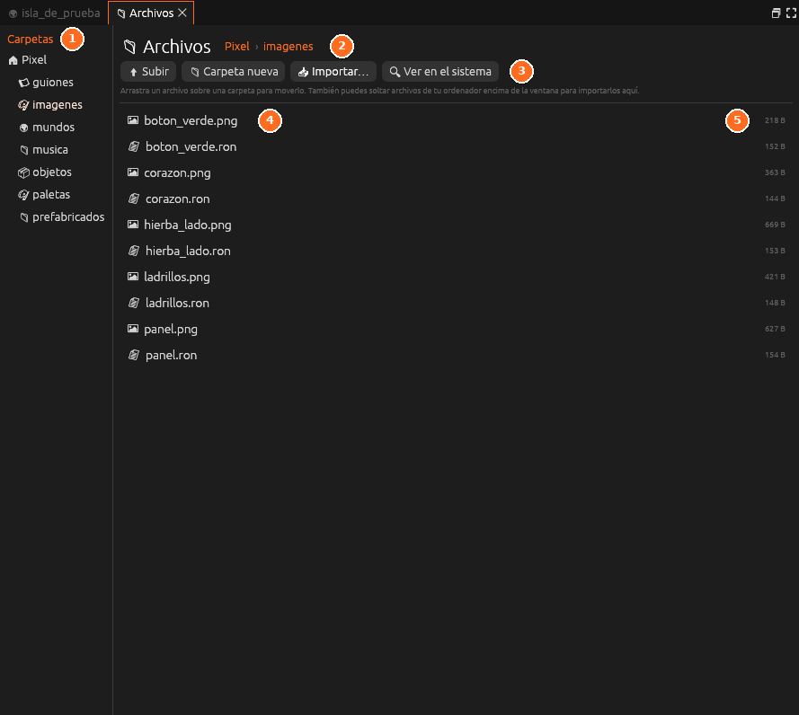

# Archivos

**Las carpetas y archivos del proyecto**, como en el Finder o el
Explorador: a la izquierda las carpetas y a la derecha lo que hay dentro.
Arriba, *Carpeta nueva*, *Importar…* y *Ver en el sistema*.

| Nº | Elemento | Descripción |
|---|---|---|
| 1 | **Carpetas** | Las carpetas del proyecto |
| 2 | **Ruta** | La carpeta que se muestra |
| 3 | **Barra** | Subir, Carpeta nueva, Importar… y Ver en el sistema |
| 4 | **Archivos** | Lo que hay en la carpeta. Doble clic lo abre en su panel |
| 5 | **Tamaño** | El tamaño de cada archivo |

Se abre desde *Proyecto → Archivos del proyecto*.

Todo se explica en [Archivos del proyecto](../guia/archivos.md).
