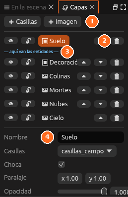

# Capas

El panel **Capas** lista las capas de la escena 2D, de la de delante a la de
atrás, y muestra los ajustes de la capa elegida y de la escena.

| Nº | Elemento | Descripción |
|---|---|---|
| 1 | **+ Casillas** y **+ Imagen** | Añaden una capa de ese tipo |
| 2 | **Capa activa** | La capa en la que se pinta. En cada fila, el ojo la muestra u oculta, el candado la bloquea, las flechas la mueven delante o detrás y la papelera la borra |
| 3 | **aquí van las entidades** | Dónde se dibujan los personajes y los objetos: las capas de encima los tapan |
| 4 | **Ajustes de la capa** | Nombre, casillas o imagen, paralaje, opacidad y si choca |

## Ajustes de la capa

| Ajuste | Qué hace |
|---|---|
| **Nombre** | Cómo se llama. Los guiones la nombran así |
| **Casillas** o **Imagen** | El juego de casillas o la imagen que dibuja |
| **Paralaje** | Cuánto se mueve con la cámara: 0 se queda quieta, 1 va con la escena |
| **Opacidad** | De transparente a opaca |
| **Choca** | Sus casillas chocan con el jugador y con los cuerpos |

Debajo de las capas, el apartado **Escena 2D** contiene los ajustes de toda
la escena: tamaño de la casilla, resolución, fondo, luz ambiente y cámara.
Ver [La escena 2D](../guia/juegos-2d.md#la-escena-2d).

> <i class="fx fx-consejo"></i> **Consejo.** Para un fondo con
> profundidad, usa varias capas de imagen con paralaje distinto: el cielo a
> 0, las montañas a 0,2 y las colinas a 0,5.

## Véase también

- [Mapas de casillas: capas](../guia/casillas.md#capas)
- [Casillas](casillas.md)
