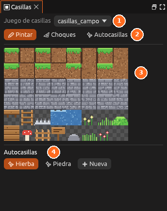
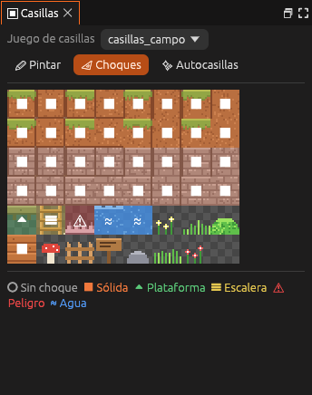
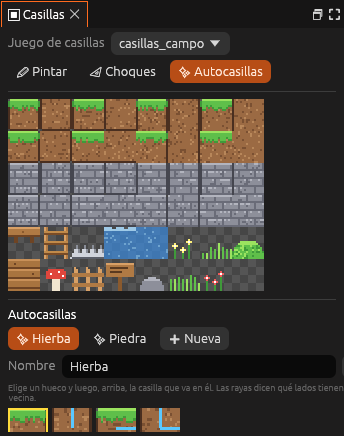

# Casillas

El panel **Casillas** contiene el juego de casillas de la capa activa de una
escena 2D. Sirve para elegir qué se pinta, cómo choca cada casilla y cómo se
montan las autocasillas.

| Nº | Elemento | Descripción |
|---|---|---|
| 1 | **Juego de casillas** | La imagen de casillas de la capa activa |
| 2 | **Modos** | **Pintar**, **Choques** o **Autocasillas**: qué hace un clic en una casilla |
| 3 | **Casillas** | Todas las casillas del juego. La elegida sale marcada |
| 4 | **Autocasillas** | Los terrenos que ponen solos sus bordes. **+ Nueva** crea otro |

## Modos

| Modo | Un clic en una casilla… |
|---|---|
| **Pintar** | La elige para el **Pincel**, el **Rectángulo** o el **Relleno** de la vista |
| **Choques** | Cambia su choque: sin choque, sólida, plataforma, escalera, peligro o agua |
| **Autocasillas** | La pone en el hueco elegido de la autocasilla que se edita |

| Choques | Autocasillas |
|---|---|
|  |  |

## Tareas

### Pintar con una casilla

1. En el panel [Capas](capas.md), elige la capa.
2. En el modo **Pintar**, haz clic en la casilla.
3. En la vista, elige el **Pincel** y pinta. El botón derecho borra.

### Cambiar cómo choca una casilla

1. Pulsa **Choques**.
2. Haz clic en la casilla hasta que muestre el choque que quieres.

> <i class="fx fx-nota"></i> **Nota.** Solo chocan las casillas de las
> capas que tienen **Choca** marcado.

Todo se explica en [Mapas de casillas](../guia/casillas.md).

## Véase también

- [Capas](capas.md)
- [Sprites](sprites.md): marcar una imagen como juego de casillas.
