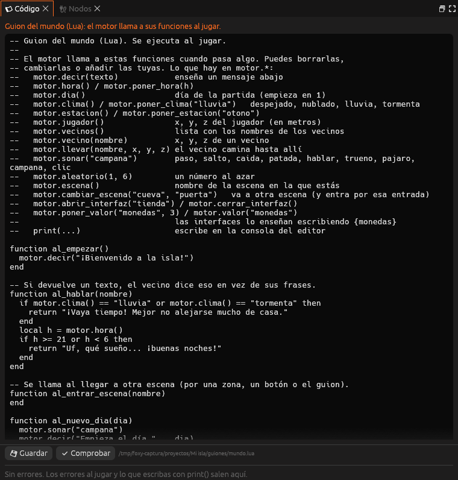

# Código

El **guion del mundo** (`mundo.lua`), en Lua. Arriba, una explicación de las
funciones que llama el motor; abajo, **Guardar**, **Comprobar** (busca
errores sin jugar) y la consola, donde sale lo que el guion escribe con
`print()`.

Se abre desde *Guion → mundo.lua* en el panel [Proyecto](proyecto.md), desde
*Herramientas → Código* o en el espacio **Programar**. Los errores van
también al [Registro](registro.md).

Todo se explica en [Guiones en Lua](../guia/guiones.md) y la
[API de Lua](../referencia/lua.md).
