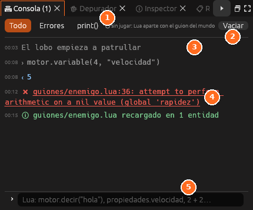

# Consola

La **Consola** enseña lo que escriben los guiones con `print()` y sus errores,
y ejecuta Lua contra el juego en marcha.

| Nº | Elemento | Descripción |
|---|---|---|
| 1 | **Filtros** | **Todo**, **Errores** o solo **print()** |
| 2 | **Vaciar** | Borra los mensajes |
| 3 | **Mensajes** | Lo que escriben los guiones, con la hora |
| 4 | **Error** | Un clic abre el guion en la línea del error |
| 5 | **Lua en vivo** | Escribe una línea de Lua y pulsa <kbd>Intro</kbd> para ejecutarla contra el juego |

Está en el espacio **Programar**, en *Ventana → Consola* y, jugando, en la
ventana **Código** (<kbd>F7</kbd>).

| Parte | Qué hace |
|---|---|
| **Todo**, **Errores**, **print()** | Filtran la lista |
| Indicador | **Con el juego en marcha**, o **sin jugar** (un Lua aparte con el guion del mundo) |
| **Vaciar** | Borra la lista |
| Lista | Cada línea con su hora. Los errores van en rojo; **un clic abre el guion en esa línea** |
| Línea de abajo | Escribe Lua y pulsa <kbd>Intro</kbd>. El resultado sale en la lista. <kbd>↑</kbd> y <kbd>↓</kbd> recuperan lo anterior |

Con el juego parado en un punto de parada, la consola ve las variables de
la función parada, y se pueden leer y cambiar. Ver
[Recargar, consola y depurador](../guia/lua-depurar.md#la-consola).

## Véase también

- [Depurador](depurador.md)
- [Registro](registro.md)
- [Recargar, consola y depurador](../guia/lua-depurar.md)
