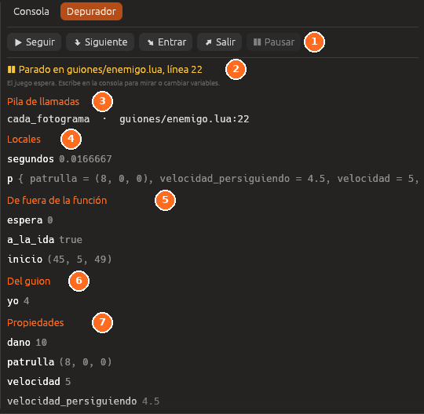

# Depurador

El **Depurador** para el juego en una línea de un guion y enseña cómo se ha
llegado ahí y el valor de todas las variables.

| Nº | Elemento | Descripción |
|---|---|---|
| 1 | **Pasos** | **Seguir**, **Siguiente**, **Entrar**, **Salir** y **Pausar** |
| 2 | **Dónde está parado** | El guion y la línea |
| 3 | **Pila de llamadas** | Las funciones por las que se ha llegado ahí |
| 4 | **Locales** | Las variables de la función |
| 5 | **De fuera de la función** | Las variables `local` del guion que usa la función |
| 6 | **Del guion** | Las variables propias del guion, como `yo` |
| 7 | **Propiedades** | Los valores de la tabla `propiedades` para esta entidad |

Está en el espacio **Programar**, en *Ventana → Depurador* y, jugando, en la
ventana **Código** (<kbd>F7</kbd>), que se abre sola al pararse.

| Parte | Qué hace |
|---|---|
| **Seguir** (<kbd>F6</kbd>) | Sigue hasta el siguiente punto de parada |
| **Siguiente** (<kbd>F10</kbd>) | La siguiente línea de esta función |
| **Entrar** (<kbd>F11</kbd>) | La siguiente línea, entrando en las funciones |
| **Salir** (<kbd>Mayús</kbd>+<kbd>F11</kbd>) | Hasta volver a quien llamó a esta función |
| **Pausar** | Para en la siguiente línea de un guion que se ejecute |
| **Pila de llamadas** | Las funciones por las que se ha llegado. **Ir a la línea** abre cada una |
| **Locales**, **De fuera de la función**, **Del guion**, **Propiedades** | Las variables y sus valores |
| **Puntos de parada** | Todos los del proyecto, con **Quitar** y **Quitar todos** |

Los puntos de parada se ponen con un clic a la izquierda del número de
línea, en el panel [Código](codigo.md). Ver
[Recargar, consola y depurador](../guia/lua-depurar.md#el-depurador).

## Véase también

- [Consola](consola.md)
- [Depurar los nodos](../guia/nodos-depurar.md)
