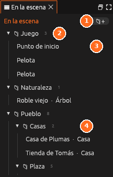

# En la escena

**Todo lo que hay en la escena abierta**: objetos, vecinos, zonas, puntos de
entrada… ordenado en carpetas. Un clic elige un objeto (y el
[Inspector](inspector.md) enseña sus opciones); <i class="fx fx-ver"></i>
**Ver** (<kbd>F</kbd>) lleva la cámara hasta él.

| Nº | Elemento | Descripción |
|---|---|---|
| 1 | **Carpeta nueva** | Crea una carpeta para ordenar la escena |
| 2 | **Carpeta** | Agrupa entidades. El número dice cuántas tiene. Se pliega con la flecha |
| 3 | **Entidad** | Un clic la elige y el Inspector muestra sus opciones |
| 4 | **Subcarpeta** | Las carpetas se pueden anidar |

El <i class="fx fx-carpeta-nueva"></i> de arriba crea una carpeta. Los
objetos se arrastran de una carpeta a otra (o **clic derecho → Mover a**), y
el número al lado de cada carpeta dice cuántos tiene.

**Suelta un objeto encima de otro** para meterlo dentro: sale debajo de él,
con sangría, y se mueve con él. Ver
[Objetos libres y jerarquía](../guia/objetos-libres.md).

Todo se explica en [Ordenar la escena](../guia/carpetas.md).
