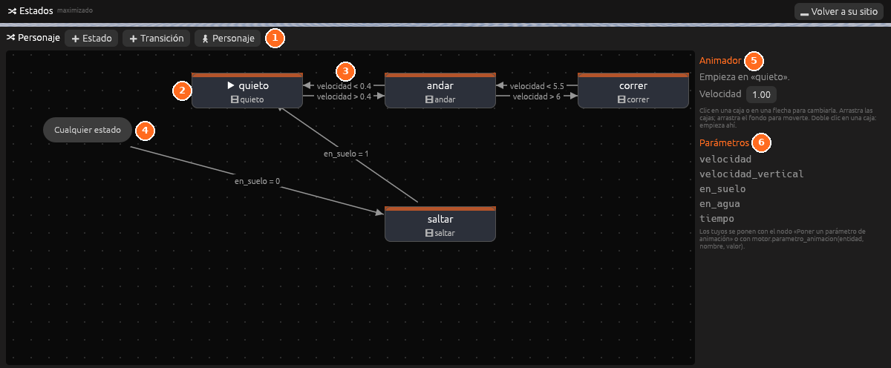

# Estados

**La máquina de estados** del componente Animador de la objeto elegido: qué
animación usa en cada momento y cuándo cambia de una a otra.

| Nº | Elemento | Descripción |
|---|---|---|
| 1 | **Barra** | **Estado**, **Transición** y **Personaje** (una máquina ya hecha) |
| 2 | **Estado inicial** | El estado con <i class="fx fx-jugar"></i> es con el que empieza la máquina |
| 3 | **Transición** | Una flecha con su condición |
| 4 | **Cualquier estado** | Las flechas que salen de aquí valen desde todos los estados |
| 5 | **Lo elegido** | Los ajustes del estado o la flecha elegidos, o del Animador |
| 6 | **Parámetros** | Los valores que pone el motor y que usan las condiciones |

| Parte | Qué hace |
|---|---|
| **Estado** | Añade un estado (una caja) |
| **Transición** | Añade una flecha entre dos estados |
| **Personaje** | Hace la máquina de un personaje: quieto, andar, correr y saltar |
| Lienzo | Los estados y sus flechas. <i class="fx fx-jugar"></i> marca el estado del principio. **Cualquier estado** es el origen de las flechas que valen desde todos |
| Lado derecho | Lo elegido: el nombre, la animación y la velocidad de un estado, o las condiciones, la espera y la mezcla de una flecha |
| **Parámetros** | Los parámetros que pone el motor. Jugando, con su valor de ahora |

Un clic elige una caja o una flecha; las cajas se arrastran y el fondo
también, para moverse. Doble clic en una caja hace que la máquina empiece
ahí. Jugando, el estado de ahora sale resaltado.

Si el objeto no tiene Animador, el panel ofrece **Añadir un Animador**.

Todo se explica en [Animación: máquina de estados](../guia/animacion.md#máquina-de-estados).
