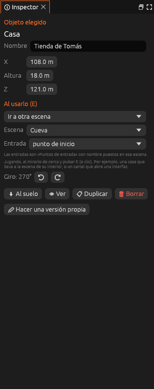

# Inspector

El inspector **cambia según lo que estés haciendo**:

- Con una herramienta de bloques: el **pincel** (forma, tamaño, simetría) y
  los **materiales**.
- Con *Colocar objetos*: la **lista de objetos** para colocar.
- Con un objeto elegido: su **nombre**, posición, giro, y
  <i class="fx fx-usar"></i> **Al usarlo (E)**, lo que pasa cuando el jugador
  lo usa. Abajo, *Duplicar*, *Ver* y *Borrar*.
- Sin nada elegido: el **terreno** de la escena y cómo pasa el **tiempo**
  (duración del día, estación, clima).

Ver [Construir el mundo](../guia/mundo.md) y [La vida del mundo](../guia/vida.md).
