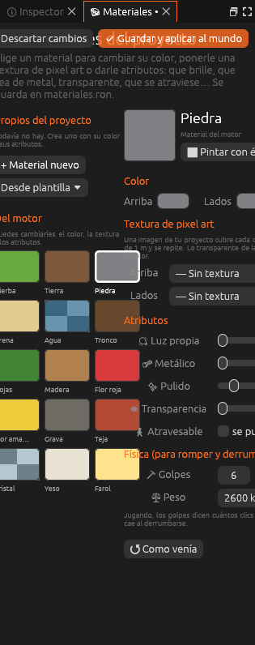

# Materiales

**La paleta de materiales del mundo**: los del motor y los del proyecto. Al
elegir uno se ven sus propiedades: color, textura de pixel art, luz propia,
metal, pulido, transparencia, y cómo se rompe y se derrumba.
**Guardar y aplicar al mundo** pone los cambios en la escena.

Se abre desde *Herramientas → Materiales*, desde el panel
[Proyecto](proyecto.md) o en el espacio **Pixel art**.

Todo se explica en [Materiales](../guia/materiales.md).
