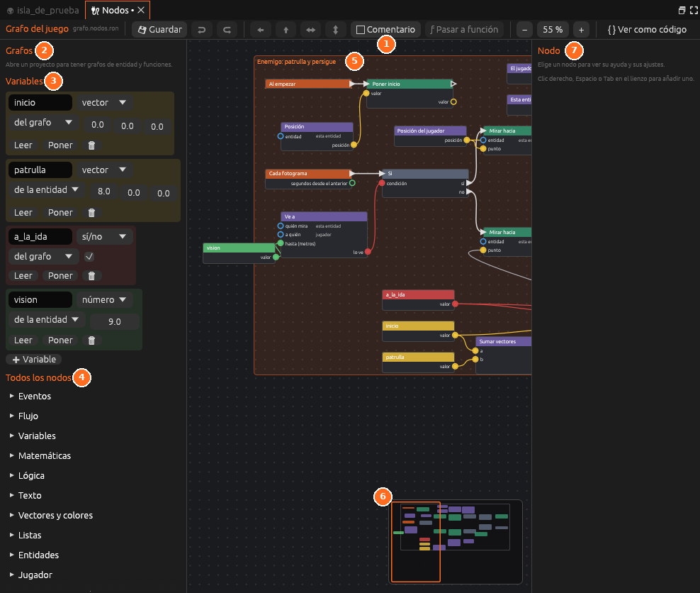
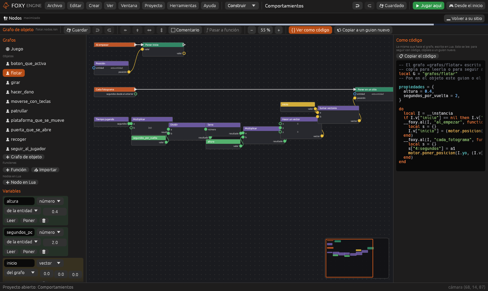

# Nodos

El editor de grafos de nodos: la forma de programar el juego sin escribir
código.

| Nº | Elemento | Descripción |
|---|---|---|
| 1 | **Barra** | Guardar, deshacer, alinear, comentario, pasar a función, zoom, **Ver como código** y **Copiar a un guion nuevo** |
| 2 | **Grafos** | Los grafos del proyecto: del juego, de escena, de objeto, funciones y nodos en Lua |
| 3 | **Variables** | Las variables del grafo, con su tipo, su alcance y su valor inicial |
| 4 | **Todos los nodos** | La paleta de nodos por categorías. Se arrastran al lienzo |
| 5 | **Comentario** | Un recuadro que agrupa y explica un trozo del grafo |
| 6 | **Minimapa** | Todo el grafo en pequeño. Un clic lleva a esa parte |
| 7 | **Nodo** | La ayuda y los ajustes del nodo elegido |

- **Izquierda.** La lista de **grafos** del proyecto (el del juego, los de
  escena, los de objeto, las funciones y los nodos en Lua), las
  **variables** del grafo abierto, o la firma si es una función, y la
  **paleta** con todos los nodos por categorías.
- **Centro.** El lienzo, con su minimapa.
- **Derecha.** Los ajustes y la ayuda del nodo elegido, o el Lua que sale
  del grafo con **{ } Ver como código** (solo se lee; el grafo no cambia).
- **Barra superior.** Guardar, deshacer y rehacer, alinear y repartir,
  **Comentario**, **Pasar a función**, el zoom, **{ } Ver como código** y,
  en los grafos de objeto, **📜 Copiar a un guion nuevo**, que crea un
  guion igual sin borrar el grafo.

Se abre desde el panel [Proyecto](proyecto.md) (*Guion → Nodos*), desde
*Herramientas → Nodos* o en el espacio **Programar**, junto al panel
[Código](codigo.md). Jugando, <kbd>F8</kbd> enseña el grafo abierto encima
del juego.

Todo se explica en [Nodos](../guia/nodos.md) y en
[Depurar y ver como código](../guia/nodos-depurar.md).
