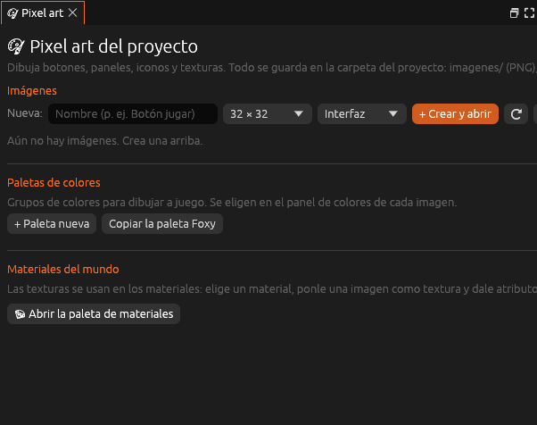

# Pixel art

**La biblioteca de pixel art del proyecto**: las imágenes (botones, iconos,
texturas…), las paletas de colores y las texturas de los materiales. Arriba
se crea una imagen nueva con su nombre y su tamaño; al abrirla, se dibuja en
la [Vista](vista.md).

Se abre desde *Herramientas → Pixel art* o en el espacio **Pixel art**.

Todo se explica en [Pixel art](../guia/pixel-art.md).
