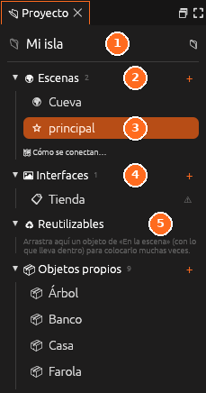

# Proyecto

**Todo lo que tiene el proyecto en un solo sitio.** Un clic abre cualquier
cosa, y el <i class="fx fx-mas"></i> de cada grupo crea una nueva.

| Nº | Elemento | Descripción |
|---|---|---|
| 1 | **Proyecto** | El nombre del proyecto abierto |
| 2 | **Escenas** | Las escenas del proyecto. El <i class="fx fx-mas"></i> crea una nueva |
| 3 | **Escena inicial** | La <i class="fx fx-estrella"></i> marca la escena con la que empieza el juego; la resaltada es la abierta |
| 4 | **Interfaces** | Menús, marcadores y carteles. El <i class="fx fx-aviso"></i> avisa de que nada abre esa interfaz |
| 5 | **Objetos propios** | Los objetos de cubitos del proyecto. El número dice cuántos hay |

Cada grupo lista una clase de recurso:

| Grupo | Qué lista | Capítulo |
|---|---|---|
| <i class="fx fx-mundo"></i> **Escenas** | Las escenas. La <i class="fx fx-estrella"></i> marca la inicial. *Cómo se conectan…* abre el mapa de escenas | [Escenas](../guia/escenas.md) |
| <i class="fx fx-interfaz"></i> **Interfaces** | Menús, marcadores y carteles | [Interfaces](../guia/interfaces.md) |
| **♻ Reutilizables** | Los objetos reutilizables. Clic para editar el original en su pestaña; **suelta aquí un objeto** de *En la escena* para hacerlo reutilizable | [Objetos reutilizables](../guia/reutilizables.md) |
| <i class="fx fx-objeto"></i> **Objetos propios** | Los objetos hechos con cubitos | [Crear objetos propios](../guia/creador.md) |
| **Materiales** | La paleta de materiales | [Materiales](../guia/materiales.md) |
| <i class="fx fx-pixel"></i> **Pixel art** | Las imágenes, y *Biblioteca, paletas y texturas…* | [Pixel art](../guia/pixel-art.md) |
| <i class="fx fx-guion"></i> **Guiones** | `mundo.lua`, los guiones de objeto, los módulos y los nodos. **Guion nuevo** crea uno a partir de una plantilla | [Programar en Lua](../guia/programar-lua.md) |

Arriba están el nombre del proyecto y una <i class="fx fx-buscar"></i> lupa
que abre su carpeta. Sin proyecto (un mundo suelto), el panel ofrece
*Proyecto nuevo…* y *Abrir proyecto…*.

## Los avisos <i class="fx fx-aviso"></i>

Un <i class="fx fx-aviso"></i> al lado de algo avisa de que **todavía no se
podrá ver al jugar**: una escena a la que no lleva nada, una interfaz que
nada abre o un guion con errores. Pasa el ratón por encima para ver qué
falta.
