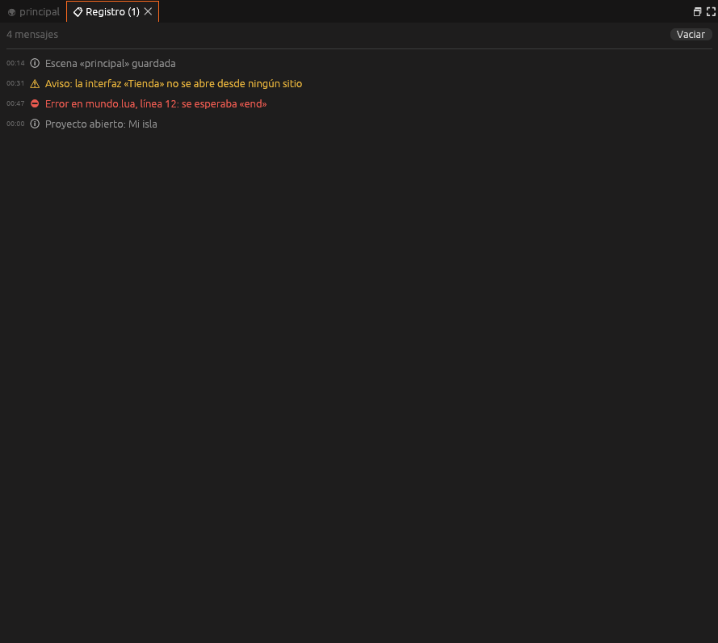

# Registro

**Todos los avisos del editor**, con su hora, del más nuevo al más viejo:

| Color | Qué es |
|---|---|
| Gris | Información: algo se guardó, se abrió… |
| Amarillo <i class="fx fx-aviso"></i> | Un aviso: algo que falta o que no se verá al jugar |
| Rojo | Un error: el guion no se pudo cargar, un archivo no se pudo guardar… |

**Vaciar** borra la lista. La [barra de estado](../empezar/editor.md#la-barra-de-estado)
enseña el último aviso; un clic en ella abre este panel, y **⛔ N** dice
cuántos errores hay.
