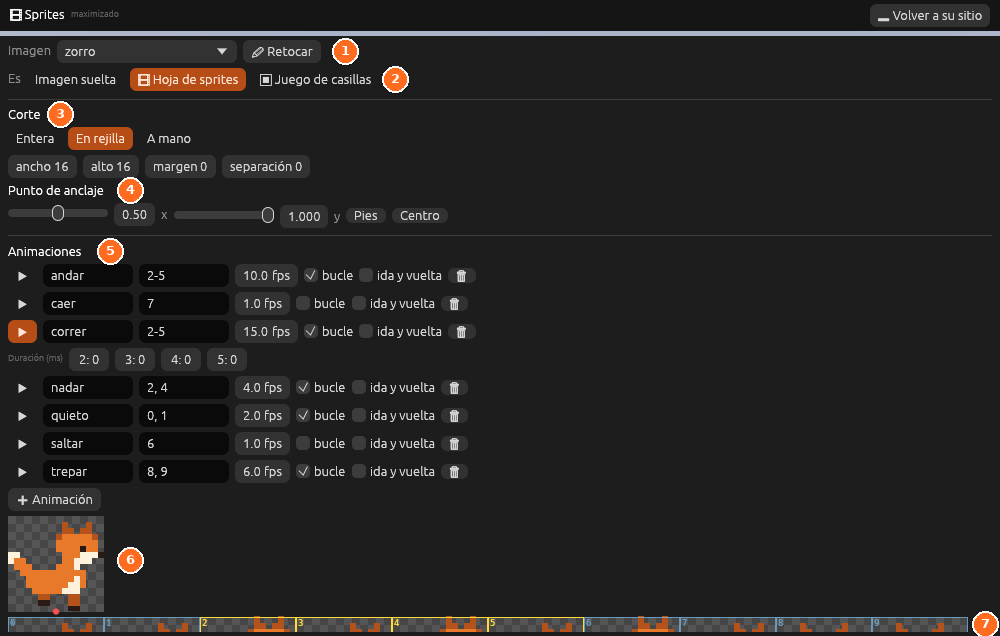

# Sprites

El panel **Sprites** es el gestor de las imágenes 2D del proyecto: corta una
hoja de sprites en fotogramas, fija su punto de anclaje y monta sus
animaciones.

| Nº | Elemento | Descripción |
|---|---|---|
| 1 | **Imagen** | La imagen de `imagenes/` que se edita. **Retocar** la abre en [Pixel art](pixel-art.md) |
| 2 | **Es** | **Imagen suelta**, **Hoja de sprites** o **Juego de casillas** |
| 3 | **Corte** | **Entera**, **En rejilla** (ancho, alto, margen y separación) o **A mano** |
| 4 | **Punto de anclaje** | El punto de cada fotograma que va en la posición del objeto. **Pies** y **Centro** lo ponen de golpe |
| 5 | **Animaciones** | Cada animación con sus fotogramas, su velocidad en fotogramas por segundo, si va en bucle y si va de ida y vuelta |
| 6 | Vista previa | La animación elegida, moviéndose, con el punto de anclaje en rojo |
| 7 | Fotogramas | Todos los fotogramas, numerados desde 0. Los de la animación elegida salen en amarillo |

## Tareas

### Crear una animación

1. Elige la imagen y comprueba que **Es** está en **Hoja de sprites**.
2. Pulsa **+ Animación** y escribe su nombre, por ejemplo `correr`.
3. En la casilla de fotogramas, escribe los números, como `2-5` o `0, 1`.
4. Ajusta los **fps** y marca **bucle** si debe repetirse.

Los cambios se guardan solos en `imagenes/<nombre>.ron`.

> <i class="fx fx-nota"></i> **Nota.** El jugador 2D elige solo la
> animación según lo que hace si se llaman `quieto`, `andar`, `correr`,
> `saltar`, `caer`, `trepar` o `nadar`. Ver
> [Animaciones del jugador](../guia/juegos-2d.md#animaciones-del-jugador).

Todo se explica en [Sprites](../guia/sprites.md).

## Véase también

- [Sprite](../referencia/componentes/sprite.md), el componente.
- [Animación](../guia/animacion.md): animaciones de objetos y cinemáticas.
