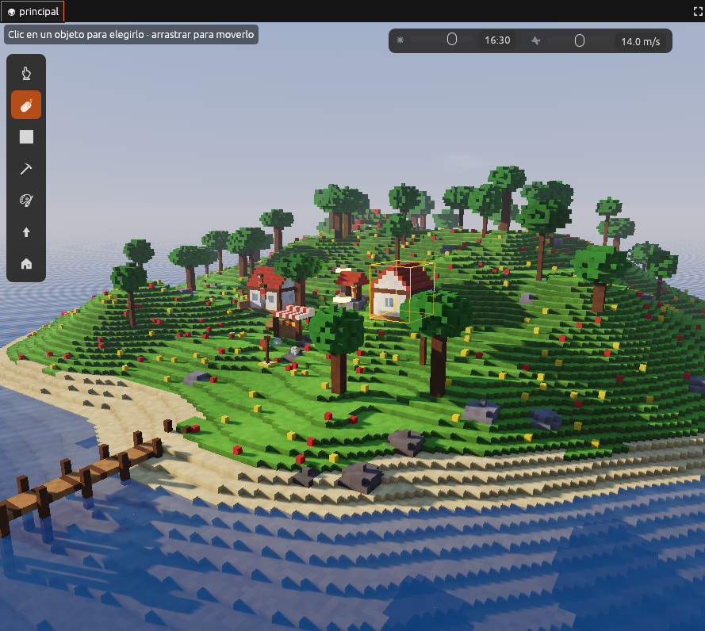

# Vista

La Vista es el panel del centro: **la escena en 3D**, donde se construye.
No se puede cerrar, pero sí [maximizar o sacar a otra ventana](../editor/espacio-de-trabajo.md),
por ejemplo para tenerla en un segundo monitor mientras programas en el
primero.

## Qué tiene

- A la izquierda, la **tira de herramientas**:

  | | Herramienta | Tecla |
  |---|---|---|
  | <i class="fx fx-cursor"></i> | Cursor (solo elegir) | <kbd>C</kbd> |
  | <i class="fx fx-mover"></i> | Elegir y mover | <kbd>V</kbd> |
  | <i class="fx fx-poner"></i> | Poner bloques | <kbd>B</kbd> |
  | <i class="fx fx-quitar"></i> | Quitar bloques | <kbd>E</kbd> |
  | <i class="fx fx-pintar"></i> | Pintar | <kbd>P</kbd> |
  | <i class="fx fx-colocar"></i> | Colocar objetos | <kbd>O</kbd> |

- Arriba a la izquierda, una línea que recuerda qué hace la herramienta.
- Arriba a la derecha, la **hora** del editor y la **velocidad** de la
  cámara.

## Otros documentos

La Vista también enseña lo que abras desde el panel
[Proyecto](proyecto.md): un **objeto** en el creador, una **imagen** en el
lienzo de pixel art o una **interfaz**. Cuando hay más de uno abierto, salen
pestañas encima para cambiar entre ellos; la <i class="fx fx-cerrar"></i>
cierra cada uno y un punto (•) marca lo que tiene cambios sin guardar.

Cómo moverse y construir: [Construir el mundo](../guia/mundo.md).
