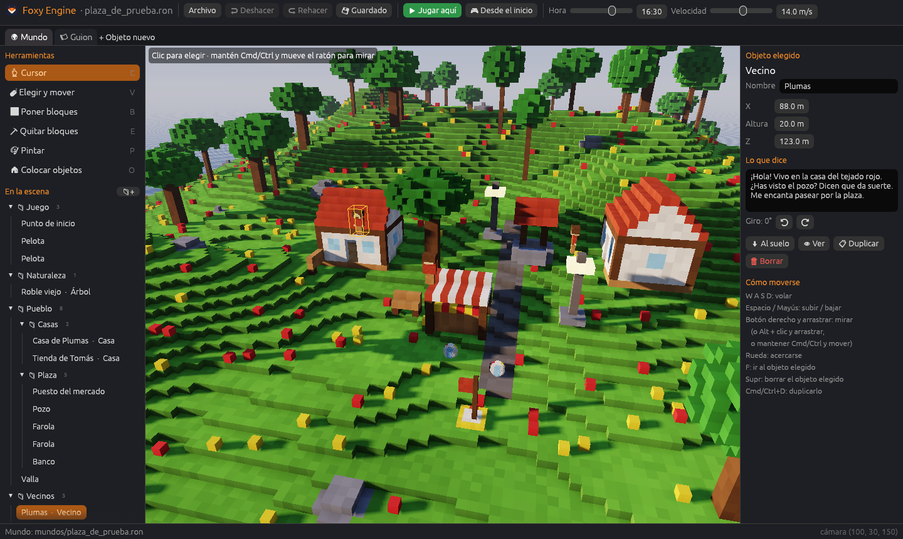

  
  
  
El motor para construir mundos de bloques vivos, sin pelearte con el código.

# Bienvenida

**Foxy Engine** es un motor de juegos de escritorio para **Mac, Windows y
Linux**. Con él construyes una isla de bloques, la llenas de casas, árboles,
vecinos y pelotas, diseñas menús y carteles, dibujas tus propias texturas en
pixel art y, cuando quieras, le das vida con pequeños guiones en Lua. Todo
desde un mismo editor, y todo se guarda en archivos de texto que puedes leer,
copiar y subir a GitHub.

Este manual explica cómo usarlo, desde la instalación hasta el último detalle
de los archivos.

## Qué puedes hacer

  <a href="guia/mundo.html"><strong>🌍 Construir</strong>Pinta el terreno con pinceles de bloques y coloca casas, árboles y vecinos.</a>
  <a href="guia/creador.html"><strong>📦 Crear objetos</strong>Modela tus propios objetos de bloques y úsalos en cualquier mundo.</a>
  <a href="guia/pixel-art.html"><strong>🎨 Dibujar</strong>Haz botones, iconos y texturas para los materiales del mundo.</a>
  <a href="guia/interfaces.html"><strong>🖼 Diseñar interfaces</strong>Menús, marcadores y carteles que funcionan con ratón, teclado y mando.</a>
  <a href="guia/escenas.html"><strong>🗺 Unir escenas</strong>Una isla, una cueva, el interior de una casa… y puertas entre ellas.</a>
  <a href="guia/guiones.html"><strong>📜 Programar</strong>Guiones en Lua para que el mundo reaccione a lo que pasa.</a>

## Cómo leer este manual

- **Primeros pasos** es para empezar: instalar el motor, crear tu primer
  proyecto y conocer el editor. Si es tu primera vez, empieza aquí y léelo en
  orden.
- **Guía del editor** explica cada parte del editor con ejemplos. Se puede leer
  en cualquier orden.
- **Referencia** es para consultar: todas las teclas, todas las funciones de
  Lua, todas las acciones, objetos y materiales, y el formato de cada archivo.
- **Apéndices** recoge la solución a los problemas más comunes, un glosario y
  el historial de versiones.

Usa el buscador (la lupa de arriba, o la tecla <kbd>S</kbd>) para encontrar
cualquier palabra.

## Convenciones

| Así se escribe | Significa |
|---|---|
| <kbd>Cmd</kbd>/<kbd>Ctrl</kbd>+<kbd>S</kbd> | <kbd>Cmd</kbd> en Mac, <kbd>Ctrl</kbd> en Windows y Linux |
| **Guardar** | Un botón, una pestaña o una opción del editor |
| *Colocar objetos → Mis objetos* | Un camino dentro del editor |
| `mundos/principal.ron` | Un archivo o una carpeta, dentro de la carpeta del proyecto |
| `motor.decir(texto)` | Código que se escribe tal cual |

> **Consejo.** Los recuadros como este dan trucos que ahorran tiempo.

## Medidas del mundo

Foxy Engine mide en **metros**. El terreno está hecho de **cubitos de medio
metro**, y dos por dos cubitos forman un **bloque** de 1 m. Algunos números de
los archivos van en cubitos (lo verás indicado en cada caso). El mar está a
10 m de altura y la isla de prueba ocupa de 0 a 192 m en los ejes x y z.

## Estado del motor

Este manual describe Foxy Engine hasta las **escenas e interfaces**, después
de la Fase 4 (*vida*). La Fase 5 traerá Maxycraft al motor y la Fase 6 servirá
para exportar y publicar juegos. Mira el [historial de versiones](apendices/historial.md).
