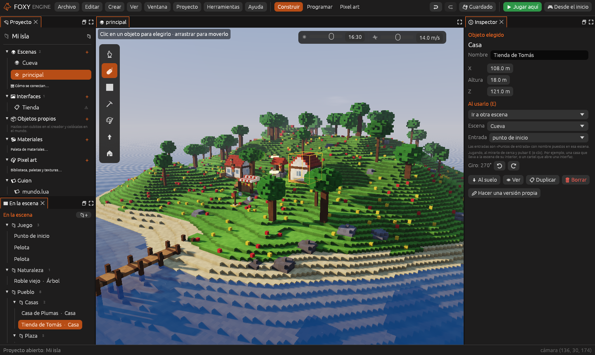
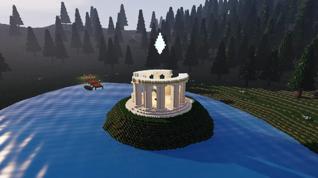
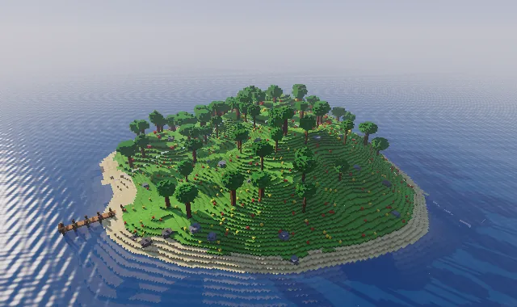
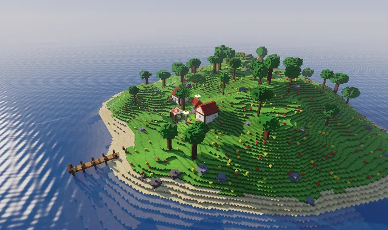
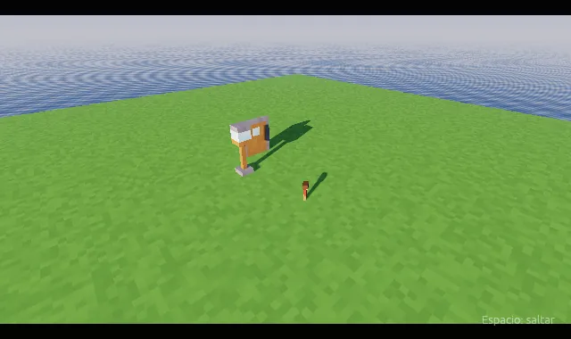
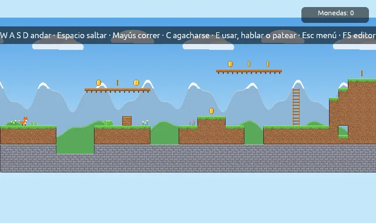
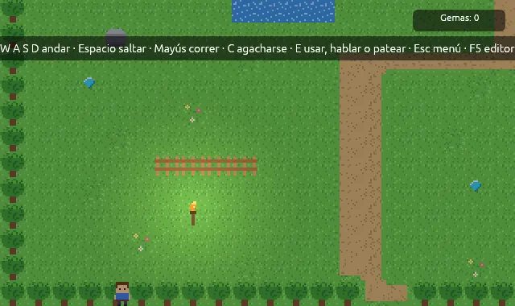
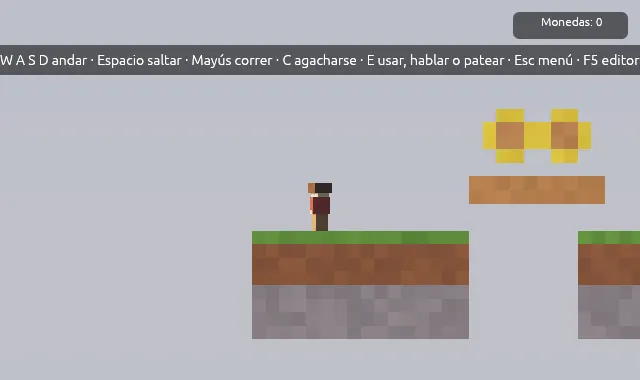

  
  
  
Motor de juegos vóxel y pixel art para Mac, Windows y Linux.

# Foxy Engine

**Foxy Engine** es un motor de juegos de escritorio para crear mundos de
cubitos (vóxeles) y juegos de pixel art, en 3D y en 2D. Reúne en un solo
editor todo lo necesario para hacer un juego: construir escenas, modelar
objetos, dibujar sprites y texturas, animar, diseñar menús y dar
comportamiento con nodos, sin escribir código, o con guiones en Lua. El
resultado se publica como una aplicación para Mac, Windows y Linux.

Este manual es la documentación oficial del motor. Sirve para aprender a
usarlo, para consultar cómo se hace algo concreto y para conocer todo lo que
permite crear.

## Escaparate

Cada plantilla es un proyecto completo con el que empezar. Las animaciones
están hechas con el propio motor.

  <figure><figcaption><strong>Demo técnica</strong>El templo del zorro: rayos de sol en la niebla, mármol, oro, una ciudad entera y el mar.</figcaption></figure>
  <figure><figcaption><strong>Isla vóxel</strong>Una isla generada con colinas, playa y árboles, lista para construir encima.</figcaption></figure>
  <figure><figcaption><strong>Isla de ejemplo</strong>Un pueblo con mercado, vecinos que hablan, día y noche, clima y estaciones.</figcaption></figure>
  <figure><figcaption><strong>Personaje animado</strong>Un personaje por piezas que anda, corre y salta, una puerta animada y una cinemática.</figcaption></figure>
  <figure><figcaption><strong>Plataformas 2D</strong>Un nivel de pixel art con monedas, escaleras, agua, pinchos y una meta.</figcaption></figure>
  <figure><figcaption><strong>Aventura cenital</strong>Un prado visto desde arriba, con una vecina, antorchas y gemas que buscar.</figcaption></figure>
  <figure><figcaption><strong>Plataformas vóxel</strong>Un nivel de cubitos visto de lado, con cámara ortográfica.</figcaption></figure>

## Qué se puede hacer

  <a href="guia/mundo.html"><strong><i class="fx fx-mundo"></i>Construir</strong>Esculpir el terreno con pinceles y generadores, y colocar objetos y objetos.</a>
  <a href="guia/creador.html"><strong><i class="fx fx-objeto"></i>Modelar</strong>Objetos de cubitos propios, o importados de MagicaVoxel y Qubicle.</a>
  <a href="guia/juegos-2d.html"><strong><i class="fx fx-pixel"></i>Juegos 2D</strong>Sprites, hojas de animación y mapas de casillas con autocasillas.</a>
  <a href="guia/animacion.html"><strong><i class="fx fx-jugar"></i>Animar</strong>Línea de tiempo, máquinas de estados, personajes por piezas y cinemáticas.</a>
  <a href="guia/nodos.html"><strong><i class="fx fx-mapa"></i>Programar sin código</strong>Comportamientos con nodos unidos por cables, con depuración en vivo.</a>
  <a href="guia/programar-lua.html"><strong><i class="fx fx-guion"></i>Programar en Lua</strong>Guiones con autocompletado, recarga en caliente, consola y depurador.</a>
  <a href="guia/interfaces.html"><strong><i class="fx fx-interfaz"></i>Diseñar interfaces</strong>Menús, marcadores y carteles que funcionan con ratón, teclado y mando.</a>
  <a href="publicar/publicar.html"><strong><i class="fx fx-mando"></i>Publicar</strong>Aplicaciones para Mac, Windows y Linux con un clic.</a>

## Por dónde empezar

1. [Instala Foxy Engine](empezar/instalar.md).
2. Sigue el [tutorial del primer juego 3D](empezar/primer-proyecto.md) o el
   del [primer juego 2D](empezar/primer-juego-2d.md).
3. Consulta el [Manual del editor](empezar/editor.md) cuando necesites saber
   qué hace un panel.

## Organización del manual

| Parte | Contenido |
|---|---|
| **Empezar** | Instalación, la pantalla de inicio, la creación de un proyecto y los dos primeros tutoriales. Se recomienda leerla en orden |
| **Manual del editor** | Una página por cada panel, con su captura anotada, y la personalización del espacio de trabajo. Se consulta en cualquier orden |
| **Conceptos** | Las ideas en las que se basa el motor: proyectos, escenas, objetos, componentes y lógica |
| **Guías prácticas** | Tutoriales de principio a fin y guías de cada tarea, agrupadas por tema |
| **Referencia** | Componentes, módulos, acciones, nodos, API de Lua, formatos de archivo, atajos y línea de comandos. Las referencias de componentes, nodos y Lua las genera el propio motor |
| **Apéndices** | Solución de problemas, glosario, capturas, marca e historial de versiones |

El buscador (la lupa de la parte superior o la tecla <kbd>S</kbd>) encuentra
cualquier término en todo el manual.

## Convenciones

| Formato | Significado |
|---|---|
| <kbd>Cmd</kbd>/<kbd>Ctrl</kbd>+<kbd>S</kbd> | <kbd>Cmd</kbd> en Mac; <kbd>Ctrl</kbd> en Windows y Linux |
| **Guardar** | Un botón, una pestaña, un menú o una opción del editor, con su nombre exacto |
| **Proyecto → Ajustes del proyecto** | Una opción dentro de un menú |
| `mundos/principal.ron` | Un archivo o una carpeta, relativos a la carpeta del proyecto |
| `motor.decir(texto)` | Código que se escribe tal cual |
| ① ② ③ | Los números de una captura anotada, explicados en la tabla de debajo |

> <i class="fx fx-nota"></i> **Nota.** Información adicional sobre lo que se
> está explicando.

> <i class="fx fx-consejo"></i> **Consejo.** Un atajo o una práctica
> recomendada.

> <i class="fx fx-aviso"></i> **Importante.** Algo que puede hacer perder
> trabajo si no se tiene en cuenta.

## Unidades

Foxy Engine mide en **metros**. El terreno está formado por **cubitos** de
0,5 m; dos por dos por dos cubitos forman un **bloque** de 1 m. Las escenas
2D se miden en **casillas**. Ver [Escenas 3D y 2D](conceptos/escenas-3d-2d.md).

## Versión

La versión del motor que describe este manual aparece arriba a la derecha y
al pie de cada página. Los cambios de cada versión están en el
[historial de versiones](apendices/historial.md).
