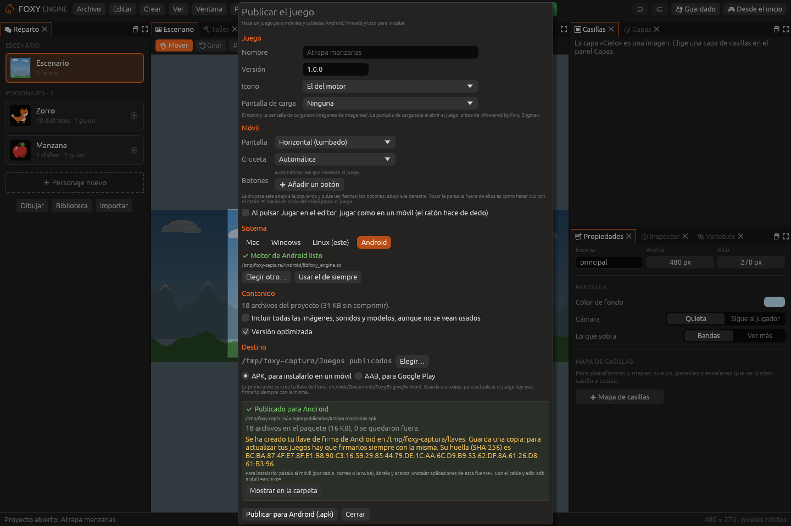
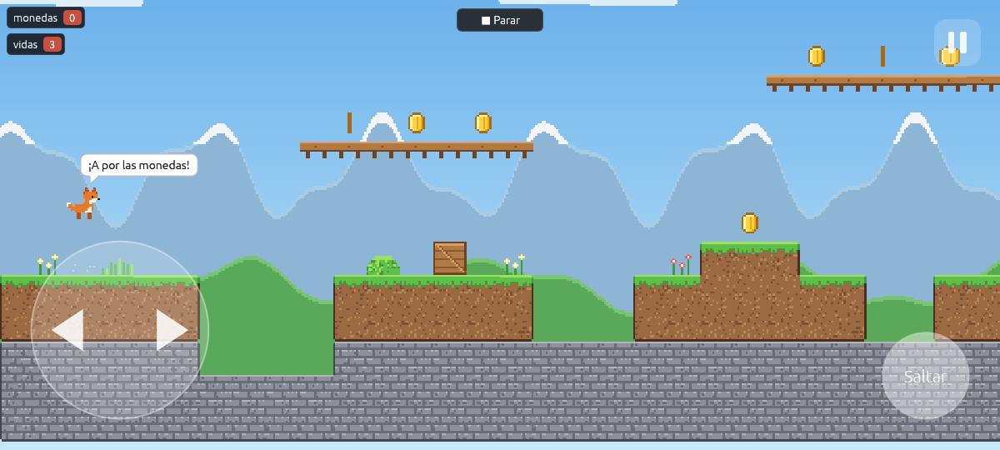
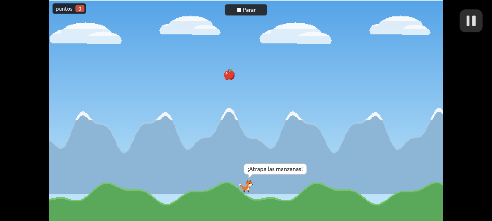

# Android

Los juegos **2D** se pueden publicar para móviles y tabletas Android. Sale
un archivo que se instala en el móvil (APK) o que se sube a Google Play
(AAB). En el móvil, el juego se maneja tocando la pantalla: Foxy Engine
pone una cruceta y botones cuando el juego los necesita.



## Preparar el motor de Android (una sola vez)

Un juego de Android lleva dentro un Foxy Engine compilado para móviles. Se
prepara una vez, en la Terminal, desde la carpeta del motor:

```sh
cd ~/foxy-engine
scripts/preparar-android.sh
```

La primera vez tarda un rato, porque descarga las herramientas de Android
(el NDK, más o menos 1 GB). Al terminar deja el motor en la carpeta
`Foxy Engine/Android`, junto al editor. Desde entonces, la ventana
**Publicar** lo encuentra sola y dice **Motor de Android listo**.

Cuando actualices Foxy Engine con `scripts/instalar-mac.sh`, el motor de
Android se vuelve a preparar solo, para que siempre sea de la misma versión
que el editor.

> <i class="fx fx-consejo"></i> **Consejo.** Si tienes el motor en otro
> sitio, pulsa **Elegir otro…** y busca el archivo `libfoxy_engine.so`.
> **Usar el de siempre** vuelve al de la carpeta `Android`.

## Publicar

1. Elige **Proyecto › Publicar…**.
2. En **Sistema**, elige **Android**.
3. Elige el formato:
   - **APK, para instalarlo en un móvil**: para probarlo tú o pasárselo a
     tus amigos.
   - **AAB, para Google Play**: el que pide Google Play Console.
4. Ajusta la sección **Móvil** (más abajo).
5. Pulsa **Publicar para Android (.apk)** o **Publicar para Android
   (.aab)**.

El archivo sale en la carpeta de salida, con el nombre del juego.

| Formato | Qué sale | Para qué |
|---|---|---|
| APK | `Nombre.apk` | Instalarlo directamente en un móvil |
| AAB | `Nombre.aab` | Subirlo a Google Play Console |

> <i class="fx fx-aviso"></i> **Importante.** Android está pensado para
> proyectos 2D. Un proyecto 3D también se publica, pero la ventana avisa de
> que los móviles son más lentos que un ordenador.

## La sección Móvil

En vez de **Ventana**, con Android elegido la ventana muestra **Móvil**:

| Opción | Qué hace |
|---|---|
| **Pantalla** | **Horizontal (tumbado)** o **Vertical (de pie)**: cómo se coge el móvil. El juego se ajusta a cualquier tamaño de pantalla. |
| **Cruceta** | **Automática** (la pone si el juego usa las flechas), **Ninguna**, **Izquierda y derecha** o **Cuatro flechas**. |
| **Botones** | Hasta tres botones, cada uno con su texto y la tecla que pulsa. Si no añades ninguno, salen automáticamente los que necesite el juego (por ejemplo **Saltar** si usa la barra espaciadora). |

Cómo se juega en el móvil:

- La **cruceta** sale abajo a la izquierda y pulsa las flechas.
- Los **botones** salen abajo a la derecha.
- **Tocar la pantalla** fuera de ellos es como hacer clic con el ratón, y
  arrastrar el dedo es como mover el ratón.
- El botón de **pausa** (arriba a la derecha) y el botón de **atrás** del móvil pausan
  el juego.
- Si el juego pregunta algo, sale el teclado del móvil.



### Probarlo en el editor

Marca **Al pulsar Jugar en el editor, jugar como en un móvil (el ratón
hace de dedo)**. Al pulsar **Jugar**, el juego sale con los controles
táctiles y el ratón hace de dedo, para ver cómo quedará sin tener que
publicarlo.



## La llave de firma

Android solo instala juegos **firmados**. La primera vez que publicas para
Android, Foxy Engine crea tu llave de firma en la carpeta
`Foxy Engine/Android` (el archivo `llave-de-firma.der`) y avisa con su
huella. Desde entonces firma con ella todos tus juegos.

> <i class="fx fx-aviso"></i> **Importante.** Guarda una copia de la
> llave en un sitio seguro. Para actualizar un juego que ya está instalado,
> o que ya está en Google Play, hay que firmarlo **siempre con la misma**.
> Si la pierdes, el móvil no deja actualizarlo: hay que desinstalarlo y
> volver a instalarlo.

## Instalar el APK en un móvil

1. Pasa el archivo `.apk` al móvil: por cable, por correo o con la nube.
2. Ábrelo en el móvil.
3. Si el móvil lo pide, acepta **Instalar aplicaciones de esta fuente**.
4. Pulsa **Instalar** y abre el juego.

Con el cable y las herramientas de Android (`adb`) también se puede
instalar desde el ordenador:

```sh
adb install Nombre.apk
```

Sirve cualquier móvil Android 8 o más nuevo, de 64 bits (casi todos los de
los últimos años).

## Subir el AAB a Google Play

1. Entra en Google Play Console y crea la aplicación.
2. En **Producción** o **Prueba interna**, crea una versión nueva y sube
   `Nombre.aab`.

Google Play pide que cada actualización tenga un número mayor. Antes de
publicar una actualización, sube la **Versión** del juego (por ejemplo de
`1.0.0` a `1.0.1`). La ventana muestra el número que verá Google Play.

El nombre del paquete (por ejemplo `com.autor.juego`) sale del
identificador del juego. No lo cambies después de subirlo a Google Play,
porque para Google sería otra aplicación.

## Desde la línea de órdenes

```sh
foxy-engine --publicar <carpeta> --sistema android
foxy-engine --publicar <carpeta> --sistema android --aab
```

Con `--motor libfoxy_engine.so` se usa otro motor de Android.
