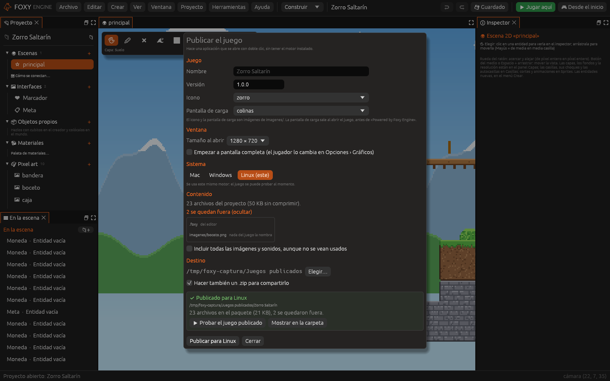
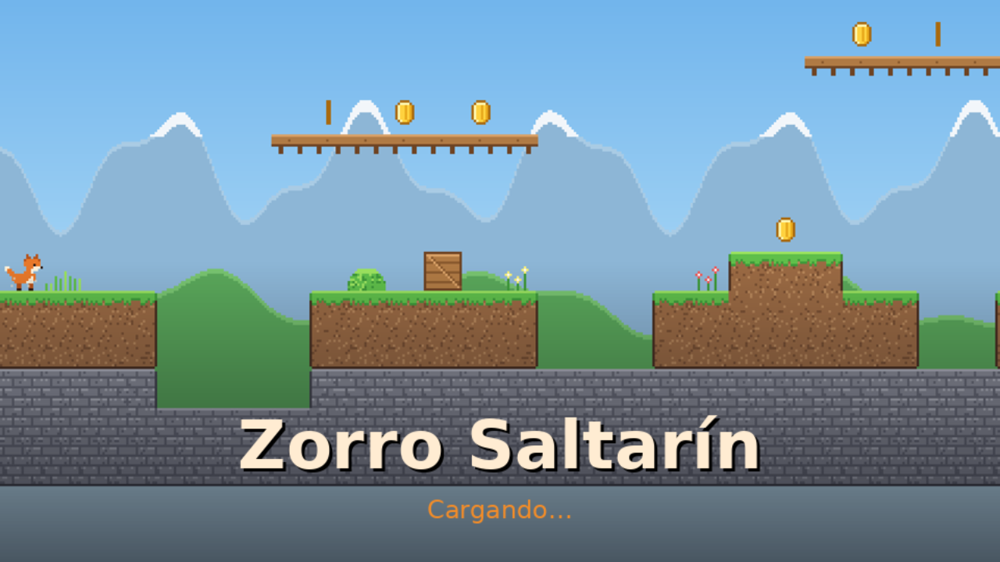
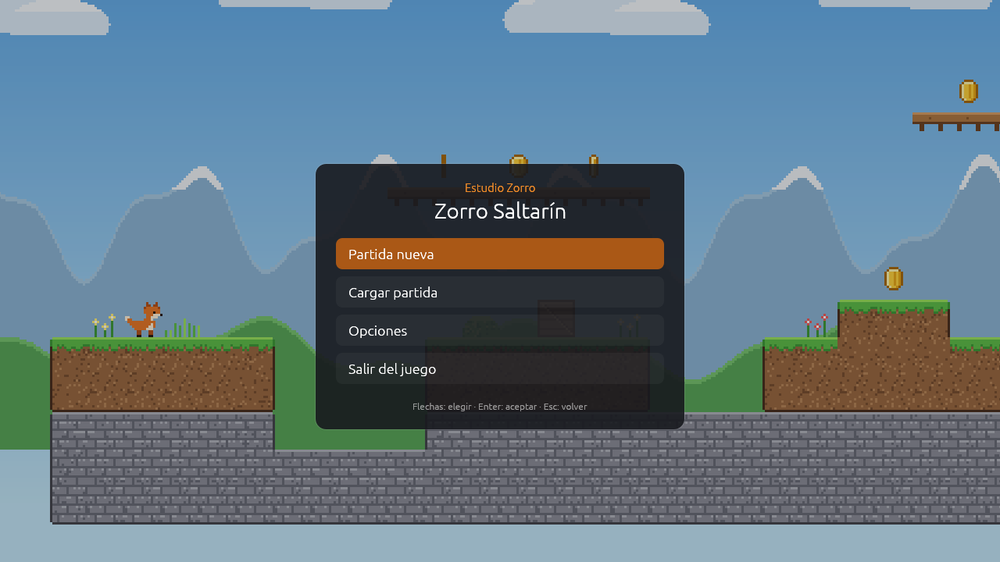
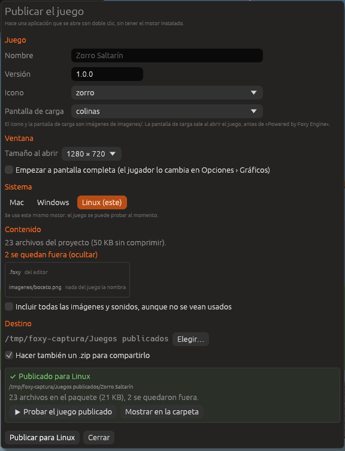
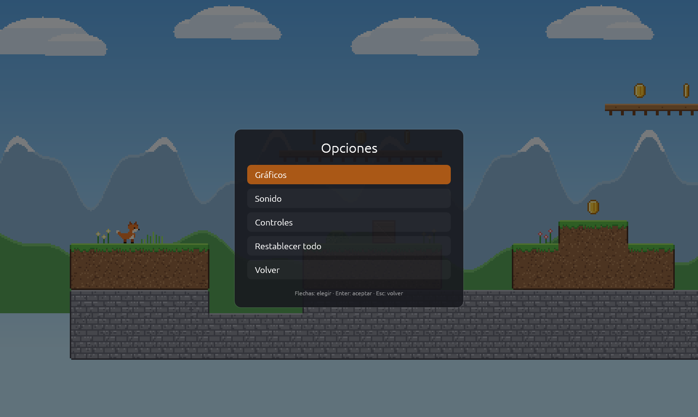
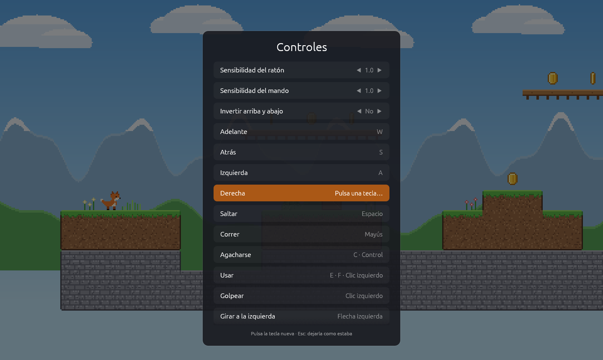

# Publicar tu juego

Publicar convierte un proyecto en una **aplicación** que cualquiera puede
abrir con doble clic, sin tener Foxy Engine instalado. Sale para Mac
(`.app`), Windows (`.exe`) o Linux, con el nombre, el icono y la versión del
juego.



Un juego publicado se abre así: primero su **pantalla de carga**, después
«Powered by Foxy Engine» y por último su menú principal, con el autor encima
del título.

| Pantalla de carga | Powered by Foxy Engine | Menú principal |
|---|---|---|
|  |  |  |

## Publicar paso a paso

1. Abre el proyecto y elige **Proyecto › Publicar…** (o escribe *Publicar*
   en la paleta de comandos, <kbd>Cmd</kbd>+<kbd>K</kbd>).
2. En **Juego**, revisa el nombre, la versión, el icono y la pantalla de
   carga.
3. En **Ventana**, elige el tamaño con el que se abre y si empieza a
   pantalla completa.
4. En **Sistema**, elige **Mac**, **Windows** o **Linux**. El tuyo sale
   marcado como *(este)*.
5. En **Destino**, elige la carpeta. Deja marcada **Hacer también un .zip**
   para tener un solo archivo que compartir.
6. Pulsa **Publicar para …**. El editor guarda antes todo lo que tengas sin
   guardar.
7. Cuando sale **Publicado para …**, pulsa **Probar el juego publicado**
   para abrirlo como lo abrirá quien lo juegue.



> <i class="fx fx-nota"></i> **Nota.** Lo que eliges en esta ventana se
> guarda en `proyecto.ron`, en `publicar`. La próxima vez sale igual.

## La ventana Publicar

| Sección | Campo | Qué hace |
|---|---|---|
| **Juego** | **Nombre** | El nombre de la aplicación y de la ventana. Vacío = el del proyecto |
| | **Versión** | La que sale en la información de la aplicación, como `1.0.0` |
| | **Icono** | Una imagen de `imagenes/`. Mejor cuadrada; el pixel art se agranda sin emborronar. Vacío = el zorro del motor |
| | **Pantalla de carga** | Una imagen de `imagenes/` que se ve al abrir el juego, ajustada a la ventana. Vacío = ninguna |
| **Ventana** | **Tamaño al abrir** | 960 × 540, 1280 × 720, 1600 × 900, 1920 × 1080 o 1024 × 768 |
| | **Empezar a pantalla completa** | El jugador lo puede cambiar en **Opciones › Gráficos** |
| **Sistema** | **Mac**, **Windows**, **Linux** | Para qué sistema se hace. Para otro que no es el tuyo, pide el Foxy Engine de ese sistema ([Mac, Windows y Linux](sistemas.md)) |
| **Contenido** | | Cuántos archivos van en el juego y cuáles se quedan fuera (**ver**) |
| | **Incluir todas las imágenes y sonidos** | Mete también los que nada nombra |
| **Destino** | **Elegir…** | La carpeta donde se deja el juego. Por defecto, `Documentos/Foxy Engine/Juegos publicados` |
| | **Hacer también un .zip** | Además de la aplicación, un `.zip` listo para compartir |

## Qué va dentro del juego

El juego lleva un **paquete**, `juego.foxy`, con los archivos del proyecto
que necesita, comprimidos. El motor que va con el juego no tiene editor: el
proyecto no se puede abrir ni cambiar desde el juego publicado.

| Va en el juego | Se queda fuera |
|---|---|
| `proyecto.ron`, escenas, objetos, prefabricados, guiones, nodos, interfaces, animaciones, cinemáticas, materiales y acciones | Lo del editor: `.foxy` (miniatura, espacio de trabajo, copias), papelera, paletas y `.luarc.json` |
| Las imágenes y los sonidos que algún archivo del juego nombra, más el icono y la pantalla de carga | Las partidas guardadas al probar (`partidas/`) |
| | Las imágenes y los sonidos que nada nombra |

> <i class="fx fx-aviso"></i> **Importante.** Si un guion forma el nombre
> de una imagen o un sonido por partes (por ejemplo `"moneda_" .. n`), el
> motor no ve que se usa. Marca **Incluir todas las imágenes y sonidos** o
> pulsa **ver** en **Contenido** para comprobar qué se queda fuera.

## El menú de opciones del juego

Todo juego trae un menú **Opciones**, en el menú principal y en la pausa,
con tres páginas. También se abre desde un botón de un
[menú propio](../guia/interfaces.md) con la acción **Opciones**.

| Opciones | Controles |
|---|---|
|  |  |

| Página | Ajustes |
|---|---|
| **Gráficos** | **Pantalla completa**, **Campo de visión**, **Balanceo al caminar**, **Mostrar fotogramas por segundo** |
| **Sonido** | **Volumen de la música**, **Volumen de los efectos** |
| **Controles** | **Sensibilidad del ratón** y **del mando**, **Invertir arriba y abajo**, y la tecla de cada [acción de entrada](../guia/acciones-entrada.md) |

Para cambiar una tecla en **Controles**:

1. Elige la acción con las flechas (o el ratón) y pulsa <kbd>Intro</kbd>.
2. Pulsa la tecla nueva. Con <kbd>Esc</kbd> se queda como estaba.

Si otra acción ya usaba esa tecla, abajo sale un aviso. **Restablecer
teclas** deja las del proyecto, y **Restablecer todo** (en **Opciones**)
deja también los demás ajustes como al principio.

## Dónde guarda el jugador

Un juego publicado guarda sus partidas, sus ajustes (`ajustes.ron`) y su
registro (`registro.txt`) en una carpeta propia, con el nombre del juego:

| Sistema | Carpeta |
|---|---|
| Mac | `~/Library/Application Support/<Nombre>` |
| Windows | `%APPDATA%\<Nombre>` |
| Linux | `~/.local/share/<Nombre>` |

## Publicar desde la Terminal

```sh
foxy-engine --publicar "Documentos/Foxy Engine/proyectos/Zorro Saltarín"
foxy-engine --publicar <carpeta> --sistema windows --motor foxy-engine.exe
```

Las opciones están en [Línea de comandos](../referencia/linea-de-comandos.md#publicar).

## Véase también

- [Mac, Windows y Linux](sistemas.md)
- [Ajustes del proyecto](../editor/ajustes-proyecto.md)
- [Acciones de entrada](../guia/acciones-entrada.md)
- [Probar el juego](../guia/jugar.md)
