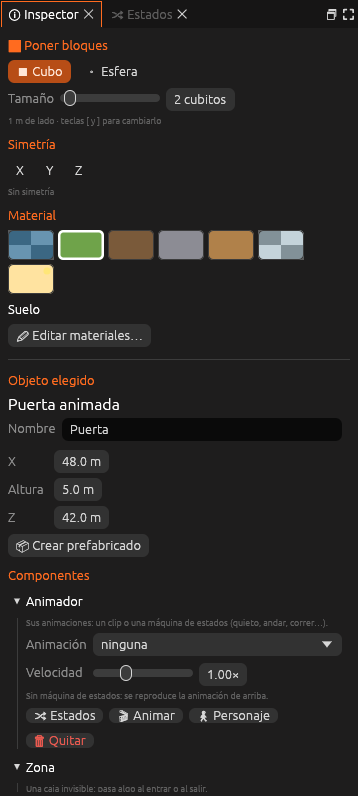

# Animador

Las animaciones de la entidad: una que se repite sin parar o una
**máquina de estados** que elige la animación según lo que hace.



<!-- generado: propiedades -->
<!-- Esta tabla la escribe `foxy-engine --referencia-componentes`. -->

| Propiedad | Campo | De fábrica | Descripción |
|---|---|---|---|
| Animación | `animacion` | — | La animación de `animaciones/` que se reproduce al empezar si no hay máquina de estados. |
| Máquina de estados | `maquina` | — | Los estados y las transiciones. Se editan en el panel **Estados**. |
| Velocidad | `velocidad` | 1 | Multiplica la velocidad de sus animaciones (1 es la normal). |

<!-- fin -->

Los botones del inspector abren el panel **Estados**, abren su animación en
la línea de tiempo (**Animar**) y, si no tiene máquina, hacen la de un
personaje (**Personaje**).

Para la entidad del jugador, el motor pone solo los parámetros `velocidad`,
`velocidad_vertical`, `en_suelo` y `en_agua`.

## En el archivo

```ron
Animador((
    animacion: "",
    maquina: (
        inicial: "quieto",
        estados: [
            (nombre: "quieto", animacion: "quieto", velocidad: 1.0, pos: (0.0, 0.0)),
            (nombre: "andar", animacion: "andar", velocidad: 1.0, pos: (260.0, 0.0)),
        ],
        transiciones: [
            (de: "quieto", a: "andar", condiciones: [
                (parametro: "velocidad", comparar: Mayor, valor: 0.4),
            ], al_terminar: false, mezcla: 0.15),
        ],
    ),
    velocidad: 1.0,
))
```

`de: "*"` es una transición desde cualquier estado. `comparar` puede ser
`Mayor`, `Menor`, `Igual` o `Distinto`.

## Véase también

- [Animación](../../guia/animacion.md)
- [Componentes](index.md)
- [Entidades y componentes](../../guia/entidades.md)
