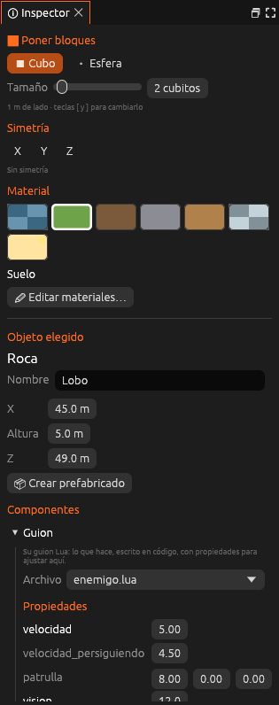

# Guion

Le da a la entidad el comportamiento de un **guion de Lua** de la carpeta
`guiones/`. Cada entidad con este componente tiene su propia copia del guion,
con sus propias variables y propiedades. Ver
[Guiones de entidad](../../guia/guiones-entidad.md).



| Propiedad | Campo | Descripción |
|---|---|---|
| Archivo | `archivo` | El guion, relativo a `guiones/` (por ejemplo, `enemigo.lua`) |
| Propiedades | `propiedades` | Los valores de la tabla `propiedades` del guion que se han cambiado en esta entidad. Los que no salen aquí toman el valor del guion |
| Al empezar *(antiguo)* | `al_empezar` | Una función del guion del mundo que se llama al empezar, con el nombre de la entidad |
| Cada segundo *(antiguo)* | `cada_segundo` | Una función del guion del mundo que se llama cada segundo, con el nombre de la entidad |

La entidad recibe también una caja de colisión, para que lleguen
`al_chocar` y las zonas.

```ron
Guion((archivo: "enemigo.lua", propiedades: {"velocidad": "5", "vision": "12"}))
```

```lua
-- guiones/enemigo.lua
propiedades = {
  velocidad = 3,  -- metros por segundo
  vision = 9,     -- metros a los que ve al jugador
}

function cada_fotograma(segundos)
  if motor.ve(yo, "jugador", propiedades.vision) then
    motor.mover_hacia(yo, "jugador", propiedades.velocidad)
  end
end
```

> <i class="fx fx-nota"></i> **Nota.** Los campos *Al empezar* y *Cada
> segundo* son de las versiones anteriores y siguen funcionando. En los
> proyectos nuevos, usa un guion de entidad con `al_empezar` y
> `cada_segundo` dentro.

## Véase también

- [Componentes](index.md)
- [Guiones de entidad](../../guia/guiones-entidad.md)
- [Referencia de la API de Lua](../api-lua.md)
