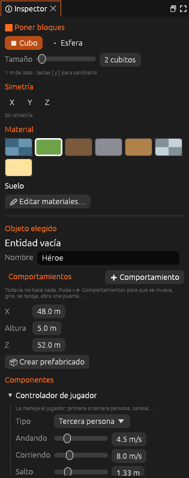

# Componentes

Referencia de los componentes que se pueden añadir a una entidad. Ver
[Entidades y componentes](../../guia/entidades.md) para aprender a usarlos.



<!-- generado: propiedades -->
<!-- Esta tabla la escribe `foxy-engine --referencia-componentes`. -->

| Componente | En el archivo | Para qué sirve |
|---|---|---|
| [Colisión](colision.md) | `Colision` | Si se choca con la entidad o se atraviesa. |
| [Cuerpo físico](cuerpo-fisico.md) | `CuerpoFisico` | Cae, bota, rueda y se puede empujar o patear. |
| [Controlador de jugador](controlador.md) | `Controlador` | La maneja el jugador: primera o tercera persona, cenital… |
| [Cámara](camara.md) | `Camara` | Distancia y altura de la cámara, o ver el juego desde aquí. |
| [Luz](luz.md) | `Luz` | Ilumina alrededor, con su color y su alcance. |
| [Sonido](sonido.md) | `Sonido` | Un sonido que sale de aquí y se oye más cerca que lejos. |
| [Zona](zona.md) | `Zona` | Una caja invisible: pasa algo al entrar o al salir. |
| [Sprite](sprite.md) | `Sprite` | Una imagen o un fotograma de una hoja de sprites (en 2D). |
| [Animador](animador.md) | `Animador` | Sus animaciones: un clip o una máquina de estados (quieto, andar, correr…). |
| [Recogible](recogible.md) | `Recogible` | Se recoge al tocarlo: suma monedas (o lo que digas), suena y desaparece. |
| [Partículas](particulas.md) | `Particulas` | Polvo, chispas, lluvia, nieve, humo u hojas que salen de aquí. |

<!-- fin -->

## En el archivo de la escena

Los componentes van en la lista `componentes` de cada entidad. Solo se
escriben los valores distintos de los de fábrica:

```ron
(tipo: "farola", nombre: "Farola de la plaza", pos: (90.0, 16.0, 118.0),
 componentes: [
     Luz((color: "#ffd27a", intensidad: 1.5, alcance: 10.0)),
     Sonido((sonido: "grillos", volumen: 0.6)),
 ]),
```

En una copia de un [prefabricado](../../guia/entidades.md#prefabricados),
`componentes` solo guarda lo que la copia cambia; el resto se toma del
prefabricado.

## Véase también

- [Conceptos básicos](../../conceptos/basicos.md)
- [Entidades y componentes](../../guia/entidades.md)
