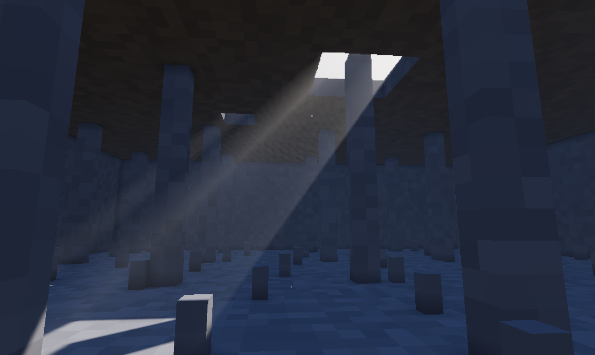

# Niebla

Niebla en toda la escena. Donde le da el sol se ilumina, así que la luz
que entra por un agujero o una ventana se ve como **rayos**. Las antorchas y
las demás luces hacen un **halo** en ella. Se añade con **Crear → Niebla**;
si hay varias, manda la primera.

Los rayos y los halos solo salen con el dibujante nuevo. Con el clásico se
ve la niebla lejana de siempre.



## Propiedades

<!-- generado: propiedades -->
<!-- Esta tabla la escribe `foxy-engine --referencia-componentes`. -->

| Propiedad | Campo | De fábrica | Descripción |
|---|---|---|---|
| Densidad | `densidad` | 0,3 | Lo espesa que es, de 0 (nada) a 1 (no se ve a unos metros). |
| Color | `color` | `"#ffffff"` | Color de la niebla, `#rrggbb` (blanco = gris, como la de siempre). |
| Altura | `altura` | 200 m | Por encima de esta altura se va aclarando (niebla de valle). Muy alta = igual en todas partes. |
| Rayos | `rayos` | 1 | Fuerza de los rayos de luz y de los halos de las luces, de 0 a 2. |

<!-- fin -->

Para una niebla de valle, que se queda abajo y deja ver las cumbres, baja
la **Altura** hasta un poco por encima del suelo. Para una niebla que solo
deja ver los rayos, sin tapar lo lejano, deja la **Densidad** baja y sube
los **Rayos**.

```ron
Niebla((densidad: 0.35, rayos: 1.2, altura: 40.0))
```

## Véase también

- [Componentes](index.md)
- [Luz del sol](sol.md)
- [Gráficos: luz, sombras y atmósfera](../../guia/graficos.md#luz-y-atmósfera)
