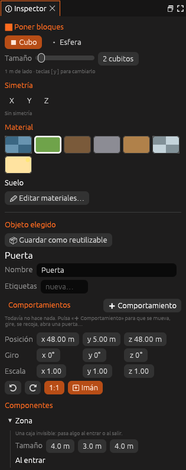

# Zona

Una caja invisible alrededor de la entidad. Cuando el jugador entra o sale
de ella, se ejecuta una [acción](../acciones.md).



<!-- generado: propiedades -->
<!-- Esta tabla la escribe `foxy-engine --referencia-componentes`. -->

| Propiedad | Campo | De fábrica | Descripción |
|---|---|---|---|
| Tamaño | `tamano` | 3 × 2,5 × 3 m | Ancho, alto y fondo, centrado en la base del objeto. |
| Al entrar | `al_entrar` | Nada | Acción que se ejecuta cuando el jugador entra. |
| Al salir | `al_salir` | Nada | Acción que se ejecuta cuando el jugador sale. |

<!-- fin -->

La zona se queda en el sitio que la entidad tiene en el editor, aunque la
entidad se mueva durante la partida. Así una puerta que se desplaza no se
sale de su propia zona.

Al empezar la partida, si el jugador ya está dentro de una zona, esta no se
activa hasta que salga y vuelva a entrar.

```ron
Zona((
    tamano: (4.0, 3.0, 4.0),
    al_entrar: Mover(desplazamiento: (1.0, 0.0, 0.0), segundos: 0.4),
    al_salir: Mover(desplazamiento: (0.0, 0.0, 0.0), segundos: 0.4),
))
```

> <i class="fx fx-nota"></i> **Nota.** El objeto *Zona de cambio* de
> versiones anteriores sigue funcionando: es una zona de 2 × 2,5 m con una
> acción al entrar.

## Véase también

- [Componentes](index.md)
- [Entidades y componentes](../../guia/entidades.md)
