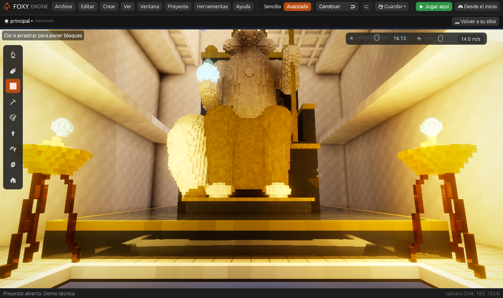
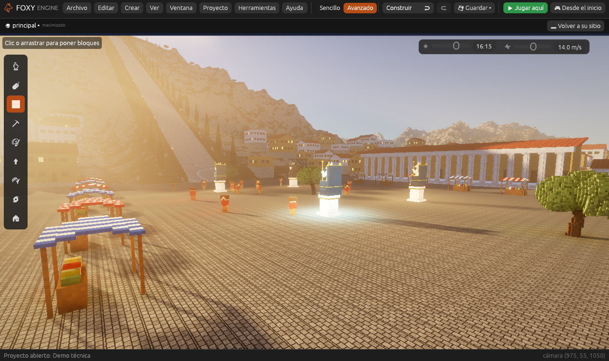

# Demo técnica

La **Demo técnica** enseña lo que puede hacer Foxy Engine cuando se busca
un aspecto realista. Es **el templo del zorro**: en la cumbre de un monte
junto al mar se levanta un templo de mármol como el de Zeus en Olimpia, con
34 columnas y, dentro, una estatua enorme de un zorro sentado en su trono,
de oro y marfil. Una escalera de mármol con antorchas baja hasta una ciudad
griega de casas encaladas, con su plaza, su teatro, un puerto con
trirremes y un faro en un islote. Alrededor hay olivares, pinos y cipreses.

Todo está hecho **con el propio motor**, sin imágenes ni modelos de fuera:
el monte es una imagen de alturas, las texturas están pintadas en Pixel
art, el templo está hecho con cubitos del terreno, la estatua, las casas y
los barcos son objetos de cubitos, y la llama, la cinemática y el guion se
hicieron con el editor.

## 1. Crear el proyecto

1. En la pantalla de inicio, pulsa **Nuevo proyecto**.
2. En **¿Qué juego quieres hacer?**, dentro de *Más ejemplos*, elige
   **Demo técnica**.
3. Escribe un nombre y pulsa **Crear proyecto**.

Es un mundo grande (2 × 2 km y unos 6.000 objetos), así que tarda un poco
más que los demás en abrirse.

## 2. Jugarla

Pulsa **Desde el inicio** para verla entera. Primero sale una
**cinemática** que llega desde el mar, pasa por el puerto y la plaza, sube
la escalera y entra en el templo. Después estás en el pórtico, en primera
persona, mirando a la estatua:

- Anda con <kbd>W</kbd> <kbd>A</kbd> <kbd>S</kbd> <kbd>D</kbd>, corre con
  <kbd>Mayúsculas</kbd> y salta con <kbd>Espacio</kbd>.
- Entra en la sala: está en penumbra, y la luz del sol entra por una
  abertura del techo y le da en la cara a la estatua. El estanque del suelo
  la refleja.
- Pulsa <kbd>F3</kbd> para ver la ventana [Rendimiento](../guia/rendimiento.md):
  lo que tarda cada parte del motor en cada fotograma.
- Espera unos minutos: el sol se pone. Un día entero dura media hora. De
  noche alumbran los trípodes del templo, las antorchas de la escalera, las
  luces de la ciudad y el faro.

## 3. Ver cómo está hecha

| Qué | Dónde mirarlo |
|---|---|
| **Cubitos de 25 cm** | [Ajustes del proyecto](../editor/ajustes-proyecto.md): el cubito es de 0,25 m. |
| **El monte, la costa y el mar** | Elige el objeto **Terreno** en *En la escena*: es el generador **Imagen de alturas** con `imagenes/relieve.png`, de 2 km de lado. Ver [El terreno de cubitos](../guia/generadores.md). |
| **El templo** | Está hecho con cubitos del propio terreno (como si se hubiera hecho con el pincel), por eso la luz que rebota lo ve y dentro queda en penumbra. Las columnas y la estatua sí son objetos. |
| **Mármol, oro y marfil** | En [Materiales](../guia/materiales.md): el mármol es **pulido**, el oro y el bronce son **metálicos**, y el fuego, las ventanas y el orbe de la estatua tienen **luz**. El orbe lleva además el efecto **Latido**. |
| **Texturas** | En [Pixel art](../interfaz/pixel-art.md), las imágenes `demo_marmol`, `demo_losas`, `demo_adoquin`... de 32 × 32 píxeles, que cubren un metro. |
| **La estatua, las casas y los barcos** | En *Objetos propios* del panel Proyecto. Todos van de una pieza, también la estatua y el teatro: un objeto puede medir hasta 256 cubitos de lado. Los árboles, la hierba y las velas tienen **Viento** y se mecen. |
| **La gente** | Catorce [vecinos](../referencia/modulos/vecinos.md) pasean por la plaza; acércate y pulsa <kbd>E</kbd> para hablar con ellos. |
| **La playa** | El terreno tiene [suelo de varios materiales](../guia/generadores.md#suelo-de-varios-materiales): arena en la orilla y roca en los cortados. |
| **Los fuegos** | Los objetos **Fuego del trípode** llevan una [Luz](../referencia/componentes/luz.md) con **Sombras**, partículas y un Animador con la animación **llama**. |
| **La niebla y los rayos de sol** | El objeto **Niebla del mar** lleva el componente Niebla, con **rayos**. El objeto **Sol** pone la hora de la tarde. |
| **La cinemática** | En el panel [Animación](../guia/cinematicas.md), la cinemática **presentacion**. La pone el guion del mundo al empezar. |
| **Los gráficos** | En **Ajustes del proyecto → Gráficos**: calidad Ultra, atmósfera realista (luz que rebota, rayos, agua que refleja), mundo enorme (carga por zonas, se ve hasta 2,4 km) y [mar, viento y reflejos](../guia/graficos.md#mar-viento-y-reflejos) (el mármol refleja las columnas y el mar llega al horizonte con olas). Ver [Gráficos](../guia/graficos.md). |

Es un proyecto como cualquier otro: cambia lo que quieras o
[publícalo](../publicar/publicar.md) para jugarlo fuera del editor.

## Lo que añadió esta versión

Al hacer la demo faltaban cosas en el motor. Ya están todas, y la demo las
usa: reflejos en el mármol, objetos grandes de una pieza, luz que rebota
también en los objetos, arena en la playa, mar hasta el horizonte con olas,
viento, gente por la plaza y pinceles para
[pintar el suelo, suavizar y sembrar](../guia/mundo.md#pintar-el-suelo).
Además, la escena se abre mucho más deprisa.

| El suelo pulido refleja la estatua | Gente en la plaza |
|---|---|
|  |  |
