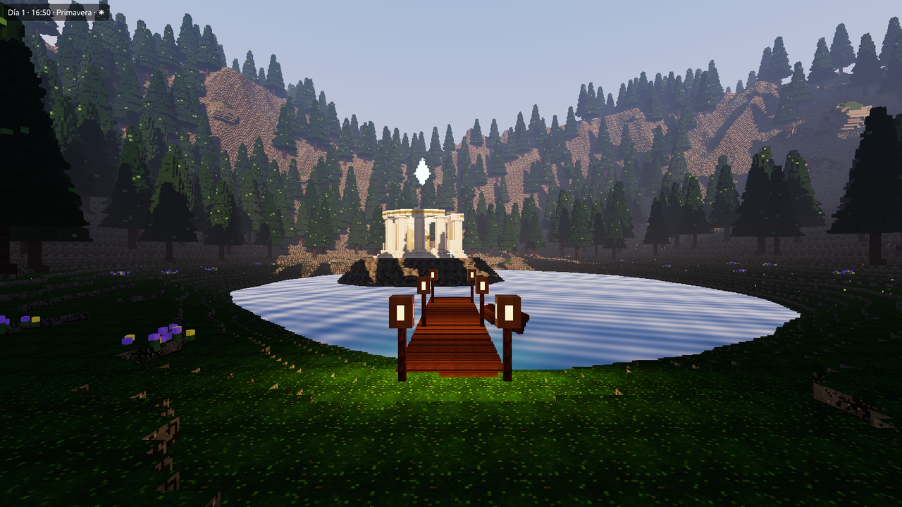
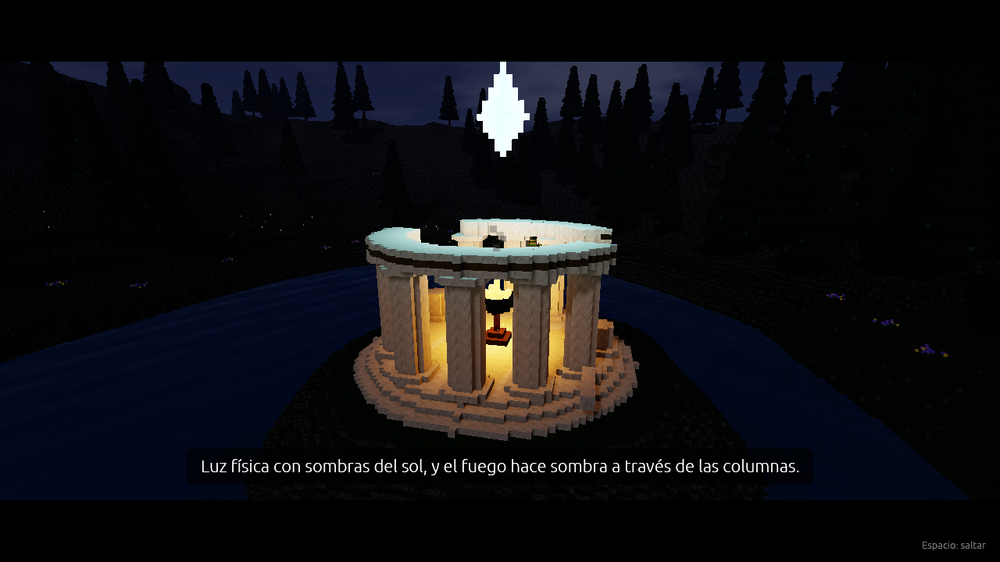
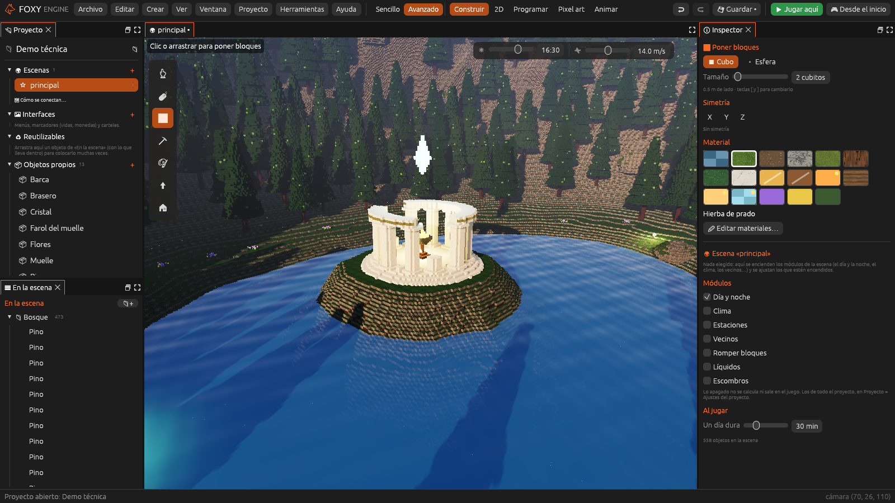
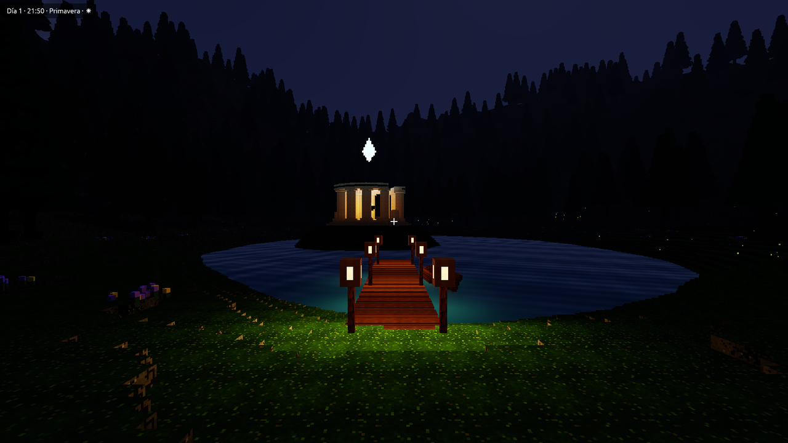

# Demo técnica

La **Demo técnica** enseña lo que puede hacer Foxy Engine cuando se busca
un aspecto realista. Es un valle de montaña al atardecer: un lago con una
isla, un templo de mármol y oro en lo alto de la isla, un muelle de madera
con faroles y una barca, cientos de pinos y rocas con musgo, y luciérnagas
en los prados.

Todo está hecho **con el propio motor**, sin imágenes ni modelos de fuera:
el relieve es una imagen de alturas, las texturas están pintadas en Pixel
art, los pinos, las rocas y el templo son objetos de cubitos, y la llama,
la cinemática y el guion se hicieron con el editor.

## 1. Crear el proyecto

1. En la pantalla de inicio, pulsa **Nuevo proyecto**.
2. En **¿Qué juego quieres hacer?**, dentro de *Más ejemplos*, elige
   **Demo técnica**.
3. Escribe un nombre y pulsa **Crear proyecto**.

## 2. Jugarla

Pulsa **Desde el inicio** para verla entera. Primero sale una
**cinemática** que recorre el valle y rodea el templo. Después apareces en
el muelle, en primera persona:

- Anda con <kbd>W</kbd> <kbd>A</kbd> <kbd>S</kbd> <kbd>D</kbd> y salta con
  <kbd>Espacio</kbd>.
- Pulsa <kbd>F3</kbd> para ver la ventana [Rendimiento](../guia/rendimiento.md):
  lo que tarda cada parte del motor en cada fotograma.
- Espera unos minutos: el sol se pone. Un día entero dura media hora, así
  que a las 19:30 ya es de noche y solo alumbran el fuego del brasero, los
  faroles y el cristal que flota sobre el templo.

## 3. Ver cómo está hecha

| Qué | Dónde mirarlo |
|---|---|
| **Cubitos de 25 cm** | [Ajustes del proyecto](../editor/ajustes-proyecto.md): el cubito es de 0,25 m, la rejilla más fina. |
| **El valle** | Elige el objeto **Terreno** en *En la escena*: es el generador **Imagen de alturas** con `imagenes/relieve.png`. Ver [El terreno de cubitos](../guia/generadores.md). |
| **Roca en las pendientes** | En [Materiales](../guia/materiales.md), la **Hierba de prado** lleva la textura de roca en sus lados: donde el suelo se empina se ve la piedra. |
| **Mármol, oro y bronce** | También en Materiales: el mármol es **pulido**, y el oro y el bronce son **metálicos**. El fuego, los farolillos y el cristal tienen **luz**. |
| **Texturas** | En [Pixel art](../interfaz/pixel-art.md), las imágenes `demo_hierba`, `demo_roca`, `demo_marmol`... de 32 × 32 píxeles, que cubren un metro. |
| **Pinos, rocas y templo** | En *Objetos propios* del panel Proyecto. Ábrelos en el [creador de objetos](../guia/creador.md). |
| **El fuego** | El objeto **Fuego del brasero** lleva una [Luz](../referencia/componentes/luz.md) con **Sombras**, partículas de chispas y un Animador con la animación **llama**, que mueve su fuerza y su color. |
| **El cristal** | Lleva los comportamientos **Girar** y **Flotar**. |
| **La cinemática** | En el panel [Animación](../guia/cinematicas.md), la cinemática **presentacion**. La pone el guion del mundo al empezar. |
| **La luz** | En **Ajustes del proyecto → Gráficos**: calidad Ultra y un poco más de exposición. Ver [Gráficos](../guia/graficos.md). |

Es un proyecto como cualquier otro: cambia lo que quieras o
[publícalo](../publicar/publicar.md) para jugarlo fuera del editor.

> <i class="fx fx-consejo"></i> **Si ves líneas de puntos blancos** en las
> laderas lejanas, quita **Detalle de lejos** en las
> [Preferencias](../guia/preferencias.md). Con cubitos de 25 cm, lo de lejos
> todavía deja alguna rendija; se arreglará en una fase próxima.

