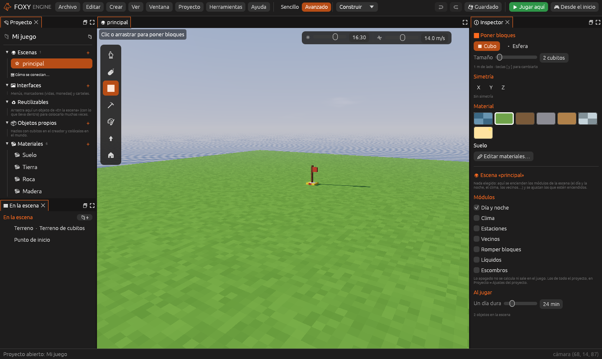

# Desde cero

Las plantillas **Vacío 3D** y **Vacío 2D** son una hoja en blanco: el
suelo, el punto donde aparece el jugador y nada más. No traen objetos,
comportamientos ni módulos que no hayas pedido. Son para quien ya sabe qué
quiere hacer, o para aprender cada parte del motor paso a paso.

## Crear el proyecto

1. En la pantalla de inicio, pulsa **Nuevo proyecto**.
2. En **¿Qué juego quieres hacer?**, dentro de *Empezar de cero*, elige
   **Vacío 3D** o **Vacío 2D**.
3. Escribe un nombre y pulsa **Crear proyecto**.

| Plantilla | Qué trae |
|---|---|
| **Vacío 3D** | Un llano de 96 × 96 m, el **Punto de inicio** y el módulo Día y noche |
| **Vacío 2D** | Un suelo de casillas, el cielo, el zorro (el jugador) y un marcador de monedas |

## Los tutoriales largos

Estos dos tutoriales hacen un juego completo a partir de una plantilla
vacía, sin código:

- [Tutorial: tu primer juego 3D](../empezar/primer-proyecto.md): un camino,
  tres gemas, un marcador y una puerta de meta. Unos veinte minutos.
- [Tutorial: tu primer juego 2D](../empezar/primer-juego-2d.md): un nivel
  de plataformas con monedas dibujadas por ti.

## Lo primero que conviene saber

1. **Poner cosas.** Con **Colocar objetos** (<kbd>O</kbd>) eliges un objeto
   en el Inspector y haces clic en la escena. El proyecto vacío no trae
   objetos: pulsa **Añadir los objetos de ejemplo** o crea los tuyos (ver
   [Crear objetos propios](../guia/creador.md)).
2. **Darles vida.** Elige un objeto y pulsa **➕ Comportamiento → Ya
   hechos**. Con **Girar**, **Flotar** o **Recoger** ya tienes una moneda.
3. **Probar.** Pulsa **Jugar aquí** (<kbd>F5</kbd>) y otra vez
   <kbd>F5</kbd> para volver.

## Seguir

- [Comportamientos](../guia/comportamientos.md): los once ya hechos.
- [Objetos que se hablan](../guia/objetos-que-se-hablan.md): etiquetas y
  eventos entre objetos.
- [Objetos libres y jerarquía](../guia/objetos-libres.md): poner un objeto
  dentro de otro.
- [Modelos 3D](../guia/modelos-3d.md): traer modelos hechos en otros
  programas.
