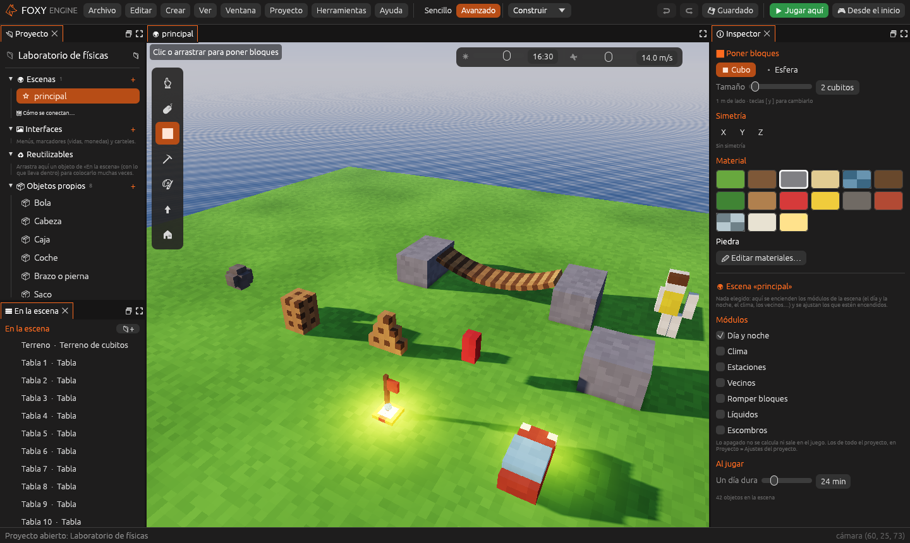
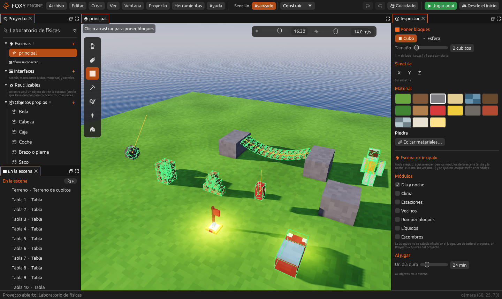

# Laboratorio de físicas

El **Laboratorio de físicas** enseña las
[físicas precisas](../guia/fisicas.md) con cuatro montajes hechos **sin
una línea de código**, solo con componentes en el inspector:

- un **puente colgante** de doce tablas unidas con bisagras,
- un **coche** que se conduce,
- una **bola de demolición** colgada de una cuerda que tira un muro de
  cajas rompibles,
- un **muñeco de trapo** que cae sobre un bloque,
- y además un saco colgado de un muelle y una pila de cajas para empujar.

## 1. Crear el proyecto

1. En la pantalla de inicio, pulsa **Nuevo proyecto**.
2. En **¿Qué juego quieres hacer?**, dentro de *Más ejemplos*, elige
   **Laboratorio de físicas**.
3. Escribe un nombre y pulsa **Crear proyecto**.

El proyecto empieza con las físicas precisas y el modo **determinista**
encendidos (**Proyecto → Ajustes del proyecto… → Físicas**): cada vez que
juegas pasa exactamente lo mismo.

## 2. Jugar

Pulsa **Jugar aquí**. Al empezar, la bola se columpia y tira las cajas,
el muñeco cae y el puente se mece.

- Cruza el **puente**: se balancea con tu peso.
- Camina contra las **cajas** para empujarlas, o mira a una y pulsa
  **Usar** (<kbd>E</kbd>) para darle una patada.
- Da patadas al **saco**: rebota en su muelle.
- Acércate al **coche** y pulsa **Usar** para subir. Conduce con
  <kbd>W</kbd> <kbd>A</kbd> <kbd>S</kbd> <kbd>D</kbd>, frena con
  <kbd>Espacio</kbd> y vuelve a pulsar **Usar** para bajar.

## 3. Cómo está hecho el puente

Elige **Tabla 2** en **En la escena** y mira el inspector:

- **Cuerpo físico**: dinámico, de 40 kg, con algo de **Frenado** para que
  no se columpie sin parar.
- **Articulaciones**: una **Bisagra** **con** «Tabla 1», con el **ancla**
  en su borde izquierdo (`-0,5` en X) y el **eje** Z.

Cada tabla está unida a la anterior igual. La primera se une **con el
mundo** (con vacío) y la última tiene dos bisagras: una con la tabla
anterior y otra con el mundo. Como las tablas se colocaron ya colgando,
esa es su postura de reposo.

> <i class="fx fx-consejo"></i> **Prueba.** Pon **Se rompe con** a 3000 en
> la bisagra de la tabla del centro y cruza el puente corriendo.

## 4. Cómo están hechos los demás

| Montaje | Componentes |
|---|---|
| **Coche** | Cuerpo físico (caja de 800 kg) y Vehículo (lo conduce el jugador) |
| **Bola de demolición** | Cuerpo físico (esfera de 1500 kg) y una **Cuerda** con el mundo, con el ancla 5 m a un lado y 7 m por encima: empieza tirante y cae columpiándose |
| **Cajas rompibles** | Cuerpo físico con **Rompible** y **Resistencia** 1 |
| **Muñeco de trapo** | Cabeza, brazos y piernas unidos al **Torso** con **Rótulas** con límites (35° la cabeza, 80° los brazos y 60° las piernas) |
| **Saco** | Cuerpo físico y un **Muelle** con el mundo, 3 m por encima |

Con **Ver → Formas de física** se ven las formas y las uniones.

## Siguientes pasos

- Haz tu propio montaje: un columpio (dos **Cuerdas**), una puerta con
  **Bisagra** y **Límites**, o un ascensor con una **Deslizadera** con
  **Motor**.
- Lee [Físicas precisas](../guia/fisicas.md) para ver todas las opciones.
