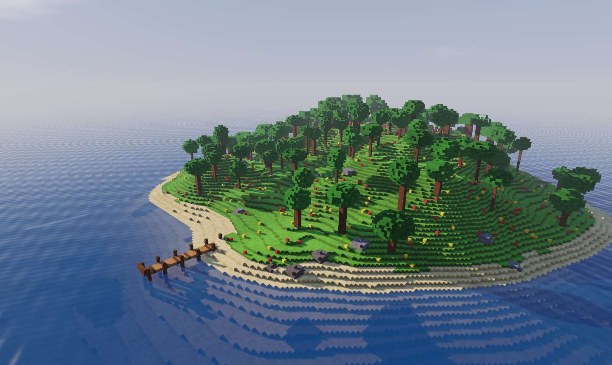

# Mundo de cubitos

Un mundo **hecho de cubitos** que se puede construir, cavar y romper,
también jugando. Es la parte del motor que más se parece a un juego de
construir. Hay dos plantillas:

| Plantilla | Qué trae |
|---|---|
| **Isla vóxel** | Una isla generada con colinas, playa, árboles y un muelle, sin construcciones. Para construir tú |
| **Isla de ejemplo** | Una isla con pueblo, mercado, vecinos, pelotas y un guion. Para ver de qué es capaz el motor |

## 1. Crear el proyecto

1. En la pantalla de inicio, pulsa **Nuevo proyecto**.
2. En **¿Qué juego quieres hacer?**, dentro de *Mundo de cubitos*, elige
   **Isla vóxel**.
3. Escribe un nombre y pulsa **Crear proyecto**.

Estas plantillas traen todos los [módulos](../referencia/modulos/index.md)
encendidos: día y noche, clima, estaciones, vecinos, romper bloques,
líquidos y escombros.

## 2. Jugarlo

Pulsa **Jugar aquí** (<kbd>F5</kbd>). Anda con <kbd>W</kbd> <kbd>A</kbd>
<kbd>S</kbd> <kbd>D</kbd> y salta con <kbd>Espacio</kbd>. Haz clic con el
botón izquierdo sobre un bloque para golpearlo: según su material, se rompe
de un golpe o de varios. Mira cómo pasa el día y cambia el tiempo.

## 3. Construir

Vuelve al editor (<kbd>F5</kbd>) y usa las herramientas de la tira de la
izquierda de la Vista:

1. **Poner bloques** (<kbd>B</kbd>): elige un material en el Inspector y
   haz clic o arrastra sobre el terreno. Levanta las paredes de una casa.
2. **Quitar bloques** (<kbd>E</kbd>): cava un hueco junto a la playa. Por
   debajo del nivel del mar se llena de agua.
3. **Pintar** (<kbd>P</kbd>): cambia el material de lo que ya hay, por
   ejemplo un camino de piedra sobre la hierba.
4. **Colocar objetos** (<kbd>O</kbd>): pon árboles, farolas o una casa
   entera.

Todas las herramientas se explican en [Mundos vóxel](../guia/mundo.md).

## 4. Cambiarlo

1. **Un mundo sin romper.** Si no quieres que el jugador rompa nada,
   apaga **Romper bloques** en los **Módulos** de la escena: con nada
   elegido, salen abajo en el Inspector.
2. **Siempre de día.** Apaga **Día y noche**, o cambia cuánto dura un día.
3. **Vecinos.** Con **Colocar objetos**, pon un vecino cerca del muelle.
   Con el módulo **Vecinos** encendido, pasea solo por la isla.
4. **Una montaña.** Con **Poner bloques**, sube el tamaño del pincel con
   <kbd>]</kbd> y arrastra varias veces sobre el mismo sitio.

## La Isla de ejemplo

Crea otro proyecto con **Isla de ejemplo** para ver un mundo más completo:
un pueblo con mercado, vecinos que hablan, pelotas que ruedan y un
[guion del mundo](../guia/guiones.md) que lo une todo. Es buen sitio para
abrir objetos y ver cómo están hechos.

## Seguir

- [Mundos vóxel](../guia/mundo.md) y
  [El terreno de cubitos](../guia/generadores.md).
- [La vida del mundo](../guia/vida.md): reloj, clima y vecinos.
- [Crear objetos propios](../guia/creador.md): modela tus muebles y casas.
- [Materiales](../guia/materiales.md).
