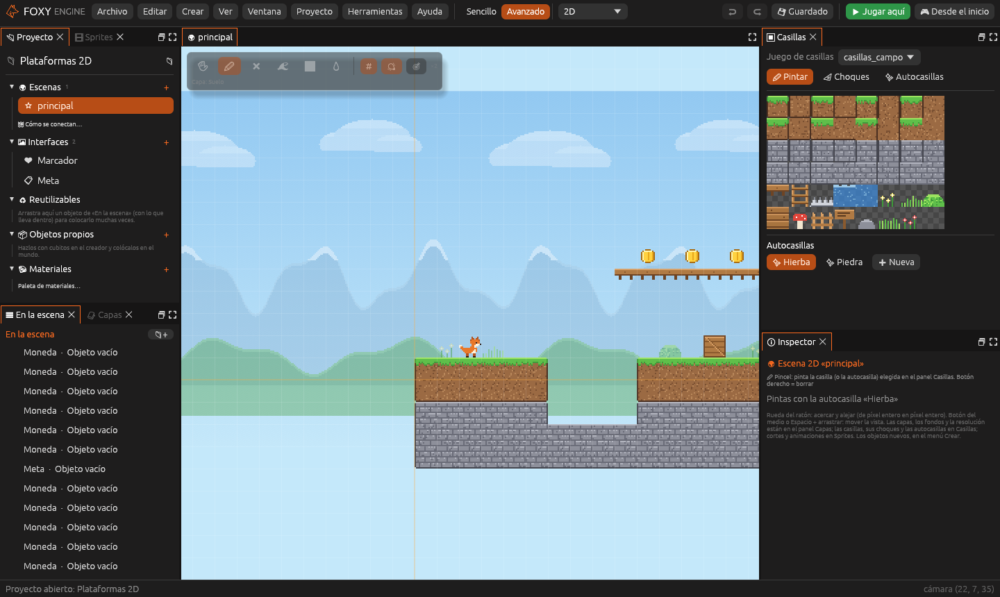
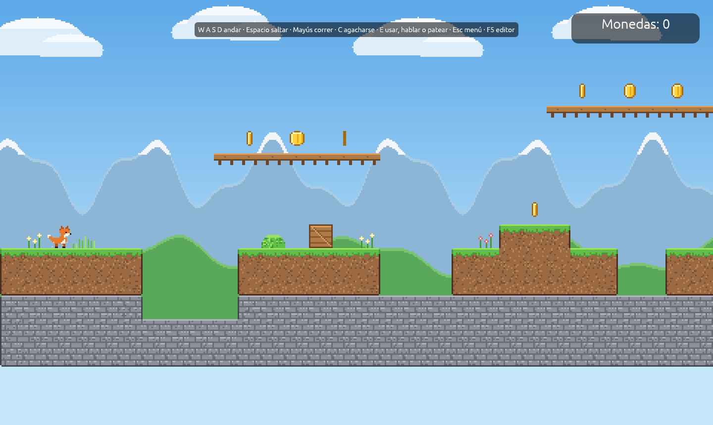
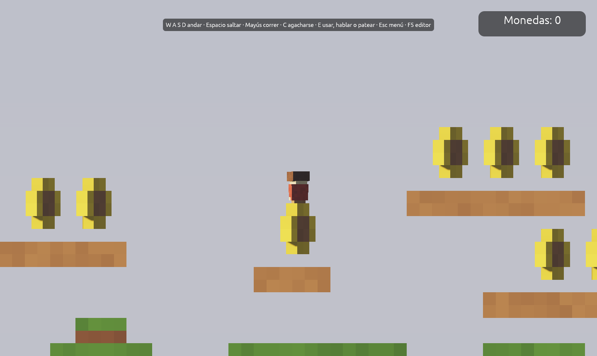

# Plataformas

Un juego de **correr y saltar visto de lado**: el jugador recorre el nivel,
coge monedas y llega a la meta. Hay dos plantillas con la misma idea:

| Plantilla | Cómo se ve |
|---|---|
| **Plataformas 2D** | Pixel art: casillas, sprites y fondos que se mueven a distinta velocidad |
| **Plataformas vóxel** | Cubitos vistos de lado, con la cámara fija |

## 1. Crear el proyecto

1. En la pantalla de inicio, pulsa **Nuevo proyecto**.
2. En **¿Qué juego quieres hacer?**, dentro de *Plataformas*, elige
   **Plataformas 2D**.
3. Escribe un nombre y pulsa **Crear proyecto**.

## 2. Jugarlo

Pulsa **Jugar aquí** (<kbd>F5</kbd>). El zorro corre con <kbd>A</kbd> y
<kbd>D</kbd> y salta con <kbd>Espacio</kbd>. Coge las monedas, sube por las
escaleras, esquiva los pinchos y llega a la bandera. El marcador de arriba
cuenta las monedas. Pulsa <kbd>F5</kbd> otra vez para volver al editor.

## 3. Ver cómo está hecho

Elige una **Moneda** con un clic en la Vista. En el Inspector verás:

- El componente **Recogible**, que suma 1 al valor `monedas` al tocarla.
- El comportamiento ya hecho **Flotar**, que la sube y baja despacio.

La bandera (el objeto **Meta**) tiene una **Zona**: al entrar el jugador, abre la interfaz
**Meta** («¡Nivel superado!»). El suelo, las escaleras y los pinchos son
**casillas** pintadas en la capa *Suelo*.

## 4. Cambiarlo

1. **Monedas que giran.** Elige una moneda, pulsa **➕ Comportamiento → Ya
   hechos → Girar** y prueba. Repítelo en las demás, o
   duplica la que ya gira.
2. **Más monedas.** Elige una moneda y pulsa
   <kbd>Cmd</kbd>/<kbd>Ctrl</kbd>+<kbd>D</kbd> para duplicarla. Arrástrala
   a otro sitio.
3. **Un enemigo.** Duplica la caja, cámbiale el nombre a «Enemigo» y dale
   dos comportamientos: **Patrullar** (con `recorrido` de 4 casillas en x) y
   **Hacer daño**.
4. **Alargar el nivel.** En el panel [Casillas](../interfaz/casillas.md),
   elige la hierba y pinta más suelo a la derecha.
5. **Otra meta.** Elige la interfaz **Meta** en el panel Proyecto y cambia
   su texto.

## Plataformas vóxel

La plantilla **Plataformas vóxel** se juega igual, pero el nivel está hecho
de **cubitos**: se construye con **Poner bloques** como un mundo 3D y la
cámara lo mira de lado. Sus monedas llevan el componente **Recogible** y
el comportamiento **Girar**.

## Seguir

- [Juegos 2D](../guia/juegos-2d.md), [Sprites](../guia/sprites.md) y
  [Mapas de casillas](../guia/casillas.md).
- [Pixel art](../guia/pixel-art.md): dibuja tus propias monedas.
- [Tutorial: tu primer juego 2D](../empezar/primer-juego-2d.md).
